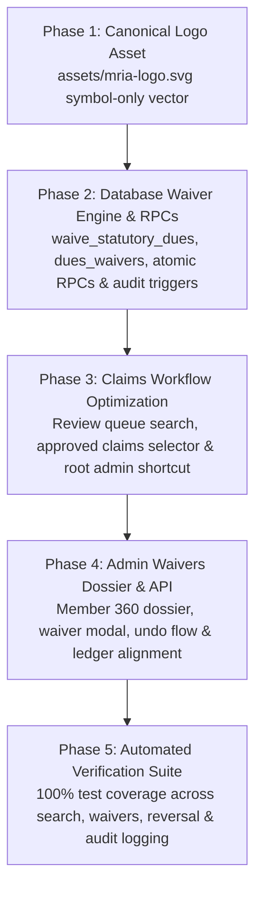

# Feature Concepts Brief: Claims Workflow Optimization, Dues Waiver System & Canonical Emblem Architecture

* **Author:** Antigravity Engineering
* **Date:** 2026-11-12
* **Target Milestone:** MRIA Welfare Association Platform — Governance & Ledger Extensions
* **Review Mode:** EGM Brainstorm & Architectural Specification (Step 3: Multi-Lens Synthesis)
* **Consensus Reviewers:** `egm-design`, `egm-codebase-details`, `egm-zoom-out`, `egm-comprehension`, `egm-implementation-readiness`, `egm-structural`

---

## 1. Overview & Problem Statement

This specification defines three targeted enhancements to the MRIA Welfare Association administrative platform:

1. **Claims Review Search & Disbursement Acceleration:**
   The current claims review queue and payout desk require manual scanning of all rows. The committee requires instant search filtering across applicant identities, statuses, and approved-only queues, alongside a root-admin-only expedited approval-to-payout shortcut that respects the four-eyes segregation policy for other officers.

2. **Dues & Fee Waiver Subsystem ("ගෙවීම් නිදහස් කරන්න"):**
   Certain members (e.g., special hardship cases, honorary appointments, extended unpaid medical leaves) require lawful exemption from statutory admission fees or specific monthly dues. An administrative tab, cryptographic ability gate (`waive_statutory_dues`), and non-destructive transactional waiver ledger must allow authorized officers to release dues with mandatory reason tracking, guaranteeing zero cashbook pollution, exclusion from arrears, and reversible state tracking with full audit logging.

3. **Canonical Logo Architecture:**
   The platform requires a clean, symbol-only vector placeholder emblem (aviation wings + welfare shield) located strictly at `assets/mria-logo.svg`, enabling seamless manual asset swapping without code modifications.

---

## 2. In-Scope Goals vs. Out-of-Scope Non-Goals

### In-Scope Goals
* **Review Queue Real-Time Search:** Search bar and trigger button on the Claims Review Queue filtering applicant full name, EPF, benefit program, and claim status with 150ms debounce and instant clear.
* **Payout Desk Approved Claims Search:** Dedicated selector in the Direct Benefit Payout Desk listing approved, not-yet-disbursed claims for one-click form pre-filling.
* **Beneficiary Selection Lock:** Locking member selection when an approved claim is loaded into the Payout Desk to prevent accidental cross-member disbursement.
* **Root-Admin-Only Expedited Payout Shortcut:** An "Approve & Go to Payout" button visible exclusively to `krishaja@gmail.com`. For non-root officers, the four-eyes segregation rule remains strictly enforced (approved claims pass to a separate officer's payout queue).
* **Dedicated Admin Waivers Tab:** A top-level admin tab displaying a member search bar, complete 360-degree payment and benefit claim history dossier, and waiver controls.
* **Granular Waiver Ability (`waive_statutory_dues`):** A dedicated enum value in `public.app_ability`, assignable exclusively by the root administrator. No user (including the Treasurer) receives this ability by default.
* **Atomic Transactional Database RPCs:** `fn_record_dues_waiver` and `fn_reverse_dues_waiver` executing waiver insertion and `member_dues.status` transitions atomically under PostgreSQL transaction blocks.
* **Partial Unique Indexes for Safe Reversibility:** Partial indexes filtering `WHERE is_active = true` to allow repeatable waiver/reversal cycles without unique key collisions.
* **Waiver Accounting Isolation:** Waived dues are strictly excluded from pending arrears, advance prepaid balance calculations, and the defaulters roster. Waivers create zero cashbook inflow/outflow rows in `treasury_transactions`.
* **Prohibition on Waiving Paid Dues:** Strict database check preventing any waiver on dues already settled as `'paid'`.
* **Individual Waiver Reversibility:** Every waiver entry contains an "Undo Waiver" action requiring a mandatory reason, restoring the due to pending while permanently retaining audit trail history.
* **Canonical Symbol-Only SVG:** Clean vector shield with aviation wings in `assets/mria-logo.svg` without embedded lettering.

### Out-of-Scope Non-Goals
* **No Batch Claim Actions:** Bulk approvals or mass disbursements are explicitly prohibited; each application must be reviewed individually.
* **No Automatic Role Granting:** The `waive_statutory_dues` permission is never granted automatically based on user roles (`admin`, `treasurer`, etc.).
* **No Dashboard Metrics Modification:** The top three dashboard metric cards (*Advance Prepaid Balance*, *Contributions Paid to Date*, *Total Welfare Benefits Received*) and their calculations remain strictly untouched.
* **No Financial Cash Flow for Waivers:** A waiver is a statutory debt forgiveness, not a cash payment; it must never touch treasury reserves or account balances.

---

## 3. Detailed Architecture & Technical Design

### A. Claims Search & Root Admin Shortcut

#### 1. Review Queue Search Interface
* Location: Top of `#tab-content-claims` above the Review Queue table.
* Elements: `#claimsReviewSearchInput` input with debounce and instant-clear button.
* Filter behavior: Case-insensitive search matching `members.full_name`, `members.epf_number`, `benefit_types.title_en`, and `benefit_claims.status`.
* Action Buttons: Unapproved claims display `Approve` and `Reject` for regular officers. The misleading `Disburse` button is removed on unapproved claims. For root admin `krishaja@gmail.com`, an expedited `Approve & Go to Payout` button is rendered.

#### 2. Payout Desk Approved Claims Filter & Beneficiary Lock
* Location: Inside `#grantPayoutDeskSection`.
* Elements: `#payoutDeskApprovedSearchSelect` dropdown populated exclusively with claims where `status = 'approved'` and `disbursed_at IS NULL`.
* Beneficiary Lock: Loading an approved claim sets `#grantMemberSearchInput` and `#grantMemberSelect` to `disabled = true`, preventing beneficiary desynchronization. Clicking `#btnUnlinkGrantClaim` unlocks the member selector.

---

### B. Dues & Fee Waiver Subsystem ("ගෙවීම් නිදහස් කරන්න")

#### 1. Database Schema & Partial Indexes
```sql
-- 1. Ability Enum
ALTER TYPE public.app_ability ADD VALUE IF NOT EXISTS 'waive_statutory_dues';

-- 2. Dues Waivers Table
CREATE TABLE IF NOT EXISTS public.dues_waivers (
    id UUID PRIMARY KEY DEFAULT gen_random_uuid(),
    member_id UUID NOT NULL REFERENCES public.members(id) ON DELETE CASCADE,
    waiver_type TEXT NOT NULL CHECK (waiver_type IN ('admission_fee', 'monthly_due')),
    billing_month DATE NULL,
    due_id UUID REFERENCES public.member_dues(id) ON DELETE SET NULL,
    waived_amount NUMERIC(10, 2) NOT NULL CHECK (waived_amount > 0),
    reason TEXT NOT NULL CHECK (length(trim(reason)) >= 5),
    waived_by UUID NOT NULL REFERENCES public.members(id),
    created_at TIMESTAMPTZ NOT NULL DEFAULT timezone('utc', now()),
    is_active BOOLEAN NOT NULL DEFAULT true,
    reversed_by UUID REFERENCES public.members(id),
    reversed_at TIMESTAMPTZ NULL,
    reversal_reason TEXT NULL
);

-- Partial Indexes ensuring safe reversibility without collisions:
CREATE UNIQUE INDEX IF NOT EXISTS uq_active_monthly_waiver 
ON public.dues_waivers (member_id, billing_month) 
WHERE is_active = true AND waiver_type = 'monthly_due';

CREATE UNIQUE INDEX IF NOT EXISTS uq_active_admission_waiver 
ON public.dues_waivers (member_id) 
WHERE is_active = true AND waiver_type = 'admission_fee';
```

#### 2. Transactional Atomic Database RPCs
* **`fn_record_dues_waiver`**:
  * Validates that caller is root admin (`is_root_admin()`) or has `has_ability('waive_statutory_dues')`.
  * Verifies target due is NOT already `'paid'`.
  * Atomically updates `member_dues.status = 'waived'`.
  * Inserts record into `public.dues_waivers`.
  * Invokes `fn_record_audit_log('WAIVE_STATUTORY_DUE', ...)`.
* **`fn_reverse_dues_waiver`**:
  * Validates caller authority.
  * Sets `is_active = false`, records `reversed_by`, `reversed_at`, `reversal_reason`.
  * If linked to a monthly due, atomically updates `member_dues.status = 'pending'`.
  * Invokes `fn_record_audit_log('REVERSE_STATUTORY_WAIVER', ...)`.

#### 3. Ledger & Defaulters Roster Recalculation Engine
* In `js/api.js`:
  * `calculateMemberDues()`: Active monthly waivers mark corresponding dues as `'waived'` and active admission fee waivers mark the fee as exempt.
  * `calculateMemberBalance()`: Waived months are filtered out of `totalBilledUpToNow` (`d.status !== 'waived'`), preventing statutory waivers from falsely consuming prepaid cash balances.
* In `defaulters_roster` database view:
  * Only pending dues (`WHERE status = 'pending'`) are counted as arrears. Waived dues (`status = 'waived'`) are immediately and automatically excluded.

#### 4. Admin Waivers Tab UI (`#tab-content-waivers`)
* Tab Navigation: Added to `#adminTabsHeader` with title "Dues & Fee Waivers (ගෙවීම් නිදහස් කිරීම්)".
* Member Search Bar: `#waiverMemberSearchInput` for instant member discovery.
* Member 360 Dossier Card:
  * Section A: Member Identification & Membership Status.
  * Section B: Complete Payment History (verified dues and receipts).
  * Section C: Welfare Benefits Claim History (all grants received).
  * Section D: Outstanding Dues & Admission Fee Status with "Waive Due (නිදහස් කරන්න)" action buttons on pending rows only.
  * Section E: Active & Historical Waivers Table with "Undo Waiver (අවලංගු කරන්න)" button.
* Waiver Confirmation Dialog (`#waiverActionModal`): Validates minimum 5-character reason before submission.
* Reversal Confirmation Dialog (`#waiverReverseModal`): Validates mandatory reversal reason before committing undo.

---

### C. Emblem Logo Architecture

* **Canonical File:** `assets/mria-logo.svg`.
* **Design Specifications:**
  * Viewbox: `0 0 120 120`.
  * Geometry: Minimalist protective shield with stylized aerodynamic aviation wings and central trust star/spark.
  * Styling: Vector stroke scalability (`vector-effect="non-scaling-stroke"`).
  * Typography: Symbol-only (zero embedded text strings in English or Sinhala).
  * Palette: Primary cyan `#0284C7`, secondary dark slate `#0F172A`, surface white `#FFFFFF`.
* **Consumer References:** All pages (`index.html`, `dashboard.html`, `admin.html`, `unauthorized.html`) link to `/assets/mria-logo.svg`. Replacing this single file updates the entire platform.

---

## 4. Phased Implementation & Verification Plan



### Phase 1: Canonical Emblem Asset
1. Update `assets/mria-logo.svg` with the symbol-only aviation shield vector design.
2. Verify asset path and rendering across `index.html`, `dashboard.html`, `admin.html`, and `unauthorized.html`.

### Phase 2: Database Waiver Engine & Atomic RPCs
1. Create migration `20261112000005_dues_waivers_and_ability.sql` and rollback script.
2. Add `waive_statutory_dues` to `public.app_ability`.
3. Create `public.dues_waivers` table with partial unique indexes (`WHERE is_active = true`).
4. Establish RLS policies restricting inserts and updates to root admin and members with `waive_statutory_dues`.
5. Deploy `fn_record_dues_waiver` and `fn_reverse_dues_waiver` transactional functions.
6. Deploy `trg_audit_dues_waivers` to record all waiver and reversal events in `public.audit_logs`.

### Phase 3: Claims Workflow & Disbursement Shortcuts
1. Add `#claimsReviewSearchInput` with 150ms debounce and clear button in `admin.html`.
2. Add `#payoutDeskApprovedSearchSelect` to the Payout Desk in `admin.html`.
3. In `js/page-admin.js`, implement client-side real-time filtering for `allClaimsList`.
4. Render "Approve & Go to Payout" shortcut exclusively for `krishaja@gmail.com`; preserve standard four-eyes workflow for all other officers.
5. Lock beneficiary member selector when a claim is linked to the payout desk.

### Phase 4: Admin Waivers Tab & Member Dossier
1. Add `tab-waivers` to navigation bar in `admin.html`.
2. Build Member 360 dossier layout in `admin.html` with search bar.
3. In `js/api.js`, export `recordDuesWaiver()`, `reverseDuesWaiver()`, and `getMemberWaivers()`.
4. Update `calculateMemberDues()` and `calculateMemberBalance()` in `js/api.js` to recognize active waivers and exclude waived months from `totalBilledUpToNow`.
5. Build waiver and reversal confirmation dialogs with mandatory reason validation in `admin.html` and `js/page-admin.js`.

### Phase 5: Automated Verification Suite
1. Create `scripts/test-phase-e-waivers-and-claims.mjs`.
2. Verify:
   - Claims search filtering by name, EPF, and status.
   - Root admin expedited payout shortcut vs non-root four-eyes enforcement.
   - Privilege check: unauthorized users cannot waive dues.
   - Prohibiting waiver on already paid dues.
   - Successful waiver of admission fee and monthly dues with mandatory reason.
   - Exclusion of waived dues from arrears, advance balance calculation, and defaulters roster.
   - Non-pollution of cash book (zero treasury transaction rows created).
   - Safe waiver reversal ("undo waiver") returning due to pending without unique key collision.
   - Complete audit trail logging in `public.audit_logs`.
   - Local logo asset integrity across all 4 HTML pages.

---

## 5. Alternatives Weighed & Rejected

| Alternative Considered | Rejection Rationale |
| :--- | :--- |
| **Table-Level `UNIQUE(member_id, billing_month, is_active)`** | **Rejected by Goldfish Review:** Breaks repeated waiver/reversal lifecycles because multiple historical rows with `is_active = false` cause duplicate key errors. Resolved via partial unique indexes `WHERE is_active = true`. |
| **Client-Side Split Mutation (`insert` then `update`)** | **Rejected by Goldfish Review:** Network interruptions between requests leave split-brain state where waiver is recorded but due remains pending. Resolved via atomic Postgres RPCs `fn_record_dues_waiver` and `fn_reverse_dues_waiver`. |
| **Waiving Already-Paid Dues** | **Rejected by Goldfish Review:** Creates financial discrepancies between collected cash and ledger state. Resolved by enforcing `status <> 'paid'` in the RPC. |
| **Directly deleting rows in `member_dues` to clear debt** | **Rejected:** Deleting rows destroys historical billing continuity, makes audit reconstruction impossible, and prevents reversible state ("undo"). Storing distinct records in `public.dues_waivers` preserves a complete audit trail. |
| **Injecting dummy zero-amount payments into `payments` table** | **Rejected:** Pollutes member payment history and receipt numbering sequences with synthetic entries. A dedicated waiver ledger cleanly separates actual financial remittances from statutory committee exemptions. |
| **Granting `waive_statutory_dues` automatically to Treasurer role** | **Rejected:** The user explicitly required that dues waiver authority must be assignable exclusively on a per-member basis by the root administrator to prevent unauthorized balance cancellations. |
| **Embedding lettering inside `assets/mria-logo.svg`** | **Rejected:** The user requested a symbol-only emblem so they can later swap in their own canonical organization logo without having text conflict with UI page headers. |

---

## 6. Rollback & Safety Invariants

1. **Migration Rollback Script:** `supabase/migrations/20261112000005_dues_waivers_and_ability_rollback.sql` reverts table, enum, RPCs, policies, and triggers cleanly.
2. **Dashboard Cards Invariant:** No modifications will be made to `outstandingDuesDisplay`, `currentMonthAmountDisplay`, or `benefitsClaimedDisplay` in `dashboard.html` or `js/page-dashboard.js`.
3. **Database Financial Invariant:** No waiver or reversal operation will ever insert, update, or delete rows in `public.treasury_transactions`.
