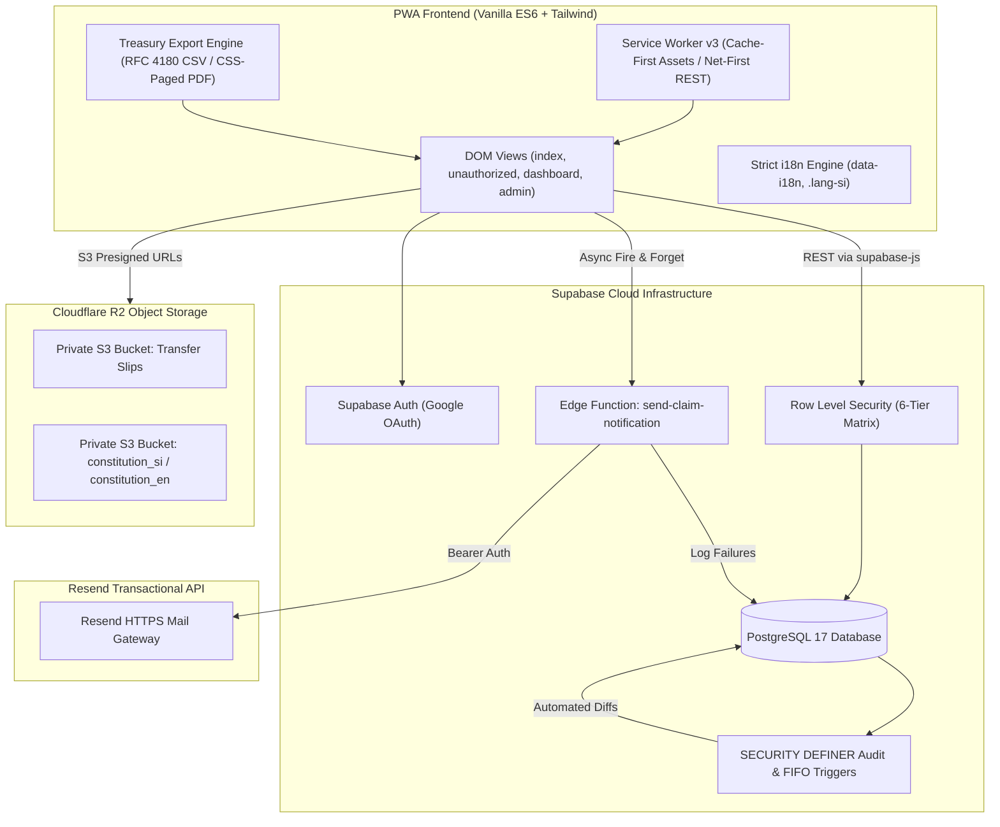
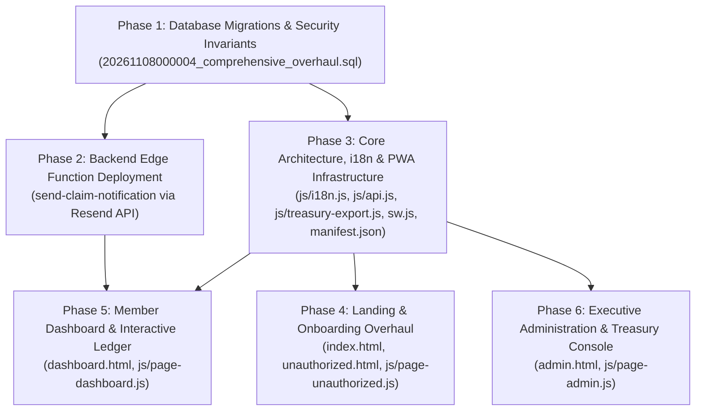

# MRIA Management Welfare Association PWA: Comprehensive Redesign & Architectural Overhaul

* **Author:** kiyamaninfo-alt
* **Status:** Draft
* **Date:** 2026-11-08

--------------------------------------------------------------------------------

## Overview

The Mattala Rajapaksa International Airport (MRIA) Management Welfare Association ("MRIA කළමනාකාර සුබසාධක සංගමය") operates an internal statutory welfare society for airport management staff. This design document establishes the comprehensive architectural overhaul of the association's Progressive Web Application (PWA).

The upgraded platform is built with Vanilla HTML5, Vanilla ES6 JavaScript modules, Tailwind CSS, Supabase (PostgreSQL 17), and Cloudflare R2 private object storage. It replaces legacy manual coordination with an automated, auditable, offline-capable member self-service and treasury management system. The overhaul encompasses six foundational pillars: statutory identity & contact CMS, strict single-language localization, multi-platform PWA installation, a 6-tier granular Role-Based Access Control (RBAC) matrix, an interactive member ledger with asynchronous welfare claim dispatch, and an immutable audit trail with an asset-segregated treasury ledger and reporting engine.

## The Problem

The existing digital prototype and operational workflow suffer from critical functional, statutory, and ergonomic limitations:

1. **Brand Inconsistency & Public Exposure of Private Contacts:** 
   The application displays conflicting nomenclature ("MRIA සුබසාධක සංගමය" vs. "MRIA සුබසාධක කළමනාකරණ සංගමය"), references outdated build tags and restrictive airport domain disclaimers, and publicly exposes private executive telephone numbers instead of institutional routing channels. Digital vouchers also contain legacy references to SMS delivery, which is unsupported.
2. **Mixed-Language User Interface:** 
   The interface currently displays English and Sinhala text simultaneously within identical containers, violating clean localization principles and cluttering mobile viewports.
3. **Rigid Role-Based Access Control:** 
   The database role matrix lacks dedicated tiers for the Secretary (`secretary` / ලේකම්) and Committee Members (`committee_member`). Member identity records lack statutory airport attributes (EPF Number and Airport Designation), preventing formal administrative roster synchronization.
4. **Synchronous Notification Bottlenecks:** 
   Welfare claim lodgments lack automated committee alerting. Introducing third-party notification gateways synchronously risks aborting critical bereavement claims if the external mail service suffers latency or rate-limiting.
5. **Absence of Forensic Audit Trails:** 
   Administrative actions (such as role modifications, slip verifications, and dues waivers) lack an immutable, append-only database audit log, creating governance and accountability risks.
6. **Unsegregated Treasury Operations & Lack of Reporting:** 
   The treasury lacks transactional asset segregation between Bank of Ceylon operating savings, cash held by the Treasurer awaiting deposit, and long-term Fixed Deposits. Furthermore, the Treasurer cannot generate filtered statements (monthly, yearly, or custom date range) in CSV or printable PDF formats for formal executive audit meetings.

## Goals

* **Strict Single-Language i18n:** Enforce 100% linguistic isolation so that selecting Sinhala renders zero English (except standardized technical loanwords), and selecting English renders zero Sinhala, with instant reactive DOM swapping and script-aware line-height adjustments (`.lang-si`).
* **Granular 6-Tier RBAC:** Implement formal permissions for `admin`, `manager`, `secretary`, `treasurer`, `committee_member`, and `member` via Supabase Row Level Security (RLS) policies and dynamic UI route guards.
* **Statutory Airport Identity & Hybrid Onboarding:** Capture and display Full Name, EPF Number, and Airport Designation across all profile headers, receipts, and admin rosters, supported by Secretary pre-seeding and an in-app registration request modal on `unauthorized.html`.
* **Asynchronous Resend Email Notification:** Dispatch automated claim lodgment notices to all committee officials via an asynchronous Edge Function (`send-claim-notification`), ensuring claims commit to PostgreSQL unconditionally while logging delivery failures to the audit trail.
* **Immutable Database Audit Trail:** Establish an append-only `audit_logs` table protected by a PostgreSQL `BEFORE UPDATE OR DELETE` exception trigger, capturing automated diffs across member profiles, dues, payments, and treasury movements.
* **Asset-Segregated Treasury Ledger:** Track every inflow, outflow, and internal transfer across three distinct accounts (BOC Savings, Cash in Hand, Fixed Deposits) with real-time balance calculations.
* **Treasury Statement Export Engine:** Enable the Treasurer to export date-filtered ledger statements (monthly, yearly, custom range) into RFC 4180 CSV and official printable PDF documents.
* **Dual-Slot Statutory CMS:** Provide an in-app administrative CMS for uploading and downloading language-paired Constitution documents (`constitution_si.pdf` / `constitution_en.pdf`) via private Cloudflare R2 storage.
* **True Multi-Platform PWA:** Upgrade `manifest.json` and `sw.js` (v3) to deliver installation shortcuts for Windows, Linux, Android, and iOS, with cache-first delivery for official Bank QR codes and fonts.

## Non-Goals

* **Merchant Payment Gateways:** Automated integration with commercial credit/debit card merchant processors (e.g., Stripe, PayHere) is out of scope; payments remain processed via bank transfer slips and verified cash intake.
* **Outbound SMS Gateway:** Automated SMS messaging is excluded in favor of transactional email notifications and downloadable digital PDF receipts.
* **Direct Banking API Integrations:** Automated screen scraping or open-banking API integration with Bank of Ceylon is excluded; bank account balances are updated via slip approvals, cash receipts, and explicit transfer transactions.
* **Petty Cash Bookkeeping:** Tracking minor daily stationery or refreshment expenses is excluded from the system ledger; petty cash is accounted for at bulk replenishment/withdrawal intervals.

## Open Questions

*All core architectural questions raised during the brainstorming phase have been resolved:*
* *Q1 (Email Dispatch):* Resolved. Operates via Resend API gateway through Edge Function `send-claim-notification` asynchronously without blocking database transactions.
* *Q2 (EPF Onboarding):* Resolved. Implemented as a hybrid model: Secretary pre-seeding + self-service registration modal on `unauthorized.html`.
* *Q3 (Treasury Accounting):* Resolved. Implemented as a full double-entry transaction ledger (`treasury_transactions`) across 3 asset accounts with CSV and CSS-paged PDF exports.
* *Q4 (Constitution CMS):* Resolved. Implemented as a dual-slot CMS storing versioned `constitution_si.pdf` and `constitution_en.pdf` in Cloudflare R2.

## Critical User Journeys (CUJs)

### CUJ 1: Unregistered Airport Staff Member Onboarding & Secretary Verification
* **Given**: A newly hired Mattala Airport staff member signs in using their personal Google account for the first time.
* **When**: The user authenticates via Supabase OAuth and is redirected to `unauthorized.html` because their email is not yet approved.
* **Then**: 
  1. The user sees a clear status notice in their preferred language (Sinhala or English) and clicks "Register My Details".
  2. A modal opens with their name and email pre-filled; the user inputs their EPF Number, Airport Designation, and Phone Number, then submits.
  3. The record is inserted into `public.members` with `is_approved = false` and `role = 'member'`.
  4. The Secretary navigates to the Member Administration tab on `admin.html`, reviews the pending registration, verifies the EPF Number against the official airport roster, and clicks "Approve Member".
  5. The member record is updated to `is_approved = true`, logged to `audit_logs`, and the user is granted access to `dashboard.html` upon their next visit.

### CUJ 2: Member Welfare Aid Claim Submission & Asynchronous Committee Alerting
* **Given**: An active, approved member needs to request emergency bereavement aid for an immediate family member.
* **When**: The member navigates to `dashboard.html`, clicks "Request Welfare Aid", selects the benefit type, enters the requested amount, attaches supporting documentation via Cloudflare R2 upload, and submits the form.
* **Then**:
  1. The claim record commits immediately to `public.benefit_claims` with status `submitted`.
  2. The frontend triggers an asynchronous background request to Edge Function `send-claim-notification`.
  3. The Edge Function dispatches an HTML notification email via the Resend API to all users with roles `admin`, `manager`, `secretary`, `treasurer`, and `committee_member`.
  4. If the Resend API fails or is rate-limited, the claim remains safely committed in the database, and the error is appended to `public.audit_logs`.
  5. Committee members see the new claim on their administrative console for collective review and disbursement authorization.

### CUJ 3: Direct Cash Intake & Real-Time Treasury Ledger Rebalancing
* **Given**: A member pays their monthly membership dues in physical cash to the Treasurer at the airport administrative office.
* **When**: The Treasurer logs in, opens the Cash Collection Desk on `admin.html`, selects the member, verifies the transaction date and amount, and clicks "Issue Instant Cash Receipt".
* **Then**:
  1. A verified payment record is created in `public.payments` (`payment_method = 'cash'`, `status = 'verified'`).
  2. The FIFO settlement engine marks the member's oldest pending monthly due in `member_dues` as `paid`.
  3. A corresponding treasury transaction is recorded in `treasury_transactions` (`transaction_type = 'inflow'`, `destination_account = 'cash_in_hand'`).
  4. An instant digital cash receipt opens in a printable modal with verified security stamps.
  5. The Treasurer's running "Cash in Hand" balance increments immediately. When the Treasurer subsequently deposits accumulated cash into the Bank of Ceylon account, they record a `transfer` transaction (`source_account = 'cash_in_hand'`, `destination_account = 'savings'`), keeping the ledger balanced.

### CUJ 4: Periodic Treasury Audit & Custom Date-Filtered Export
* **Given**: The Treasurer needs to present a quarterly financial statement to the Executive Committee.
* **When**: The Treasurer navigates to the Society Treasury module on `admin.html`, selects the "Custom Date Range" filter, enters the start and end dates, and clicks "Export Statement".
* **Then**:
  1. The reporting engine queries `treasury_transactions` within the specified date boundaries.
  2. The Treasurer can click "Download CSV" to receive a standardized RFC 4180 file with ISO dates and decimal figures for spreadsheet analysis.
  3. The Treasurer can click "Print Official PDF" to open a styled print window formatted with the association crest, date boundaries, categorized inflows/outflows, opening/closing balances across Savings, Cash in Hand, and Fixed Deposits, and a formal Treasurer certification signature box.

### CUJ 5: Language Toggle & Dual-Slot Constitution Access
* **Given**: A member prefers reading documents in Sinhala.
* **When**: The member clicks the language toggle button in the navigation bar.
* **Then**:
  1. All DOM elements with `data-i18n` update immediately to Sinhala without a page reload.
  2. The `.lang-si` class is applied to the document body, adjusting line heights and text scaling.
  3. When the member clicks "Download Association Constitution", the system detects the active language and downloads `constitution_si.pdf` sourced from Cloudflare R2.


--------------------------------------------------------------------------------

## Technical Plan (Architecture)

### 1. High-Level System Architecture

The application implements a decoupled, offline-resilient Progressive Web App architecture backed by Supabase Managed PostgreSQL 17, Cloudflare R2 object storage, and the Resend transactional email API.



---

### 2. Database Schema & Data Models

The relational schema is implemented across PostgreSQL migrations enforcing strict foreign key constraints, check invariants, and automated triggers.

#### A. Role Enumeration Migration (`app_role`)
To ensure zero breaking changes with existing records and active policies, migration `20261108000004_comprehensive_overhaul.sql` executes:
```sql
ALTER TYPE public.app_role ADD VALUE IF NOT EXISTS 'secretary';
ALTER TYPE public.app_role ADD VALUE IF NOT EXISTS 'committee_member';

-- Data migration: Upgrade legacy 'official' members to 'committee_member'
UPDATE public.members 
SET role = 'committee_member' 
WHERE role = 'official';
```

#### B. Member Profiles Schema (`public.members`)
Augments the existing profile table with official statutory airport attributes:
* `id` UUID PRIMARY KEY REFERENCES auth.users(id) ON DELETE CASCADE
* `email` VARCHAR(255) UNIQUE NOT NULL
* `full_name` VARCHAR(255) NOT NULL
* `epf_number` VARCHAR(50) UNIQUE NOT NULL
* `designation` VARCHAR(150) NOT NULL
* `phone` VARCHAR(30) NOT NULL
* `nic` VARCHAR(20)
* `role` public.app_role NOT NULL DEFAULT 'member'
* `is_legacy_member` BOOLEAN NOT NULL DEFAULT FALSE
* `is_approved` BOOLEAN NOT NULL DEFAULT FALSE
* `created_at` TIMESTAMPTZ NOT NULL DEFAULT timezone('utc', now())
* `updated_at` TIMESTAMPTZ NOT NULL DEFAULT timezone('utc', now())

#### C. Immutable Audit Trail Schema (`public.audit_logs`)
Stores an append-only forensic history. Direct client inserts are blocked by RLS; updates and deletions are blocked by a database trigger:
```sql
CREATE TABLE public.audit_logs (
    id UUID PRIMARY KEY DEFAULT gen_random_uuid(),
    timestamp TIMESTAMPTZ NOT NULL DEFAULT timezone('utc', now()),
    user_email VARCHAR(255) NOT NULL,
    full_name VARCHAR(255),
    epf_number VARCHAR(50),
    action VARCHAR(100) NOT NULL,
    entity_type VARCHAR(100) NOT NULL,
    entity_id VARCHAR(100) NOT NULL,
    diff_json JSONB NOT NULL DEFAULT '{}'::jsonb
);

-- Database-Level Invariant: Strictly prevent modification or truncation
CREATE OR REPLACE FUNCTION public.fn_prevent_audit_tampering()
RETURNS TRIGGER AS $$
BEGIN
    RAISE EXCEPTION 'Security Violation: audit_logs records are strictly immutable and cannot be updated or deleted.';
END;
$$ LANGUAGE plpgsql SECURITY DEFINER;

CREATE TRIGGER trg_audit_logs_immutable
BEFORE UPDATE OR DELETE ON public.audit_logs
FOR EACH ROW EXECUTE FUNCTION public.fn_prevent_audit_tampering();
```

#### D. Treasury Asset Segregation Schema (`public.treasury_accounts` & `public.treasury_transactions`)
Maintains a full transaction ledger across segregated asset accounts:
```sql
CREATE TYPE public.treasury_tx_type AS ENUM ('inflow', 'outflow', 'transfer');

CREATE TABLE public.treasury_accounts (
    id VARCHAR(50) PRIMARY KEY, -- 'boc_savings', 'cash_in_hand', 'fixed_deposits'
    account_name VARCHAR(100) NOT NULL,
    account_number VARCHAR(100),
    description TEXT,
    is_active BOOLEAN NOT NULL DEFAULT TRUE,
    created_at TIMESTAMPTZ NOT NULL DEFAULT timezone('utc', now())
);

-- Initial Accounts Seeding
INSERT INTO public.treasury_accounts (id, account_name, account_number, description) VALUES
('boc_savings', 'Bank of Ceylon Operating Savings', 'BOC-HAM-8839201', 'Primary association operational bank account'),
('cash_in_hand', 'Treasurer Physical Cash Float', NULL, 'Physical cash collected at airport desk awaiting bank deposit'),
('fixed_deposits', 'BOC Fixed Deposit Capital Reserve', 'BOC-FD-0029104', 'Long-term interest-bearing emergency welfare reserve')
ON CONFLICT (id) DO NOTHING;

CREATE TABLE public.treasury_transactions (
    id UUID PRIMARY KEY DEFAULT gen_random_uuid(),
    transaction_date DATE NOT NULL DEFAULT CURRENT_DATE,
    transaction_type public.treasury_tx_type NOT NULL,
    source_account_id VARCHAR(50) REFERENCES public.treasury_accounts(id),
    destination_account_id VARCHAR(50) REFERENCES public.treasury_accounts(id),
    amount NUMERIC(12, 2) NOT NULL CHECK (amount > 0),
    reference_no VARCHAR(100) NOT NULL,
    description TEXT NOT NULL,
    recorded_by UUID NOT NULL REFERENCES public.members(id),
    created_at TIMESTAMPTZ NOT NULL DEFAULT timezone('utc', now()),
    CONSTRAINT chk_treasury_accounts_validity CHECK (
        (transaction_type = 'inflow' AND destination_account_id IS NOT NULL AND source_account_id IS NULL) OR
        (transaction_type = 'outflow' AND source_account_id IS NOT NULL AND destination_account_id IS NULL) OR
        (transaction_type = 'transfer' AND source_account_id IS NOT NULL AND destination_account_id IS NOT NULL AND source_account_id <> destination_account_id)
    )
);

-- Real-Time Balance Summary View
CREATE OR REPLACE VIEW public.treasury_account_balances AS
SELECT 
    acc.id AS account_id,
    acc.account_name,
    COALESCE(SUM(
        CASE 
            WHEN tx.destination_account_id = acc.id THEN tx.amount 
            WHEN tx.source_account_id = acc.id THEN -tx.amount 
            ELSE 0 
        END
    ), 0.00) AS current_balance
FROM public.treasury_accounts acc
LEFT JOIN public.treasury_transactions tx 
    ON acc.id = tx.source_account_id OR acc.id = tx.destination_account_id
GROUP BY acc.id, acc.account_name;
```

#### E. Statutory Governance CMS Schema (`public.cms_documents`)
Supports dual-slot Constitution uploads and bilingual statutory policies:
* `id` UUID PRIMARY KEY DEFAULT gen_random_uuid()
* `slug` VARCHAR(50) UNIQUE NOT NULL -- 'constitution', 'privacy_policy', 'security_terms'
* `title_en` VARCHAR(255) NOT NULL
* `title_si` VARCHAR(255) NOT NULL
* `content_en` TEXT -- HTML or Markdown body for policies
* `content_si` TEXT
* `file_url_en` TEXT -- Versioned R2 storage key for English PDF
* `file_url_si` TEXT -- Versioned R2 storage key for Sinhala PDF
* `version` VARCHAR(20) NOT NULL DEFAULT '1.0'
* `updated_by` UUID REFERENCES public.members(id)
* `updated_at` TIMESTAMPTZ NOT NULL DEFAULT timezone('utc', now())

---

### 3. Granular Row Level Security (RLS) Policy Matrix

Security is enforced at the PostgreSQL layer based on `public.get_current_user_role()`:

| Table | `member` | `committee_member` | `treasurer` | `secretary` | `manager` | `admin` |
| :--- | :--- | :--- | :--- | :--- | :--- | :--- |
| `members` | Own Profile (R/W) | Read All Active | Read All Active | Full CRUD | Read All | Full CRUD |
| `member_dues` | Own Dues (Read) | Read All | Full CRUD | Read All | Read All | Full CRUD |
| `payments` | Own (Insert/Read) | Read All | Verify / Direct Cash | Read All | Read All | Full CRUD |
| `benefit_claims` | Own (Insert/Read) | Read / Vote | Read / Disburse | Read All | Review / Approve | Full CRUD |
| `treasury_transactions` | No Access | Read Summary | Full CRUD | Read Summary | Read All | Full CRUD |
| `audit_logs` | No Access | No Access | No Access | No Access | Read Only | Full Read (No Write) |
| `cms_documents` | Read Published | Read Published | Read Published | Edit Constitution | Read Published | Full CRUD |

---

### 4. Asynchronous Claim Notification Edge Function (`send-claim-notification`)

* **Runtime:** Supabase Edge Function (Deno TypeScript runtime).
* **Execution Trigger:** Frontend fires asynchronous `fetch('/functions/v1/send-claim-notification', { method: 'POST', body: JSON.stringify({ claim_id }) })` immediately after claim commit.
* **Service Gateway:** Resend Transactional Email API (`POST https://api.resend.com/emails`).
* **Recipient Resolution:** Supabase Service Role client queries all active members where `role IN ('admin', 'manager', 'secretary', 'treasurer', 'committee_member')` and extracts their verified emails.
* **Email Template:** Formal institutional HTML notification displaying Claim ID, Member Name, EPF Number, Airport Designation, Benefit Category, Amount Claimed, and a direct link to the Executive Review Portal.
* **Resilience Invariant:** Wrapped in `try...catch`. Any Resend HTTP error, rate-limit, or timeout logs an entry into `public.audit_logs` (`action = 'claim_notification_failed'`) with error details, returning HTTP 200 with `{ dispatched: false, error: ... }` to prevent client failure.

---

### 5. Frontend Client-Side Architecture

#### A. Strict Single-Language i18n Engine (`js/i18n.js`)
* Complete dictionary mapping for 100% of UI keys in `en` and `si`.
* Eliminates all container-level bilingual duplication. Elements specify `<span data-i18n="nav_dashboard">Dashboard</span>`.
* When Sinhala is active, `document.documentElement.lang = 'si'` and `document.body.classList.add('lang-si')`.
* CSS Invariant: `.lang-si` enforces `line-height: 1.6` on card headers and buttons to prevent vertical descender clipping in Sinhala glyphs.

#### B. Multi-Platform PWA Installation Lifecycle
* `manifest.json`: Defines `id`, `start_url`, `display: "standalone"`, `background_color: "#FFFFFF"`, `theme_color: "#0F172A"`, and multi-density icon masks (`192x192`, `512x512`, `512x512-maskable`).
* Windows/Linux/Android Shortcuts: Direct shortcuts for "My Dues Ledger", "Cash Collection Desk", and "Submit Slip".
* `sw.js` (v3):
  * Cache-First for web fonts (`Plus Jakarta Sans`), Google Material Symbols, and official Bank QR SVGs.
  * Network-First for API requests (`/rest/v1/*`), with local fallback to `mria_cached_member`.

#### C. Treasury Statement Export Engine (`js/treasury-export.js`)
1. **RFC 4180 CSV Generator:**
   - Escapes quotes and commas, standardizes headers: `Transaction Date, Reference No, Type, Source Account, Destination Account, Amount (LKR), Description, Recorded By`.
   - Formats dates as ISO `YYYY-MM-DD` and amounts with two decimal places.
2. **CSS-Paged PDF Generator:**
   - Opens an isolated print preview window populated with official MRIA Welfare letterhead, executive metadata, date boundary summary, opening balance, detailed ledger rows, closing balances for all 3 asset accounts, and the official Treasurer verification seal block.
   - Invokes `window.print()` with `@media print` rules setting A4 page margins, page-break preservation, and background color printing.


--------------------------------------------------------------------------------

## Alternatives Considered

### Alternative 1: Synchronous Email Dispatch via Client-Side Webhook

* **Mechanism**: The browser client or a synchronous database trigger halts the claim lodgment transaction until the Resend API confirms delivery of the notification email to all executive committee members.
* **Pros**: 
  * The member receives immediate visual confirmation on the dashboard that all committee members have received an email.
  * Simpler execution topology without requiring background fire-and-forget handling.
* **Cons**:
  * External HTTP latency to the mail provider (typically 800ms–2500ms) is injected directly into the critical transaction path.
  * Any third-party outage, DNS resolution failure, expired API secret, or rate-limiting error causes the member's welfare aid claim to abort and roll back.
  * Catastrophic for airport staff submitting emergency bereavement or urgent medical aid requests during off-peak hours.
* **Reason for Rejection**: Member welfare submissions must possess 100% database write availability. Asynchronous Edge Function execution decouples database persistence from external network health, logging any delivery exceptions directly to `audit_logs` without impacting the member.

---

### Alternative 2: Manual Balance Snapshot Overrides for Treasury Management

* **Mechanism**: The Treasurer inputs balance figures manually for Savings, Fixed Deposits, and Cash in Hand whenever a physical count or bank reconciliation occurs, saving a point-in-time snapshot with textual notes.
* **Pros**:
  * Eliminates the need to log discrete internal transfers when cash collected from dues is deposited at a Bank of Ceylon branch.
  * Faster to implement with fewer relational tables.
* **Cons**:
  * Destroys line-item mathematical auditability. There is no historical ledger tracing when specific cash batches were deposited, making forensic auditing impossible.
  * Inadvertent arithmetic errors or deliberate balance manipulations cannot be detected without cross-referencing physical paper deposit slips.
  * Fails to support automated date-filtered statement exports (monthly or custom range) because historical daily balances cannot be mathematically reconstructed.
* **Reason for Rejection**: The association manages statutory employee welfare funds requiring forensic audit compliance. The double-entry `treasury_transactions` ledger enforces explicit source and destination account validation on every movement, ensuring continuous reconciliation against physical Bank of Ceylon passbooks and cash float drawers.

---

### Alternative 3: Single Unified Bilingual Constitution PDF

* **Mechanism**: The Secretary uploads a single consolidated PDF document containing alternating Sinhala and English clauses or dual-column text, serving the same file to all users.
* **Pros**:
  * Requires only one file upload input in the administrative CMS.
  * Eliminates the risk of version skew where the English text is updated but the Sinhala translation lags behind.
* **Cons**:
  * Strictly violates the core project invariant of 100% single-language isolation.
  * Doubles the download payload for mobile airport staff on tarmac cellular connections.
  * Substantially degrades reading ergonomics on small mobile screens due to dual-column typography.
* **Reason for Rejection**: The association's statutory protocol mandates clean, uncompromised linguistic isolation. The dual-slot CMS enforces paired, version-stamped documents (`constitution_si.pdf` and `constitution_en.pdf`) delivered conditionally based on the active user session language.

---

### Alternative 4: Rigid Pre-Seeding Only Member Onboarding

* **Mechanism**: Only airport staff members whose email addresses were manually pre-entered by the Secretary into `public.members` can sign in. Unrecognized users receive a static rejection screen with no submission capabilities.
* **Pros**:
  * Zero unverified registration records ever touch the database.
  * Simplest possible authorization code paths.
* **Cons**:
  * Airport employees whose personal Google OAuth addresses differ from official personnel records are permanently locked out without recourse.
  * Creates significant administrative bottlenecks and endless offline WhatsApp messaging back-and-forth with the Secretary to get emails added.
* **Reason for Rejection**: The hybrid onboarding model balances security with usability. Pre-seeding handles the bulk roster, while the self-service modal on `unauthorized.html` captures unlisted staff EPF numbers and designations, presenting a structured verification queue to the Secretary.

---

### Alternative 5: Client-Side Audit Event Generation

* **Mechanism**: Audit logs are generated by JavaScript frontend functions sending `INSERT` requests to the `audit_logs` table upon button clicks or form submissions.
* **Pros**:
  * Trivial to implement without writing PL/pgSQL database trigger functions.
* **Cons**:
  * Trivially bypassed or forged by anyone with an active Supabase JWT token using standard REST tools.
  * Fails completely if an ad-blocker or network drop interrupts the secondary audit HTTP call.
  * Misses all direct SQL operations or administrative dashboard queries.
* **Reason for Rejection**: An audit log that can be forged or omitted is legally and forensically worthless. PostgreSQL `SECURITY DEFINER` table triggers guarantee that every mutation across `members`, `payments`, `member_dues`, and `treasury_transactions` is recorded unconditionally at the database engine level.


--------------------------------------------------------------------------------

## Detailed Implementation Plan

The implementation is executed as a unified, phased rollout across database migrations, backend Edge Functions, client-side core modules, and HTML/JavaScript user views.

### 1. Phased Execution Sequence



---

### 2. Comprehensive File Manifest & Impact Rationale

| File Path | Status | Impact Rationale |
| :--- | :--- | :--- |
| `supabase/migrations/20261108000004_comprehensive_overhaul.sql` | **New** | Executes backward-compatible enum alterations (`secretary`, `committee_member`); adds `epf_number` (UNIQUE) and `designation` to `members`; creates immutable `audit_logs` table with tamper-proof trigger; establishes `treasury_accounts`, `treasury_transactions`, and `treasury_account_balances` view; creates `cms_documents`; defines automated table-level audit triggers; and updates RLS policies for all 6 roles. |
| `supabase/functions/send-claim-notification/index.ts` | **New** | Deno TypeScript Edge Function orchestrating asynchronous committee email notifications on welfare claim creation via the Resend API gateway. Logs failures to `audit_logs` with zero disruption to the member. |
| `js/config.js` | **Modified** | Standardizes official titles strictly to "MRIA කළමනාකාර සුබසාධක සංගමය", binds institutional contact email `krishaja@gmail.com`, and establishes endpoints for CMS document retrieval. |
| `js/i18n.js` | **Modified** | Complete dictionary overhaul delivering 100% strict single-language isolation (zero dual-language text in Sinhala mode). Implements `.lang-si` body class switching for line-height and typography normalization. |
| `js/api.js` | **Modified** | Adds Secretary member profile CRUD (including EPF and Designation), in-app registration submission, treasury transaction recording (`recordTreasuryTransaction`), real-time account balances retrieval, and date-filtered statement queries. |
| `js/treasury-export.js` | **New** | Implements RFC 4180 compliant CSV export engine with ISO dates and decimal formatting, alongside a dedicated CSS-paged print window generator formatted with official welfare crest headers for formal audit PDF printing. |
| `js/ui.js` | **Modified** | Implements interactive Contact Administration modal (`openContactModal`), notification center dismiss persistence (`mria_dismissed_announcements`), and enhanced modal controllers. |
| `sw.js` | **Modified** | Upgrades to `mria-welfare-v3`, introducing Cache-First caching for Google Fonts, Material Symbols, and official Bank QR SVGs, alongside Network-First caching for Supabase REST endpoints. |
| `manifest.json` | **Modified** | Updates official application name, defines desktop and mobile shortcuts ("My Dues Ledger", "Cash Collection Desk", "Submit Slip"), and configures standalone PWA display parameters across Windows, Linux, Android, and iOS. |
| `index.html` | **Modified** | Updates hero branding ("Digital Platform - MRIA Management Welfare Association", "100% DEDICATED STAFF WELFARE"), removes domain restrictions and raw phone numbers, wires the interactive contact modal, updates voucher copy (removes SMS), and unifies global footer. |
| `js/page-index.js` | **Modified** | Connects contact form submission logic routing to `krishaja@gmail.com` and synchronizes single-language DOM transitions. |
| `unauthorized.html` | **Modified** | Replaces static raw contact numbers with the interactive Self-Service Registration Modal, allowing unrecognized airport staff to submit their EPF Number, Airport Designation, and Phone Number for administrative approval. |
| `js/page-unauthorized.js` | **Modified** | Manages registration modal submission, validating required fields, creating an unapproved record in `public.members`, and rendering a verified submission confirmation state. |
| `dashboard.html` | **Modified** | Implements statutory member header (`Full Name (EPF: [epf]) • [designation]`), top-3 dismissible Notification Center, interactive Outstanding Dues popup trigger, dynamic Current Month Due card, and language-aware Constitution download button. |
| `js/page-dashboard.js` | **Modified** | Connects interactive dues breakdown popup (paid vs. unpaid months), handles notification dismissal persistence, fires asynchronous Edge Function call upon claim submission, and downloads `constitution_si.pdf` or `constitution_en.pdf` based on the active language. |
| `admin.html` | **Modified** | Restructures administrative console into role-filtered workspaces: Secretary Member Administration tab (profile CRUD, EPF approval queue), Treasurer Cash Collection & Slip Verification queues, Society Treasury Module (3-account balances, transaction logger, CSV/PDF export controls), and Statutory Governance CMS. |
| `js/page-admin.js` | **Modified** | Implements Secretary member CRUD and verification actions, wires Treasury transaction recording with account constraints, connects date-filtered CSV and PDF statement exports, manages dual-slot Constitution uploads to Cloudflare R2, and filters tab visibility per role. |

---

### 3. Step-by-Step Implementation Specifications

#### Step 1: Database Migration & Security Hardening
1. Execute `20261108000004_comprehensive_overhaul.sql` via Supabase SQL engine.
2. Verify enum values `secretary` and `committee_member` are present in `app_role`.
3. Verify `members` columns `epf_number` and `designation` are enforced with appropriate constraints.
4. Verify table `audit_logs` is created with trigger `trg_audit_logs_immutable`. Test attempting an `UPDATE` or `DELETE` to ensure PostgreSQL raises an uncatchable exception.
5. Create tables `treasury_accounts`, `treasury_transactions`, and the `treasury_account_balances` view. Test check constraints ensuring `inflow`, `outflow`, and `transfer` enforce proper source and destination accounts.
6. Attach table-level `SECURITY DEFINER` audit triggers on `members`, `payments`, `member_dues`, and `treasury_transactions`.

#### Step 2: Supabase Edge Function Deployment
1. Scaffold `supabase/functions/send-claim-notification/index.ts`.
2. Configure `RESEND_API_KEY` in Supabase Secrets.
3. Test function execution by passing mock claim payloads, verifying committee email extraction and audit log fallback on invalid keys.

#### Step 3: Core Client Libraries & PWA Infrastructure
1. Update `js/config.js` with standardized titles and institutional contact configuration.
2. Expand `js/i18n.js` with comprehensive bilingual dictionaries, ensuring zero mixed-language leakage and binding `.lang-si` typographic rules.
3. Update `js/api.js` to include Secretary CRUD, registration requests, treasury logging, and balance queries.
4. Create `js/treasury-export.js` implementing RFC 4180 CSV export and CSS-paged print PDF generation.
5. Update `sw.js` to v3 with Cache-First handling for fonts and bank QR media.
6. Enhance `manifest.json` with multi-platform shortcuts and standalone configurations.

#### Step 4: Public Landing & Onboarding Workflows
1. Overhaul `index.html` typography, copywriting, contact modal, and unified footer.
2. Wire `js/page-index.js` to handle interactive contact modal submissions.
3. Update `unauthorized.html` and `js/page-unauthorized.js` to replace raw phone numbers with the Self-Service Registration Modal capturing EPF and Designation.

#### Step 5: Member Self-Service Dashboard
1. Update `dashboard.html` with the statutory identity header (`Full Name`, `EPF`, `Designation`).
2. Add the dismissible top-3 Notification Center and wire dismiss state persistence in `js/page-dashboard.js`.
3. Implement the interactive Outstanding Dues popup detailing settled vs. pending monthly breakdown.
4. Wire asynchronous Edge Function notification dispatch on claim submission.
5. Connect language-aware Constitution download (`constitution_si.pdf` vs. `constitution_en.pdf`).

#### Step 6: Executive Administration & Treasury Console
1. Re-architect `admin.html` into tabbed, role-gated modules (Secretary Console, Treasurer Console, Committee Console, Governance CMS).
2. Wire Secretary member CRUD and one-click verification queue in `js/page-admin.js`.
3. Connect Treasury transaction logging (Inflows, Outflows, Internal Transfers) and real-time 3-account balance rendering.
4. Hook date-filtered monthly, yearly, and custom range statement downloads to `js/treasury-export.js`.
5. Connect dual-slot Constitution PDF replacement with confirmation dialogs.
