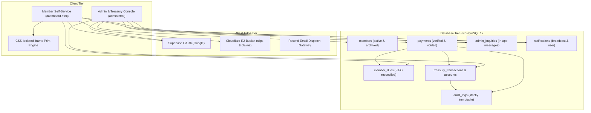
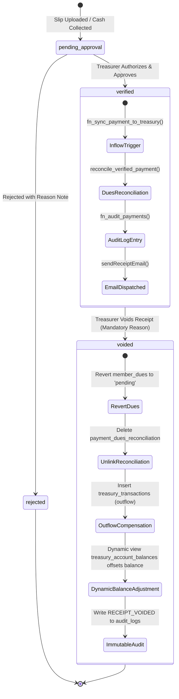
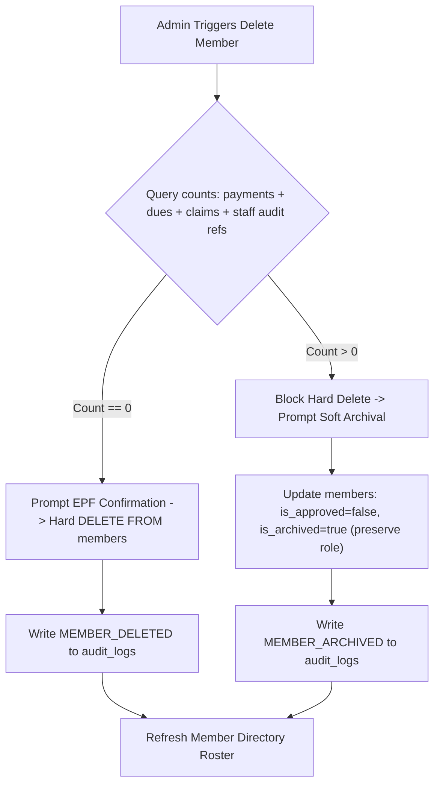

# MRIA Management Welfare Association PWA: Targeted Design Enhancement & Bug Remediation Cycle

* **Author:** kiyamaninfo-alt
* **Status:** Draft
* **Date:** 2026-11-09

--------------------------------------------------------------------------------

## Overview

The MRIA Management Welfare Association ("MRIA කළමනාකාර සුබසාධක සංගමය") Progressive Web Application (PWA) manages statutory membership records, monthly contributions, direct cash desk intake, bank deposit slip approvals, and welfare benefit disbursements for Mattala Rajapaksa International Airport staff. 

This design specification details a comprehensive 18-item enhancement and bug remediation cycle across five operational pillars:
1. **UI/UX Layout, Alignment & Numbers Formatting** (Items 1, 2, 5, 6, 7)
2. **RBAC Deletions, Approvals & Immutable Audit Logging** (Items 3, 4)
3. **Dues Logic, Dynamic Titles & Next-Month Auto-Selection** (Items 10, 11, 12, 14)
4. **Onboarding, Locked Dashboard Preview & Internal Inquiries** (Items 8, 13, 16, 17)
5. **Print Engine, App Installation & History Pagination** (Items 9, 15, 18)

The design enforces strict double-entry ledger invariants, FIFO dues reconciliation, immutable PostgreSQL audit logging, and single-language bilingual localization (Sinhala `si` and English `en`).

---

## The Problem

Through active operational usage, 18 specific functional defects, architectural risks, and visual misalignments have been identified across the application:

1. **Direct Cash Desk Export Omission (Item 1):** In `admin.html` under the Direct Cash Intake Desk (`#tab-content-cash`), the voucher preview container lacks a direct top-level download button in its card header, preventing administrators from immediately exporting receipt files.
2. **Horizontal Toolbar Stretching (Item 2):** Under Admin > Receipts & Vouchers (`#tab-content-receipts`), a 12-column grid causes search and filter controls to stretch unnaturally across wide screens while truncating on mobile devices.
3. **Misaligned Currency Values (Item 5):** Financial values across the Receipts Register, Slips Approval Queue, Cash Book, Defaulters Roster, and Member Directory are intermittently left-aligned or centered, preventing visual decimal scanning.
4. **Payout Desk Baseline Distortion (Item 6):** In the Direct Benefit Payout Desk, the "Payment Method" container and "Disbursement Date & Time" container have mismatched vertical baselines due to an internal timezone badge and uneven subtext.
5. **Inconsistent Currency Prefix Padding (Item 7):** Under Monthly Dues Settings, the "Rs." currency prefix uses `pl-3.5` with input `pl-12`, deviating from the standard `pl-3` and `pl-10` padding applied elsewhere in `admin.html`.
6. **Unsafe Member Deletion (Item 3):** Administrators cannot delete unneeded member records. Attempting a raw `DELETE FROM members` on a member with financial records triggers foreign key violations (`ON DELETE RESTRICT`) or destroys audit trails.
7. **Ledger Imbalance on Receipt Deletion (Item 4):** Issued receipts currently cannot be cancelled. Executing a physical SQL `DELETE FROM payments` breaks reconciled dues and leaves the treasury cash balance inflated, permanently desynchronizing physical bank funds from the digital ledger.
8. **Static Contribution Card Label (Item 10):** Card 2 on `dashboard.html` is labeled "Current Month Due / මෙම මස දායක මුදල", which is confusing when members check annual cumulative payments or pay ahead.
9. **Lack of Prepaid Advance Calculation (Item 11):** Card 1 displays outstanding dues as an absolute positive figure, ignoring advance prepaid contributions for upcoming months.
10. **Inverted Payment Month Auto-Selection (Item 12):** When a member opens the payment slip upload modal, `populatePaymentMonths()` loads dues ordered `DESC`, causing the *latest* unpaid month to be pre-selected instead of the *earliest*, violating FIFO principles.
11. **Constitutional Formula Drift (Item 14):** Formulas for end-of-month dues cutoffs (31st rule), one-time admission fees (Rs. 500/=), monthly contributions (Rs. 300/=), and asset account segregation require strict verification against the association constitution.
12. **Absence of Admin Messaging & Header Bell (Item 8):** Administrators cannot send targeted notices or alerts, and members have no unified notification inbox or unread counter.
13. **Missing Claim Proof Document Uploads (Item 13):** Members applying for death bereavement aid or medical aid cannot upload supporting documents (death certificates, hospital invoices) to Cloudflare R2.
14. **Disorienting Redirect for Unapproved Sign-Ins (Item 16):** Unapproved Google OAuth applicants are bounced to `unauthorized.html` and cannot preview the dashboard features awaiting approval.
15. **Unreliable Email Client Trigger on Contact Modal (Item 17):** In `js/ui.js`, "Contact Administration" fires a `mailto:` link, which fails on devices without configured mail clients and leaves no database audit trail.
16. **Hidden PWA Installation (Item 9):** Mobile members navigating to `dashboard.html` have no prominent "Install App" button.
17. **Full-Page Print Bleed on Vouchers (Item 15):** Calling `window.print()` prints the entire host webpage, capturing backgrounds, scrollbars, and navigation bars instead of an isolated voucher.
18. **Unbounded History Table DOM Growth (Item 18):** In `dashboard.html`, payment history and claim tables render all historical records in a single DOM block, slowing render times over time.

---

## Goals

* **G1 (UI & Layout):** Standardize all numerical and currency fields with `text-right font-mono tabular-nums`, fix the Direct Benefit Payout Desk and Settings baseline misalignments, add `#btnDownloadCashVoucher` to the Cash Desk, and refactor the Receipts toolbar into a compact flexbox layout.
* **G2 (RBAC Member Management):** Implement dual-mode member removal: allow strict hard deletion for unlinked profiles (0 transactions) and guarded archival (`is_approved = false`, `role = 'archived'`) for profiles with existing transaction history, logging all events to `audit_logs`.
* **G3 (Accounting Receipt Voiding):** Implement formal receipt cancellation via `status = 'voided'` with mandatory `void_reason`, automatically un-settling reconciled dues, injecting a compensating treasury outflow reversal, and appending immutable audit logs.
* **G4 (Dynamic Dues & FIFO Auto-Selection):** Transform Card 2 into a dynamic "So Far Paid Accordingly / මෙතෙක් ගෙවා ඇති මුදල" tracker, calculate net arrears (negative red) vs advance balances (positive green), and enforce chronological ascending sorting in `populatePaymentMonths()` to auto-select the earliest unpaid month.
* **G5 (Constitutional Integrity):** Verify and validate the 31st month-end cutoff rule, Rs. 500 admission fee schedule, Rs. 300 monthly rate, and asset segregation across Bank of Ceylon Savings, Physical Cash Float, and Fixed Deposits.
* **G6 (Admin Notifications & Inquiries):** Implement `public.notifications` with a header bell icon and unread counter, replace `mailto:` links with `public.admin_inquiries` persisted in the database, and add Cloudflare R2 document attachment uploads for welfare benefit claims (`document_key`).
* **G7 (Locked Preview & Mobile PWA):** Provide a read-only locked preview on `dashboard.html` for unapproved applicants with active Constitution PDF downloads and Sign Out, add a prominent "Install App" button, isolate voucher printing via a hidden iframe, and paginate transaction history (5 initial + "Load More (+25)").

---

## Non-Goals

* **NG1 (No Physical Deletion of Payments):** Physical SQL `DELETE FROM payments` is strictly prohibited to preserve double-entry accounting integrity; formal voiding and compensating reversals are used instead.
* **NG2 (No Hard Deletion of Financial Member Records):** Members with historical payment or claim records will never be hard-deleted from the database; soft archival is enforced to preserve statutory audit history.
* **NG3 (No External Telephony/SMS Gateways):** Automated outbound SMS notifications are excluded; communications remain strictly within the PWA notification center and authenticated email.
* **NG4 (No Direct Commercial Bank API Integrations):** Core banking integration is excluded; society funds remain verified through deposit slip proofs, cash intake, and LankaQR scan confirmations.

---

## Critical User Journeys (CUJs)

### CUJ 1: Direct Cash Intake & Voucher Download
* **Given**: An authenticated Treasurer at the Direct Cash Intake Desk (`#tab-content-cash`).
* **When**: The Treasurer selects a member, enters cash contribution details, and inspects the live voucher preview.
* **Then**: The header displays a functional "Download Voucher" button (`#btnDownloadCashVoucher`) that exports the standalone HTML/PDF receipt immediately, before or after settlement.

### CUJ 2: Dual-Mode Member Deletion and Archival
* **Given**: An authenticated Administrator in the Member Directory.
* **When**: The Admin selects "Delete Member" on a member profile.
* **Then**:
  * If the member has zero payments, dues, or claims, the system prompts for EPF confirmation and permanently executes a hard delete.
  * If the member has existing financial records, the system rejects hard deletion and prompts for guarded soft archival, marking `is_approved = false` and `role = 'archived'`.
  * In both cases, the action is recorded in `audit_logs`.

### CUJ 3: Accounting Receipt Voiding & Ledger Reversal
* **Given**: An authenticated Treasurer in the Receipts Register viewing an erroneously verified receipt.
* **When**: The Treasurer clicks "Void Receipt" and provides a mandatory justification note (e.g. "Duplicate entry").
* **Then**:
  * Payment status transitions to `voided`.
  * Associated `member_dues` are reverted from `settled` back to `pending`.
  * A compensating outflow transaction (`VOID-[id]`) is appended to `treasury_transactions`, decrementing the treasury cash balance.
  * An immutable entry is written to `audit_logs`.

### CUJ 4: Dynamic Dues & Earliest Unpaid Month Auto-Detection
* **Given**: A member with 2 overdue months (e.g. September, October) and 1 current month (November).
* **When**: The member views `dashboard.html` and clicks "Make a Payment".
* **Then**:
  * Card 1 displays overdue arrears in rose red (`-Rs. 600.00`).
  * Card 2 displays cumulative contributions paid to date.
  * In the payment modal, the month selector automatically sorts chronologically ascending and pre-selects the earliest unpaid month (September).

### CUJ 5: Welfare Benefit Claim Attachment Upload
* **Given**: An approved member applying for Death Donation / Bereavement Aid (Rs. 20,000/=).
* **When**: The member selects the welfare category, fills remarks, and attaches a camera photo or PDF of the death certificate.
* **Then**: The file is uploaded to Cloudflare R2 via presigned URL, `document_key` is stored on `benefit_claims`, and reviewing officials can inspect the document proof before approving payout.

### CUJ 6: Locked Preview for Pending OAuth Applicants
* **Given**: A new Mattala airport employee who signs in with an unlisted Google account and submits the registration form on `unauthorized.html`.
* **When**: The applicant is redirected to `dashboard.html`.
* **Then**:
  * A prominent alert banner states: "Dashboard will become active once Secretary approves your account".
  * Financial cards show zero-state skeletons (`Rs. 0.00`).
  * Mutation buttons are disabled.
  * "Sign Out", "Download Constitution PDF", and "Contact Administration" remain fully active.

### CUJ 7: Isolated Receipt Printing & History Pagination
* **Given**: A member or Treasurer viewing a digital receipt voucher or looking at past payment history.
* **When**:
  * The user clicks "Print / PDF" on the receipt voucher.
  * The member scrolls down to transaction history.
* **Then**:
  * A hidden `<iframe>` is populated strictly with the receipt voucher, opening a clean single-page print dialog without capturing host webpage elements.
  * The transaction history renders the first 5 records with an active "Load More (+25)" button.

--------------------------------------------------------------------------------

## Technical Plan (Architecture)

### 1. System Architecture Overview & Component Boundaries

The MRIA Management Welfare Association PWA operates as a decoupled client-server architecture:
* **Frontend Tier:** Static HTML5 and ES6 modules (`admin.html`, `dashboard.html`, `index.html`, `unauthorized.html`) styled with Tailwind CSS, running offline-first through service worker cache strategies (`sw.js`).
* **Data & Business Logic Tier:** Supabase PostgreSQL 17 hosting relational data, row-level security (RLS) policies, FIFO settlement triggers, and immutable audit logs.
* **Object Storage Tier:** Cloudflare R2 private bucket accessed via signed S3 REST endpoints for deposit slips and welfare claim proof documents.
* **Messaging Tier:** In-app notification center and Edge Function email notifications (`send-receipt-email`, `send-claim-notification`) via the Resend API gateway.



---

### 2. State Machines & Transaction Workflows

#### A. Payment Receipt Lifecycle (Verification, Settlement & Void Reversal)



#### B. Member Lifecycle & Dual-Mode Deletion Flow



---

### 3. Detailed Pillar Implementations

#### Pillar 1: UI/UX Layout, Alignment & Numbers Formatting

1. **Cash Desk Voucher Export Button (Item 1):**
   * In `admin.html` within `#tab-content-cash`, update the card header above `#cashReceiptPreview`:
     ```html
     <div class="flex items-center gap-2">
       <button type="button" id="btnDownloadCashVoucher" onclick="window.downloadReceiptFile()" class="px-3 py-1 bg-surface-variant hover:bg-outline-variant/30 text-on-surface text-xs font-bold rounded-lg border border-outline-variant inline-flex items-center gap-1.5 transition-colors cursor-pointer" title="Download Voucher HTML">
         <span class="material-symbols-outlined text-[16px]">download</span>
         <span>Download Voucher</span>
       </button>
       <span id="receiptPreviewStatusBadge" class="text-[10px] font-bold px-2 py-0.5 rounded-full bg-amber-50 text-amber-800 border border-amber-200">
         Live Draft Preview
       </span>
     </div>
     ```
   * Wired to `window.downloadReceiptFile()`, which inspects `window.__lastReceiptData` and exports a standalone HTML document with complete styling.

2. **Receipts & Vouchers Toolbar Compacting (Item 2):**
   * Replace the wide 12-column grid (`grid-cols-1 sm:grid-cols-12 gap-3`) in `#tab-content-receipts` with a compact, responsive flexbox toolbar:
     ```html
     <div class="flex flex-wrap items-center gap-2.5 pt-1">
       <!-- Compact Search Box -->
       <div class="relative flex-1 min-w-[200px] max-w-xs sm:max-w-sm">
         <span class="material-symbols-outlined absolute left-2.5 top-2.5 text-on-surface-variant text-[17px]">search</span>
         <input type="text" id="receiptsSearchInput" placeholder="Search Name, EPF, Receipt No..." class="w-full pl-8 pr-7 py-1.5 rounded-xl border border-outline-variant bg-surface text-xs font-medium focus:border-primary focus:ring-1 focus:ring-primary outline-none" />
         <button type="button" id="receiptsClearSearchBtn" onclick="window.clearReceiptsSearch()" class="hidden absolute right-2 top-2 text-on-surface-variant hover:text-on-surface cursor-pointer">
           <span class="material-symbols-outlined text-[16px]">close</span>
         </button>
       </div>
       <!-- Category Filter Dropdown -->
       <div class="w-auto min-w-[130px]">
         <select id="receiptsCategoryFilter" onchange="window.filterReceiptsCategory(this.value)" class="w-full px-2.5 py-1.5 rounded-xl border border-outline-variant bg-surface text-xs font-semibold text-on-surface outline-none cursor-pointer">
           <option value="all">All Categories</option>
           <option value="monthly_due">Monthly Due</option>
           <option value="admission_fee">Admission Fee</option>
           <option value="donation">Donation</option>
         </select>
       </div>
       <!-- Method Filter Dropdown -->
       <div class="w-auto min-w-[120px]">
         <select id="receiptsMethodFilter" onchange="window.filterReceiptsMethod(this.value)" class="w-full px-2.5 py-1.5 rounded-xl border border-outline-variant bg-surface text-xs font-semibold text-on-surface outline-none cursor-pointer">
           <option value="all">All Methods</option>
           <option value="cash">Cash Float</option>
           <option value="bank_transfer">Bank Transfer</option>
           <option value="qr_payment">LankaQR</option>
           <option value="slip">Deposit Slip</option>
         </select>
       </div>
       <!-- Compact Sort Dropdowns -->
       <div class="flex items-center gap-1.5">
         <select id="receiptsSortSelect" onchange="window.changeReceiptsSort(this.value)" class="px-2.5 py-1.5 rounded-xl border border-outline-variant bg-surface text-xs font-semibold text-on-surface outline-none cursor-pointer">
           <option value="created_at">Date Created</option>
           <option value="amount">Amount</option>
           <option value="receipt_no">Receipt No</option>
           <option value="member_name">Member Name</option>
         </select>
         <button type="button" id="receiptsSortOrderBtn" onclick="window.toggleReceiptsSortOrder()" class="p-1.5 rounded-xl border border-outline-variant bg-surface hover:bg-surface-variant text-on-surface cursor-pointer" title="Toggle Sort Order">
           <span class="material-symbols-outlined text-[18px]" id="receiptsSortOrderIcon">arrow_downward</span>
         </button>
       </div>
     </div>
     ```

3. **Universal Numerical Right-Alignment (Item 5):**
   * Standardize table definitions across `admin.html` and `dashboard.html`:
     * Slips Approval Queue: Amount column `th` and `td` use `text-right font-mono tabular-nums font-bold text-primary`.
     * Receipts Register: Amount column `th` and `td` use `text-right font-mono tabular-nums font-extrabold text-on-surface`.
     * Cash Book Ledger: Amount column `th` and `td` use `text-right font-mono tabular-nums font-bold`.
     * Defaulters Roster: Arrears amount `th` and `td` use `text-right font-mono tabular-nums font-bold text-rose-700`.
     * Member Directory: EPF number uses `font-mono tabular-nums`.

4. **Direct Benefit Payout Desk Baseline Alignment (Item 6):**
   * In `tab-content-claims` under Direct Benefit Payout Desk, relocate the timezone tag beside the section title ("Disbursement Date & Time (Asia/Colombo)"), equalizing label heights and removing extra vertical offsets between "Payment Method" and "Disbursement Date & Time".

5. **Settings Currency Prefix Standardization (Item 7):**
   * In `duesSettingsForm` and `admissionFeeForm`, normalize input markup:
     ```html
     <div class="relative">
       <span class="absolute inset-y-0 left-0 pl-3 flex items-center text-xs font-bold text-on-surface-variant">Rs.</span>
       <input type="number" id="settingMonthlyDueAmount" required min="50" step="50" class="w-full pl-10 pr-3 py-2 rounded-xl border border-outline-variant bg-surface font-bold text-primary text-xs outline-none" />
     </div>
     ```

---

#### Pillar 2: RBAC Deletions, Approvals & Immutable Audit Logging

1. **Dual-Mode Member Deletion & Archival (Item 3):**
   * PostgreSQL Schema Adjustment & Stored Procedure:
     ```sql
     -- Decouple lifecycle state from authorization role
     ALTER TABLE public.members 
     ADD COLUMN IF NOT EXISTS is_archived BOOLEAN NOT NULL DEFAULT false;

     CREATE OR REPLACE FUNCTION public.delete_or_archive_member(
         p_member_id UUID,
         p_admin_id UUID,
         p_reason TEXT DEFAULT 'Administrative clean up'
     ) RETURNS JSONB
     LANGUAGE plpgsql
     SECURITY DEFINER
     SET search_path = public, pg_temp
     AS $$
     DECLARE
         v_pay_count INT;
         v_dues_count INT;
         v_claim_count INT;
         v_staff_refs INT;
         v_member RECORD;
         v_actor RECORD;
     BEGIN
         SELECT * INTO v_member FROM public.members WHERE id = p_member_id;
         IF NOT FOUND THEN
             RAISE EXCEPTION 'Member record not found';
         END IF;

         -- Lookup executing admin details for complete immutable audit trail
         SELECT email, full_name, epf_number INTO v_actor 
         FROM public.members WHERE id = p_admin_id;

         -- Count personal member transaction records
         SELECT COUNT(*) INTO v_pay_count FROM public.payments WHERE member_id = p_member_id;
         SELECT COUNT(*) INTO v_dues_count FROM public.member_dues WHERE member_id = p_member_id;
         SELECT COUNT(*) INTO v_claim_count FROM public.benefit_claims WHERE member_id = p_member_id;

         -- Count staff audit references to prevent foreign key constraint crashes (23503 ON DELETE RESTRICT)
         SELECT COUNT(*) INTO v_staff_refs FROM (
             SELECT 1 FROM public.payments WHERE verified_by = p_member_id
             UNION ALL
             SELECT 1 FROM public.treasury_transactions WHERE recorded_by = p_member_id
             UNION ALL
             SELECT 1 FROM public.benefit_claims WHERE disbursed_by = p_member_id OR approved_by = p_member_id
         ) s;

         IF (v_pay_count + v_dues_count + v_claim_count + v_staff_refs) > 0 THEN
             -- Soft Archival Mode: revoke access, set is_archived flag, preserve role history
             UPDATE public.members
             SET is_approved = false,
                 is_archived = true,
                 updated_at = NOW()
             WHERE id = p_member_id;

             PERFORM public.log_user_activity(
                 'MEMBER_ARCHIVED',
                 'MEMBER',
                 p_member_id::text,
                 jsonb_build_object(
                     'reason', p_reason,
                     'email', v_member.email,
                     'epf', v_member.epf_number,
                     'transactions_preserved', (v_pay_count + v_dues_count + v_claim_count),
                     'staff_references_preserved', v_staff_refs
                 ),
                 v_actor.email, v_actor.full_name, v_actor.epf_number
             );

             RETURN jsonb_build_object('action', 'archived', 'message', 'Member has existing records or staff history. Successfully archived.');
         ELSE
             -- Hard Delete Mode: clean removal for zero-record profiles
             DELETE FROM public.members WHERE id = p_member_id;

             PERFORM public.log_user_activity(
                 'MEMBER_DELETED',
                 'MEMBER',
                 p_member_id::text,
                 jsonb_build_object(
                     'reason', p_reason,
                     'email', v_member.email,
                     'epf', v_member.epf_number
                 ),
                 v_actor.email, v_actor.full_name, v_actor.epf_number
             );

             RETURN jsonb_build_object('action', 'deleted', 'message', 'Member had 0 records. Permanently deleted.');
         END IF;
     END;
     $$;
     ```

2. **Accounting Receipt Voiding & Automatic Ledger Reversals (Item 4):**
   * PostgreSQL Stored Procedure:
     ```sql
     ALTER TYPE payment_status ADD VALUE IF NOT EXISTS 'voided';

     CREATE OR REPLACE FUNCTION public.void_payment_receipt(
         p_payment_id UUID,
         p_reason TEXT,
         p_voided_by UUID
     ) RETURNS JSONB
     LANGUAGE plpgsql
     SECURITY DEFINER
     SET search_path = public, pg_temp
     AS $$
     DECLARE
         v_payment RECORD;
         v_source_account TEXT;
         v_reversed_dues INT := 0;
         v_actor RECORD;
     BEGIN
         SELECT * INTO v_payment FROM public.payments WHERE id = p_payment_id;
         IF NOT FOUND THEN
             RAISE EXCEPTION 'Payment record % not found', p_payment_id;
         END IF;

         IF v_payment.status = 'voided' THEN
             RAISE EXCEPTION 'Payment % is already voided', p_payment_id;
         END IF;

         -- Ledger safety invariant: only formally verified receipts can be voided
         IF v_payment.status != 'verified' THEN
             RAISE EXCEPTION 'Only verified payment receipts can be voided (current status: %)', v_payment.status;
         END IF;

         -- Lookup executing officer details for immutable audit trail
         SELECT email, full_name, epf_number INTO v_actor 
         FROM public.members WHERE id = p_voided_by;

         -- Update status and rejection/void reason
         UPDATE public.payments
         SET status = 'voided',
             rejection_reason = p_reason,
             verified_by = p_voided_by,
             verified_at = NOW()
         WHERE id = p_payment_id;

         -- Un-settle reconciled dues back to pending
         WITH reverted AS (
             UPDATE public.member_dues md
             SET status = 'pending',
                 updated_at = NOW()
             FROM public.payment_dues_reconciliation pdr
             WHERE pdr.payment_id = p_payment_id
               AND pdr.due_id = md.id
             RETURNING md.id
         )
         SELECT COUNT(*) INTO v_reversed_dues FROM reverted;

         DELETE FROM public.payment_dues_reconciliation WHERE payment_id = p_payment_id;

         -- Resolve treasury account from original verified transaction
         SELECT destination_account_id INTO v_source_account 
         FROM public.treasury_transactions 
         WHERE payment_id = p_payment_id 
         LIMIT 1;

         IF v_source_account IS NULL THEN
             v_source_account := CASE 
                 WHEN v_payment.payment_method = 'cash' THEN 'cash_in_hand'
                 ELSE 'boc_savings'
             END;
         END IF;

         -- Compensating treasury outflow reversal (append-only ledger)
         -- Note: The dynamic SQL view treasury_account_balances aggregates tx.source_account_id as -amount,
         -- so inserting this outflow immediately offsets account balances without mutating physical account rows.
         INSERT INTO public.treasury_transactions (
             transaction_date,
             transaction_type,
             source_account_id,
             amount,
             reference_no,
             description,
             payment_id,
             recorded_by
         ) VALUES (
             CURRENT_DATE,
             'outflow',
             v_source_account,
             v_payment.amount,
             'VOID-' || SUBSTRING(p_payment_id::text, 1, 8),
             'Voided Receipt Reversal: ' || COALESCE(p_reason, 'Erroneous Entry'),
             p_payment_id,
             p_voided_by
         );

         -- Record in immutable audit log with full actor attributes
         PERFORM public.log_user_activity(
             'RECEIPT_VOIDED',
             'PAYMENT',
             p_payment_id::text,
             jsonb_build_object(
                 'reason', p_reason,
                 'amount', v_payment.amount,
                 'reversed_dues_count', v_reversed_dues,
                 'source_account', v_source_account,
                 'payment_type', v_payment.payment_type
             ),
             v_actor.email, v_actor.full_name, v_actor.epf_number
         );

         RETURN jsonb_build_object(
             'success', true,
             'payment_id', p_payment_id,
             'reversed_dues', v_reversed_dues,
             'reversal_amount', v_payment.amount
         );
     END;
     $$;
     ```

---

#### Pillar 3: Dues Logic, Dynamic Titles & Next-Month Auto-Selection

1. **Dynamic Cumulative Contribution Tracker (Item 10):**
   * On `dashboard.html`, update Card 2:
     * Label in Sinhala: "මෙතෙක් ගෙවා ඇති මුදල"
     * Label in English: "Contributions Paid to Date"
     * Value computation: Sum of all verified payments (`payment_type IN ('monthly_due', 'admission_fee', 'donation')`) for the active member in the current calendar year.

2. **Net Standing Calculation (+/- Values) & Month-End Cutoff (Item 11):**
   * Centralized in `js/api.js` (`calculateMemberBalance`) and consumed in `js/page-dashboard.js`:
     ```javascript
     export async function calculateMemberBalance(member) {
       if (!member) return { totalPending: 0, priorArrears: 0, advanceBalance: 0, pendingDues: [], admissionFeeDue: 0, netStanding: 0 };

       const dues = await getMemberDues(member.id);
       const today = new Date();
       const currentMonthStr = today.toISOString().slice(0, 7) + "-01";

       // Month-End Cutoff Rule: Current month is NOT overdue until month-end passes.
       // Only prior billing months (< currentMonthStr) constitute overdue arrears.
       const priorPendingDues = dues.filter(d => d.status === "pending" && d.billing_month < currentMonthStr);
       const currentMonthDue = dues.find(d => d.billing_month === currentMonthStr && d.status === "pending");

       let admissionFeeDue = 0;
       if (!member.is_legacy_member) {
         const { data: admissionPayment } = await supabase
           .from("payments")
           .select("id, status")
           .eq("member_id", member.id)
           .eq("payment_type", "admission_fee")
           .eq("status", "verified")
           .maybeSingle();

         if (!admissionPayment) {
           const setting = await getSystemSetting("admission_fee_amount");
           admissionFeeDue = setting?.amount != null ? Number(setting.amount) : 500.00;
         }
       }

       // Cumulative dues payments vs billed obligations for advance calculation
       const { data: verifiedDues } = await supabase
         .from("payments")
         .select("amount")
         .eq("member_id", member.id)
         .eq("payment_type", "monthly_due")
         .eq("status", "verified");

       const totalDuesPaid = (verifiedDues || []).reduce((sum, p) => sum + Number(p.amount), 0);
       const totalBilledUpToNow = dues.filter(d => d.billing_month <= currentMonthStr).length * 300;
       const advanceBalance = Math.max(0, totalDuesPaid - totalBilledUpToNow);
       const priorArrears = priorPendingDues.reduce((sum, d) => sum + Number(d.amount), 0) + admissionFeeDue;
       const netStanding = advanceBalance > 0 ? advanceBalance : -priorArrears;

       return {
         totalPending: priorArrears + (currentMonthDue ? Number(currentMonthDue.amount) : 0),
         priorArrears,
         advanceBalance,
         admissionFeeDue,
         pendingDues: dues.filter(d => d.status === "pending"),
         netStanding,
         isArrears: netStanding < 0,
         isAdvance: netStanding > 0,
         isSettled: netStanding === 0
       };
     }
     ```
   * UI Representation (formatted via `formatCurrency(amount, { showSign: true })` without manual `Rs. ` string concatenation):
     * `netStanding < 0`: Card title: "ගෙවීමට ඇති හිඟ මුදල් (Overdue Arrears)", value: `-Rs. 500.00` (text-rose-600, badge "Arrears / හිඟ මුදල්").
     * `netStanding > 0`: Card title: "අත්තිකාරම් ශේෂය (Advance Balance)", value: `+Rs. 500.00` (text-emerald-600, badge "Advance Paid / අත්තිකාරම් ගෙවීම්").
     * `netStanding === 0`: Card title: "හිඟ මුදල් නොමැත (Up to Date)", value: `Rs. 0.00` (text-slate-900, badge "All Settled / සම්පූර්ණයෙන්ම ගෙවා ඇත").

3. **FIFO Chronological Auto-Selection Fix (Item 12):**
   * In `populatePaymentMonths()`:
     ```javascript
     const pendingMonths = (currentDues || [])
       .filter((d) => d.status === "pending")
       .sort((a, b) => a.billing_month.localeCompare(b.billing_month)); // Sort ascending!

     if (pendingMonths.length > 0) {
       pendingMonths.forEach((d) => {
         const opt = document.createElement("option");
         opt.value = d.billing_month;
         opt.textContent = `${d.billing_month.slice(0, 7)} (Unpaid Dues: ${formatCurrency(d.amount)})`;
         select.appendChild(opt);
       });
       select.value = pendingMonths[0].billing_month; // Earliest month auto-selected
     }
     ```

4. **Constitutional Formula Verification (Item 14):**
   * Month-end cutoff rule: Active dues transition to overdue past 23:59:59 on the final day of the month.
   * Admission fee default: Rs. 500/= non-refundable fee required upon registration.
   * Monthly dues rate default: Rs. 300/= (dynamically read from `system_settings` key `monthly_due_amount`).
   * Asset segregation invariant: Balance of `cash_in_hand` + `boc_savings` + `fixed_deposits` strictly equals net inflows minus net outflows in `treasury_transactions`.

---

#### Pillar 4: Onboarding, Locked Dashboard Preview & Internal Inquiries

1. **Admin Notifications Center & Member Bell Icon (Item 8):**
   * Database Schema:
     ```sql
     -- Strictly 1-to-1 targeted alerts (eliminates shared read-state bug on broadcasts)
     -- General broadcast circulars remain managed by public.announcements with client-side dismissal.
     CREATE TABLE IF NOT EXISTS public.notifications (
         id UUID PRIMARY KEY DEFAULT gen_random_uuid(),
         recipient_id UUID NOT NULL REFERENCES public.members(id) ON DELETE CASCADE,
         title_en TEXT NOT NULL,
         title_si TEXT NOT NULL,
         message_en TEXT NOT NULL,
         message_si TEXT NOT NULL,
         priority TEXT NOT NULL CHECK (priority IN ('normal', 'urgent')) DEFAULT 'normal',
         is_read BOOLEAN NOT NULL DEFAULT false,
         created_at TIMESTAMPTZ NOT NULL DEFAULT NOW()
     );

     ALTER TABLE public.notifications ENABLE ROW LEVEL SECURITY;

     CREATE POLICY "Members view own notifications" ON public.notifications
         FOR SELECT USING (recipient_id = (SELECT id FROM public.members WHERE user_id = auth.uid()));

     CREATE POLICY "Members update own notifications" ON public.notifications
         FOR UPDATE USING (recipient_id = (SELECT id FROM public.members WHERE user_id = auth.uid()))
         WITH CHECK (recipient_id = (SELECT id FROM public.members WHERE user_id = auth.uid()));

     CREATE POLICY "Staff insert notifications" ON public.notifications
         FOR INSERT WITH CHECK (
             EXISTS (
                 SELECT 1 FROM public.members m
                 WHERE m.user_id = auth.uid()
                   AND m.role IN ('admin', 'secretary', 'manager')
             )
         );
     ```
   * Header Bell Icon: Added to `dashboard.html` header:
     ```html
     <button id="notificationBellBtn" onclick="window.openNotificationsModal()" class="relative p-2 rounded-xl border border-outline-variant hover:border-primary text-on-surface-variant hover:text-primary transition-colors cursor-pointer">
       <span class="material-symbols-outlined text-[20px]">notifications</span>
       <span id="notificationUnreadBadge" class="hidden absolute -top-1 -right-1 w-4 h-4 rounded-full bg-rose-600 text-white font-bold text-[10px] flex items-center justify-center">0</span>
     </button>
     ```

2. **Cloudflare R2 Welfare Claim Proof Uploads (Item 13):**
   * Database Schema:
     ```sql
     ALTER TABLE public.benefit_claims 
     ADD COLUMN IF NOT EXISTS document_key VARCHAR(500);
     ```
   * R2 Upload Pipeline:
     * Client selects or snaps document proof -> calls `uploadStorageFile(file, "claims")` (generalized in `js/storage.js`).
     * `supabase/functions/upload-slip/index.ts` accepts `folder: "slips" | "claims"` (defaulting to `"slips"`), formatting S3 key `${folder}/${yearMonth}/${member.id}_${uniqueId}.${ext}`.
     * Inserts into `benefit_claims.document_key` via `submitBenefitClaim({ ..., documentKey })`.
     * Edge Function Authorization: Update `supabase/functions/get-slip-url/index.ts` to enforce strict tenant ownership:
       Permit presigned download if caller is staff (`admin`, `secretary`, `treasurer`, `manager`) **OR** `(payments.slip_key = slipKey AND payments.member_id = caller.id)` **OR** `(benefit_claims.document_key = slipKey AND benefit_claims.member_id = caller.id)`.

3. **Read-Only Locked Dashboard Preview (Item 16):**
   * Update `js/auth.js` to support `requireApproved: false` for preview routing.
   * Update `js/page-unauthorized.js` to redirect applicants to `dashboard.html` upon registration submission.
   * In `js/page-dashboard.js`, allow unapproved users with pending registration records to access `dashboard.html`:
     * If `member && !member.is_approved`:
       * Render prominent sticky banner:
         ```html
         <div id="lockedDashboardBanner" class="p-4 bg-amber-50 border-b border-amber-200 text-amber-900 text-xs flex items-center justify-between gap-3 shadow-xs">
           <div class="flex items-center gap-2.5">
             <span class="material-symbols-outlined text-amber-600 text-[22px]">lock_clock</span>
             <div>
               <p class="font-bold">Dashboard Preview Mode - Awaiting Approval</p>
               <p class="text-amber-800 text-[11px]">ලේකම්වරයා විසින් ඔබගේ සාමාජිකත්වය අනුමත කළ පසු මෙම පුවරුව සම්පූර්ණයෙන්ම සක්‍රිය වනු ඇත.</p>
             </div>
           </div>
           <button type="button" onclick="signOut()" class="px-3 py-1.5 bg-white border border-amber-300 rounded-lg text-amber-900 font-bold hover:bg-amber-100 transition-colors cursor-pointer">Sign Out</button>
         </div>
         ```
       * Disable all mutation buttons (`Make a Payment`, `Apply for Welfare Benefit`, drop areas).
       * Hide `#dashboardNotificationCenter` and internal circulars to prevent data leakage prior to vetting.
       * Keep "Sign Out", "Download Constitution PDF", and "Contact Administration" active.
       * Render metrics as zero skeletons (`Rs. 0.00`).

4. **In-App Inquiries Form (Replacing `mailto:`) (Item 17):**
   * Database Schema:
     ```sql
     CREATE TABLE IF NOT EXISTS public.admin_inquiries (
         id UUID PRIMARY KEY DEFAULT gen_random_uuid(),
         sender_id UUID REFERENCES public.members(id) ON DELETE SET NULL,
         sender_name TEXT NOT NULL,
         sender_email TEXT NOT NULL,
         sender_phone VARCHAR(20),
         sender_epf TEXT,
         subject TEXT NOT NULL,
         message TEXT NOT NULL,
         status TEXT NOT NULL DEFAULT 'pending', -- 'pending', 'resolved'
         resolved_by UUID REFERENCES public.members(id) ON DELETE SET NULL,
         resolution_notes TEXT,
         created_at TIMESTAMPTZ NOT NULL DEFAULT NOW(),
         updated_at TIMESTAMPTZ NOT NULL DEFAULT NOW()
     );

     ALTER TABLE public.admin_inquiries ENABLE ROW LEVEL SECURITY;

     -- Authenticated members only (prevents anonymous spam/forgery)
     CREATE POLICY "Authenticated members insert inquiries" ON public.admin_inquiries
         FOR INSERT TO authenticated
         WITH CHECK (auth.uid() IS NOT NULL);

     CREATE POLICY "Staff view inquiries" ON public.admin_inquiries
         FOR SELECT USING (
             EXISTS (
                 SELECT 1 FROM public.members m
                 WHERE m.user_id = auth.uid()
                   AND m.role IN ('admin', 'secretary', 'treasurer', 'manager')
             )
             OR sender_id = (SELECT id FROM public.members WHERE user_id = auth.uid())
         );

     CREATE POLICY "Staff update inquiries" ON public.admin_inquiries
         FOR UPDATE USING (
             EXISTS (
                 SELECT 1 FROM public.members m
                 WHERE m.user_id = auth.uid()
                   AND m.role IN ('admin', 'secretary', 'treasurer', 'manager')
             )
         );
     ```
   * Frontend: In `js/ui.js`, update `openContactModal()` to submit directly to `supabase.from("admin_inquiries").insert(...)` with `sender_phone` and eliminate `window.location.href = mailto:...`.

---

#### Pillar 5: Print Engine, App Installation & History Pagination

1. **Prominent Dashboard "Install App" Button (Item 9):**
   * Add button to `dashboard.html` header / banner:
     ```html
     <button id="btnInstallApp" class="hidden mutation-btn inline-flex items-center gap-1.5 px-3 py-1.5 rounded-xl bg-sky-700 hover:bg-sky-800 text-white text-xs font-bold shadow-sm transition-all cursor-pointer">
       <span class="material-symbols-outlined text-[16px]">install_mobile</span>
       <span>Install App</span>
     </button>
     ```
   * Bound to `window.addEventListener("beforeinstallprompt")`. On iOS Safari, display modal instructions ("Tap Share -> Add to Home Screen").

2. **CSS-Isolated Hidden `<iframe>` Print Engine (Item 15):**
   * Refactor print engine in `js/receipt.js` to use local pre-cached `/assets/styles.css` and `iframe.onload`, unifying both payment receipts and grant vouchers:
     ```javascript
     export function printIsolatedElement(elementId, documentTitle = "Voucher") {
       const el = document.getElementById(elementId);
       if (!el) return;

       const iframe = document.createElement("iframe");
       iframe.style.position = "fixed";
       iframe.style.right = "0";
       iframe.style.bottom = "0";
       iframe.style.width = "0";
       iframe.style.height = "0";
       iframe.style.border = "0";
       document.body.appendChild(iframe);

       const doc = iframe.contentWindow.document;
       doc.open();
       doc.write(`
         <!DOCTYPE html>
         <html>
           <head>
             <meta charset="utf-8" />
             <title>${documentTitle}</title>
             <link rel="stylesheet" href="/assets/styles.css">
             <link rel="stylesheet" href="https://fonts.googleapis.com/css2?family=Inter:wght@400;600;700&family=Noto+Sans+Sinhala:wght@400;600;700&display=swap">
             <style>
               @page { size: auto; margin: 10mm; }
               body { background: white; margin: 0; padding: 10px; font-family: 'Inter', 'Noto Sans Sinhala', sans-serif; }
               .print\:hidden { display: none !important; }
             </style>
           </head>
           <body>
             ${el.outerHTML}
           </body>
         </html>
       `);
       doc.close();

       iframe.onload = () => {
         setTimeout(() => {
           iframe.contentWindow.focus();
           iframe.contentWindow.print();
           setTimeout(() => {
             if (document.body.contains(iframe)) {
               document.body.removeChild(iframe);
             }
           }, 1000);
         }, 100);
       };
     }

     window.printReceipt = function () {
       printIsolatedElement("receiptVoucherPrintable", "MRIA_Payment_Receipt");
     };

     window.printGrantVoucher = function () {
       printIsolatedElement("grantVoucherPrintable", "MRIA_Benefit_Grant_Voucher");
     };
     ```

3. **History Pagination (5 Initial + 25 Load More) (Item 18):**
   * In `js/page-dashboard.js`, maintain pagination indices:
     ```javascript
     let paymentsRenderLimit = 5;
     let claimsRenderLimit = 5;

     function renderPaymentHistory(payments) {
       const sliced = payments.slice(0, paymentsRenderLimit);
       // Render rows ...
       const loadMoreBtn = document.getElementById("btnLoadMorePayments");
       if (loadMoreBtn) {
         loadMoreBtn.style.display = payments.length > paymentsRenderLimit ? "inline-flex" : "none";
         loadMoreBtn.onclick = () => {
           paymentsRenderLimit += 25;
           renderPaymentHistory(payments);
         };
       }
     }
     ```

--------------------------------------------------------------------------------

## Alternatives Considered

### Alternative 1: Physical SQL Deletion of Payments vs. Accounting Void & Reversal Outflow

* **Option Evaluated:** Executing a raw SQL `DELETE FROM payments WHERE id = ...` when an administrative error occurs.
* **Pros:** Simple to implement; immediately removes the row from the payments table.
* **Cons:** Breaks relational foreign keys in `payment_dues_reconciliation`, leaves reconciled `member_dues` in an ambiguous state, and does not decrement the Society Treasury cash balance, creating an untraceable cash book imbalance against physical bank deposits.
* **Reason for Rejection:** Double-entry accounting principles and association audit rules prohibit deleting monetary transactions. Formal voiding (`status = 'voided'`) with trigger-enforced dues un-settling and a compensating outflow entry guarantees mathematical ledger parity.

### Alternative 2: Unconditional Hard Member Deletion vs. Dual-Mode Deletion & Archival

* **Option Evaluated:** Allowing administrators to unconditionally execute `DELETE FROM members WHERE id = ...`.
* **Pros:** Completely purges unwanted records in one operation.
* **Cons:** Fails with PostgreSQL error `23503` (foreign key restriction) whenever a member has recorded payments, dues, or benefit claims. Cascading the deletion (`ON DELETE CASCADE`) would destroy historical audit logs and past financial ledgers.
* **Reason for Rejection:** Legal and financial audit standards require retaining transaction records for any staff member who has ever paid dues or received welfare benefits. Strict hard deletion is permitted only for zero-transaction profiles; members with historical records are transitioned to soft archival (`is_approved = false`, `role = 'archived'`).

### Alternative 3: Direct Host Window Print vs. CSS-Isolated Hidden `<iframe>` Printing

* **Option Evaluated:** Calling `window.print()` directly on the host document, relying on CSS `@media print { ... }` selectors to hide non-receipt elements.
* **Pros:** Requires no additional DOM elements or iframe creation.
* **Cons:** Browser print engines often leak background colors, navigation headers, floating modals, and scrollbar containers into the print dialog, causing margin distortion and multi-page blank spills.
* **Reason for Rejection:** Spawning a transient hidden `<iframe>` containing *only* the `#printableReceipt` markup and dedicated print styles guarantees centered, clean, single-page voucher exports across all desktop and mobile browsers.

### Alternative 4: Client-Side `mailto:` Links vs. Database-Persisted Inquiries Table

* **Option Evaluated:** Preserving the existing `mailto:krishaja@gmail.com` link inside the Contact Administration modal.
* **Pros:** Requires zero database schema changes or backend handling.
* **Cons:** Fails on devices without a configured native mail client (e.g. airport shared kiosks, web-mail only users), provides no delivery confirmation, and leaves no record in the administrative dashboard for Secretary review.
* **Reason for Rejection:** Storing inquiries in a dedicated `public.admin_inquiries` table with authenticated Row Level Security guarantees message delivery, enables in-app triage, and retains a permanent communication trail.

### Alternative 5: Server-Side REST Pagination vs. Client-Side Sliced Pagination for Member History

* **Option Evaluated:** Querying the Supabase REST API in batches (`/rest/v1/payments?limit=5&offset=...`) every time the user navigates history.
* **Pros:** Minimizes initial JSON payload size.
* **Cons:** Individual member payment history rarely exceeds 50 records. Slicing on the server introduces unnecessary network latency, breaks offline cache lookup in `sw.js`, and complicates offline PWA operation.
* **Reason for Rejection:** Fetching the full member record set in a single authenticated request and slicing DOM rendering on the client (5 initial + 25 on click) delivers instant UI rendering while preserving offline PWA usability.

--------------------------------------------------------------------------------

## Detailed Implementation Plan

### Target Files to Create / Modify

#### 1. `supabase/migrations/20261109000006_enhanced_governance_remediations.sql` (Create)
* **Type / Scope:** Database Schema & Migration (PostgreSQL DDL/DML).
* **Rationale:** Establishes all database entities and security definer functions required by the 18 requirements:
  * Adds `voided` value to `payment_status` enum.
  * Adds `is_archived BOOLEAN NOT NULL DEFAULT false` to `public.members` (decoupling lifecycle archival from `app_role`).
  * Creates `public.admin_inquiries` table with `sender_phone VARCHAR(20)` and RLS policies for authenticated inserts, member view, and staff update/resolution.
  * Creates `public.notifications` table strictly for 1-to-1 member alerts (`recipient_id UUID NOT NULL REFERENCES public.members(id)`) with RLS select and update policies.
  * Adds `document_key VARCHAR(500)` column to `public.benefit_claims`.
  * Implements `public.void_payment_receipt(p_payment_id, p_reason, p_voided_by)` with strict `status = 'verified'` precondition, original source account resolution, dues un-settling, compensating outflow insertion into `treasury_transactions`, and immutable audit logging with actor lookup.
  * Implements `public.delete_or_archive_member(p_member_id, p_admin_id, p_reason)` with full transaction and staff reference checks, preserving officer role upon soft archival and capturing complete actor audit attributes.

#### 2. `admin.html` (Modify)
* **Type / Scope:** Administrative Console HTML Markup.
* **Rationale:**
  * Cash Desk: Inserts `#btnDownloadCashVoucher` in the `#cashReceiptPreview` card header.
  * Receipts Toolbar: Refactors `#tab-content-receipts` toolbar from wide 12-column grid into compact flexbox with constrained widths.
  * Tables: Applies `text-right font-mono tabular-nums` to all currency columns in Slips Queue, Receipts Register, Cash Book, Defaulters Roster, and Member Directory.
  * Payout Desk: Normalizes container heights and repositions timezone indicator beside section title.
  * Settings: Standardizes input prefix padding (`pl-3` and `pl-10`) across currency fields.
  * Receipt Voiding Modal: Adds `#voidReceiptModal` with mandatory reason textarea and confirmation triggers.
  * Notifications Panel: Adds admin broadcast messaging panel under Admin CMS.
  * Inquiries Drawer: Adds administrative triage panel for reviewing and resolving submitted inquiries.

#### 3. `dashboard.html` (Modify)
* **Type / Scope:** Member Self-Service Console HTML Markup.
* **Rationale:**
  * Header: Inserts `#btnInstallApp` button and `#notificationBellBtn` with unread badge counter `#notificationUnreadBadge`.
  * Metric Cards: Converts Card 2 label into dynamic "So Far Paid Accordingly / මෙතෙක් ගෙවා ඇති මුදල", and updates Card 1 with net standing container.
  * Claim Modal: Adds camera capture and file picker drop area for attaching supporting documents (death certificates, medical invoices).
  * Locked Preview Banner: Adds `#lockedDashboardBanner` container displayed when an unapproved OAuth user accesses the dashboard.
  * History Tables: Adds pagination buttons `#btnLoadMorePayments` and `#btnLoadMoreClaims`.
  * Notifications Modal: Adds `#notificationsModal` container listing broadcast and member alerts.

#### 4. `js/auth.js` (Modify)
* **Type / Scope:** Authentication Guard & Session Management Module.
* **Rationale:**
  * Updates `requireAuth({ requireApproved = true, allowPreview = false } = {})` to permit unapproved authenticated users to render `dashboard.html` in read-only locked preview mode without bouncing to `unauthorized.html`.

#### 5. `js/page-unauthorized.js` (Modify)
* **Type / Scope:** Registration Onboarding Controller.
* **Rationale:**
  * Updates registration request submission handler to redirect pending applicants directly to `dashboard.html` to enter the locked preview mode.

#### 6. `js/api.js` (Modify)
* **Type / Scope:** Supabase Client Data Access Module.
* **Rationale:**
  * Exports `voidPaymentReceipt(paymentId, reason, voidedBy)` calling the PostgreSQL stored procedure.
  * Exports `deleteOrArchiveMember(memberId, adminId, reason)` calling the PostgreSQL stored procedure.
  * Exports `getNotifications(memberId)` and `markNotificationAsRead(notificationId)`.
  * Exports `sendNotification({ recipientId, titleEn, titleSi, messageEn, messageSi, priority })`.
  * Exports `submitInquiry({ senderId, senderName, senderEmail, senderPhone, senderEpf, subject, message })`.
  * Exports `getAdminInquiries()` and `resolveAdminInquiry(inquiryId, notes)`.
  * Updates `submitBenefitClaim({ memberId, benefitTypeId, claimAmount, notes, documentKey })` to persist `document_key`.
  * Updates `calculateMemberBalance()` to implement Month-End Cutoff rule, calculating net arrears vs advance balance and cumulative YTD verified contributions.

#### 7. `js/page-admin.js` (Modify)
* **Type / Scope:** Admin Application Controller.
* **Rationale:**
  * Connects `#btnDownloadCashVoucher` to `downloadReceiptFile()`.
  * Wires void receipt buttons in Receipts Register to `promptVoidReceipt()` and `executeVoidReceipt()`.
  * Updates Member Directory delete action to call `deleteOrArchiveMember()` with prompt confirmation.
  * Wires notification dispatch form in Admin CMS to `sendNotification()`.
  * Wires Inquiries triage drawer to display submissions and handle status updates via `resolveAdminInquiry()`.
  * Adds "View Proof Document" button in Claims Review and Payout Desk calling `getSignedSlipUrl(claim.document_key)`.
  * Refactors Receipts Register rendering to display `voided` badges and updated tabular alignment.

#### 8. `js/page-dashboard.js` (Modify)
* **Type / Scope:** Member Dashboard Application Controller.
* **Rationale:**
  * Binds PWA `beforeinstallprompt` to `#btnInstallApp` with fallback instructions for iOS Safari.
  * Calls `requireAuth({ requireApproved: false })`.
  * Evaluates `member.is_approved`: if false, displays `#lockedDashboardBanner`, hides `#dashboardNotificationCenter`, sets zero-state skeletons, disables mutation buttons, and preserves Sign Out, Constitution download, and Contact modal.
  * Loads unread 1-to-1 notifications, updates `#notificationUnreadBadge`, and renders the notifications list.
  * Updates `populatePaymentMonths()` with ascending chronological sort to auto-select the earliest unpaid month.
  * Updates `renderMetrics()` to render negative arrears vs positive advance balance using `formatCurrency({ showSign: true })`.
  * Updates Card 2 to display cumulative YTD verified payments.
  * Connects `#claimForm` file input to upload proof documents to Cloudflare R2 and store `document_key`.
  * Implements client-side pagination slicing (5 initial + 25 on click) for payment and claim histories, resetting limit on view change.

#### 9. `js/receipt.js` (Modify)
* **Type / Scope:** Digital Receipt & Voucher Generator.
* **Rationale:**
  * Implements `printIsolatedElement(elementId, documentTitle)` injecting local `/assets/styles.css` with `iframe.onload`.
  * Unifies `window.printReceipt()` and `window.printGrantVoucher()` to eliminate full-page chrome bleed.
  * Adds "VOIDED / අවලංගු කරන ලදී" watermark and badge styling when `payment.status === 'voided'`.

#### 10. `js/storage.js` (Modify)
* **Type / Scope:** Object Storage Client.
* **Rationale:**
  * Exports generalized `uploadStorageFile(file, folder = "slips")` passing the selected target folder to the upload Edge Function.

#### 11. `js/ui.js` (Modify)
* **Type / Scope:** Shared UI Utilities & Modals.
* **Rationale:**
  * Updates `openContactModal()` to submit directly to `admin_inquiries` with `sender_phone`, completely removing `mailto:`.
  * Updates `formatCurrency(amount, { showSign = false } = {})` to support signed output (`+Rs. 500.00` / `-Rs. 500.00`).
  * Adds notification modal opener and dismissers.

#### 12. `js/i18n.js` (Modify)
* **Type / Scope:** Bilingual Localization Dictionaries (`en` and `si`).
* **Rationale:**
  * Adds dictionary keys for:
    * `cumulative_contributions`: "මෙතෙක් ගෙවා ඇති මුදල" / "Contributions Paid to Date".
    * `advance_balance`: "අත්තිකාරම් ශේෂය" / "Advance Prepaid Balance".
    * `overdue_arrears`: "හිඟ මුදල්" / "Overdue Arrears".
    * `status_voided`: "අවලංගු කරන ලදී" / "Voided".
    * `notifications_title`: "දැනුම්දීම් පුවරුව" / "Notifications".
    * `install_app`: "යෙදුම ස්ථාපනය කරන්න" / "Install App".
    * `inquiry_submitted`: "ඔබගේ විමසීම සාර්ථකව යොමු කරන ලදී" / "Inquiry submitted successfully".

#### 13. `supabase/functions/upload-slip/index.ts` (Modify)
* **Type / Scope:** Cloudflare R2 Presigned Upload Edge Function.
* **Rationale:**
  * Updates request body parsing to accept `folder: "slips" | "claims"` (defaulting to `"slips"`).
  * Builds R2 presigned PUT object key as `${folder}/${yearMonth}/${member.id}_${uniqueId}.${ext}`.

#### 14. `supabase/functions/get-slip-url/index.ts` (Modify)
* **Type / Scope:** Cloudflare R2 Presigned Download Edge Function.
* **Rationale:**
  * Updates authorization check to permit presigned download if caller has staff role (`admin`, `secretary`, `treasurer`, `manager`), OR if non-staff member owns the document (`payments.slip_key = slipKey AND payments.member_id = caller.id` OR `benefit_claims.document_key = slipKey AND benefit_claims.member_id = caller.id`).

#### 15. `assets/styles.css` (Modify - via Build)
* **Type / Scope:** Production CSS Stylesheet.
* **Rationale:** Recompiled using `npm run build:css` to bundle Tailwind `tabular-nums` and newly added badge/print utility classes.

---

### Verification Plan

#### 1. Syntax & Build Compilation
* Execute `node --check js/*.js` to guarantee clean JavaScript module syntax.
* Execute `npm run build:css` to verify Tailwind CSS build without bundle errors.

#### 2. Database Migration & RLS Execution
* Apply `supabase/migrations/20261109000006_enhanced_governance_remediations.sql` to remote Supabase via management API.
* Verify `void_payment_receipt` and `delete_or_archive_member` execute atomically.
* Confirm Row Level Security policies prevent unapproved users from accessing other members' records or sensitive financial data.

#### 3. Functional End-to-End Verification
* **Cash Desk Export:** Click "Download Voucher" on direct cash intake desk; verify standalone HTML file downloads with correct styling.
* **Receipts Toolbar:** Verify toolbar is compact on desktop and wraps neatly on mobile; verify search and sorting dropdowns function smoothly.
* **Numerical Alignment:** Inspect Slips Queue, Receipts Register, Cash Book, Defaulters Roster, and Member Directory tables; verify all amounts are right-aligned with aligned decimal places.
* **Payout Desk Baseline:** Inspect Direct Benefit Payout Desk; verify Payment Method and Disbursement Date inputs share identical vertical baselines.
* **Settings Prefix:** Inspect Monthly Dues settings; verify "Rs." prefix aligns identically with other form inputs.
* **Member Deletion & Archival:**
  * Create a test member with 0 transactions -> trigger delete -> verify member is permanently purged from `members` and logged in `audit_logs`.
  * Select a member with existing transactions -> trigger delete -> verify hard delete is blocked, member is soft-archived (`is_approved = false`, `role = 'archived'`), and action is logged in `audit_logs`.
* **Receipt Voiding:**
  * Select an issued receipt in Receipts Register -> click "Void Receipt" -> provide reason.
  * Verify `payments.status` transitions to `voided`.
  * Verify settled dues return to `pending`.
  * Verify a compensating `outflow` is appended to `treasury_transactions` and account balance decrements.
  * Verify immutable entry in `audit_logs`.
* **Dynamic Contribution & Dues Cards:**
  * Card 2 displays verified cumulative contributions paid to date.
  * Card 1 displays `-Rs. 500.00` in red when in arrears, and `+Rs. 600.00` in green when prepaid in advance.
* **FIFO Month Auto-Selection:**
  * Member with past unpaid dues opens payment modal -> verify earliest unpaid month is pre-selected automatically.
* **Cloudflare R2 Claim Attachments:**
  * Submit a welfare benefit claim with attached image/PDF -> verify file uploads to R2 and `document_key` is stored on `benefit_claims`.
  * Review claim in Admin Payout Desk -> verify "View Proof Document" button opens the uploaded attachment.
* **Locked Preview Mode:**
  * Sign in with an unapproved Google OAuth user -> navigate to `dashboard.html`.
  * Verify `#lockedDashboardBanner` is displayed.
  * Verify metrics show zero skeletons (`Rs. 0.00`) and mutation buttons are disabled.
  * Verify "Sign Out", "Download Constitution PDF", and "Contact Administration" remain functional.
* **In-App Inquiries:**
  * Submit message via "Contact Administration" modal -> verify record is inserted into `admin_inquiries` without firing `mailto:`.
  * Verify inquiry appears in Admin review panel.
* **App Installation:**
  * Visit `dashboard.html` on mobile / Chrome -> verify `#btnInstallApp` is visible and triggers native install prompt.
* **Isolated Voucher Print:**
  * Click "Print / PDF" on any receipt -> verify browser print dialog renders *only* the voucher without host webpage artifacts.
* **History Pagination:**
  * View payment history -> verify initial 5 records are displayed.
  * Click "Load More (+25)" -> verify the next batch of records is appended smoothly.

--------------------------------------------------------------------------------

*Drafted with EGM*
