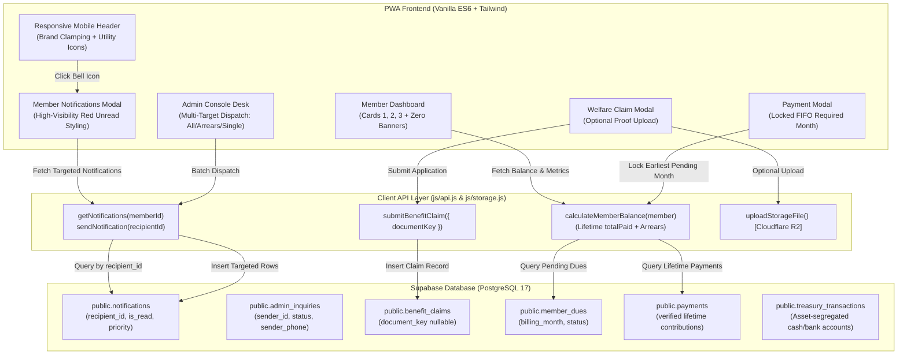

# MRIA Management Welfare Association PWA: Comprehensive Remediation & Governance Refinement

* **Author:** kiyamaninfo-alt
* **Status:** Draft
* **Date:** 2026-11-10

---

## Overview

The Mattala Rajapaksa International Airport (MRIA) Management Welfare Association ("MRIA කළමනාකාර අංශයේ සුබසාධක සංගමය") operates an internal self-service portal, treasury ledger, and welfare grant distribution platform. The platform is built as a Progressive Web Application (PWA) using Vanilla ES6 JavaScript modules, Tailwind CSS, Supabase (PostgreSQL 17), and Cloudflare R2 object storage.

This design document establishes the comprehensive technical architecture and execution plan for 19 scoped bug remediations, statutory governance alignments, database synchronization fixes, ledger metric refinements, notification channel consolidations, and mobile viewport adaptations.

---

## The Problem

Operational audits and member usage revealed several technical barriers, schema discrepancies, and usability frictions across the platform:

1. **Remote PostgREST Schema Disconnect:**
   * In-app admin inquiries (`public.admin_inquiries`) and member notifications (`public.notifications`) failed with `PGRST205` errors because migration 6 had not been applied to the remote Supabase database.
   * Benefit claim submissions failed with `PGRST204` because `document_key` was missing on `public.benefit_claims`.
2. **Notification Channel Fragmentation & Fatigue:**
   * Persistent announcement and dues alerts rendered continuously as large dashboard banners across logins, cluttering the primary member dashboard.
   * Admin notifications were strictly limited to 1-to-1 single recipient selection, with no capability to broadcast to all members or send targeted dues reminders to members with arrears.
3. **Ledger Card Inaccuracies & Unwanted Subtext:**
   * Card 1 displayed confusing settlement instructions (`check_circle ගෙවා ඇත මාසික දායක මුදල් ලේඛනය පරීක්ෂා කිරීමට ඔබන්න`) and lacked prominent red arrears highlighting when balances were overdue.
   * Card 2 reflected calendar Year-to-Date (YTD) payments rather than full lifetime verified contributions from society commencement.
   * Card 3 lacked lifetime cumulative welfare grant aggregation.
4. **Unconstrained Dues Month Selection:**
   * Payment submission permitted members to pick arbitrary billing months out of chronological sequence, risking reconciliation errors with the FIFO ledger allocation engine.
5. **Branding & Localization Drift:**
   * The formal legal name was recorded as "MRIA කළමනාකාර සුබසාධක සංගමය" instead of the constitutionally mandated "MRIA කළමනාකාර අංශයේ සුබසාධක සංගමය".
   * Outdated and premature "BOC" / "Bank of Ceylon" branding remained hardcoded across headings, QR codes, receipts, and settings.
   * The bilingual engine exhibited mixed-language parenthetical labels (e.g., `Secretary (ලේකම්)`).
6. **Mobile Viewport Breakages:**
   * Top app bar headers overflowed horizontally on viewports under 640px due to unconstrained action button clusters.
   * Print, download, and share action buttons in receipt vouchers were compressed in rigid 3-column grids on narrow screens.
7. **Rigid Attachment Mandate on Claims:**
   * Submitting a welfare claim without proof documents triggered submission failure, preventing urgent or preliminary welfare applications.

---

## Goals

* **G1 (Database Synchronization & Stability):** Maintain live PostgreSQL schema alignment for `public.admin_inquiries`, `public.notifications`, and `public.benefit_claims.document_key` with zero PostgREST schema cache errors.
* **G2 (Modal Notification Centralization & Visual Hierarchy):** Eliminate continuous banner popups on the dashboard. Route all personal notifications and announcements into the Member Notifications modal, featuring high-visibility red accents (`border-rose-600 bg-rose-50`) and red badges for unread messages.
* **G3 (Statutory Naming & Bank Neutrality):** Standardize official association title strictly to "MRIA කළමනාකාර අංශයේ සුබසාධක සංගමය" across all files, metadata, and assets. Remove all "BOC" references and neutralize bank coordinates to generic institutional labels until finalized.
* **G4 (Strict Single-Language i18n):** Enforce 100% strict single-language UI. When English is active, zero Sinhala characters appear; when Sinhala is active, zero English words appear.
* **G5 (Accurate Lifetime Ledger Metric Cards):**
  * Card 1: Remove settlement subtext; display exact overdue arrears ("ගෙවීමට ඇති හිඟ මුදල්") in bold red (`-Rs. X.00`) when arrears exist, or `Rs. 0.00` in neutral/emerald when settled.
  * Card 2: Display lifetime verified contributions ("මෙතෙක් ගෙවා ඇති මුදල") across all years since society commencement.
  * Card 3: Display lifetime disbursed welfare aid ("ලබාගත් සුබසාධන ආධාර") received by the member since society inception.
* **G6 (Simplified FIFO Required Month Lock):** In the payment modal, lock the billing month field to the single required month (earliest unpaid month, or current month if clear) so members cannot arbitrarily alter the FIFO settlement sequence.
* **G7 (Flexible Welfare Benefit Claims):** Allow members to submit benefit claim applications with or without file attachments cleanly (`document_key = null`).
* **G8 (Multi-Target Administrative Dispatch):** Upgrade the admin notification console with three targeting options: All Active Members (broadcast), Members with Arrears (targeted reminders), and Specific Individual Member.
* **G9 (Responsive Mobile Ergonomics):** Apply viewport clamping and responsive flex layouts to the top app bar and voucher action buttons, guaranteeing seamless rendering at 320px screen width.
* **G10 (Interface Preservation):** Retain existing visual themes, card hierarchies, landing page structure, and dashboard layout without unsolicited redesigns.

---

## Non-Goals

* **NG1 (Transactional Email Gateway Rework):** No modifications to Supabase Edge Functions (`send-receipt-email`) or external SMTP/API setups. As instructed, email infrastructure configuration is managed manually by the user outside this software scope.
* **NG2 (Structural Redesign of Landing Page or Dashboard):** No layout restructuring, theme replacements, or CSS framework alterations beyond the specified surgical refinements.
* **NG3 (Historical Ledger Mutability):** No manual mutations to historical audited entries in `treasury_transactions` or `payments`.
* **NG4 (Complex Multi-Month Range Sliders):** No complicated interactive month-range pickers in the payment modal; the system enforces a single locked required month to keep payment submission straightforward.

---

## Open Questions

* None. All architectural decisions (Supabase API execution, locked required month simplification, column retention of `recipient_id`, and email boundary) have been resolved with explicit owner consensus during the brainstorm phase.

---

## Critical User Journeys (CUJs)

### CUJ 1: Member Submitting Monthly Dues Payment under FIFO Lock
* **Given**: Member has two months of unpaid dues (January 2026 and February 2026).
* **When**: Member clicks "Pay Monthly Dues / මාසික දායක මුදල් ගෙවීම" on the dashboard.
* **Then**: The payment modal opens with the month field strictly locked to "January 2026" (the earliest unpaid month). The amount field defaults to the standard rate (Rs. 300/=). The member attaches a deposit slip or selects a payment method and submits successfully.

### CUJ 2: Member Submitting Attachment-Free Welfare Benefit Claim
* **Given**: Member requires immediate hospitalization welfare support and does not have medical discharge bills readily scanned.
* **When**: Member navigates to Apply for Welfare Benefit, selects "Hospitalization / රෝහල්ගතවීම්", enters Rs. 10,000, provides notes, leaves file upload empty, and submits.
* **Then**: The claim submits successfully with `document_key: null`, creating a record in `public.benefit_claims` without throwing database errors or validation toasts.

### CUJ 3: Member Inspecting High-Visibility Unread Notifications
* **Given**: Member has two unread notifications sent by the secretary.
* **When**: Member logs into the dashboard.
* **Then**: No annoying banner covers the dashboard cards. The top app bar bell icon displays a red counter badge `2`. Clicking the bell opens the modal where the two unread cards are rendered with prominent red left-accent borders (`border-l-4 border-rose-600`), light rose backgrounds, and bold red `NEW / UNREAD` badges.

### CUJ 4: Secretary Dispatching Targeted Arrears Reminder
* **Given**: Committee wants to send a payment reminder exclusively to members who owe outstanding dues.
* **When**: Secretary opens Admin Console > Secretary Desk > Dispatch Notification, selects `Target: Members with Pending Arrears`, enters bilingual message, and submits.
* **Then**: The system queries active members with `priorArrears > 0` and batch-inserts targeted notification records into `public.notifications` for each defaulting member.

### CUJ 5: Member Accessing Platform on Narrow Mobile Screen (360px Viewport)
* **Given**: Member accesses the dashboard and views a verified payment receipt on a 360px mobile smartphone.
* **When**: Viewing the top header and inspecting a digital receipt voucher.
* **Then**: The top header cleanly scales brand text and action icons without horizontal scrollbars. In the receipt voucher modal, Print / PDF, Download, and Share buttons wrap cleanly into touch-friendly full-width targets with zero clipped text.


---

## Technical Plan (Architecture)

### 1. High-Level System Architecture & Interaction Flow

The MRIA Welfare Association platform architecture connects the static PWA frontend with Supabase PostgreSQL 17 and Cloudflare R2 via stateless ES6 API clients. The diagram below illustrates the operational interactions between components after applying the 19-point remediation cycle:



---

### 2. Database Schema Alignment & Live Invariants

The live PostgreSQL schema has been synchronized using the Supabase API with the following invariants:

1. **`public.notifications` Invariant:**
   * Uses column `recipient_id UUID NOT NULL REFERENCES public.members(id) ON DELETE CASCADE`.
   * Standardizing on `recipient_id` guarantees 100% compatibility with existing functions in [`js/api.js`](file:///home/anjana/Documents/Software/MRIA%20Welfare%20Association%20/js/api.js#L1137-L1170), preventing column mismatch regressions.
   * RLS policies allow members to view and update (`is_read = true`) only their own rows, while staff roles (`admin`, `secretary`, `treasurer`, `manager`) have insert permissions.
2. **`public.admin_inquiries` Invariant:**
   * Stores member messages with columns: `id`, `sender_id`, `sender_name`, `sender_email`, `sender_phone`, `sender_epf`, `subject`, `message`, `status`, `resolution_notes`, `resolved_by`, `created_at`, `updated_at`.
   * Authenticated members and unregistered applicants can insert records; committee members have select and update permissions.
3. **`public.benefit_claims` Flexible Attachment Invariant:**
   * `document_key VARCHAR(500) NULL` is explicitly nullable.
   * Claims submitted without attachments store `document_key: null` without triggering schema errors or foreign key rejections.

---

### 3. Notification Centralization & Red Unread Styling

#### Problem & Structural Removal
Currently, [`dashboard.html`](file:///home/anjana/Documents/Software/MRIA%20Welfare%20Association%20/dashboard.html#L140) defines `#dashboardNotificationCenter`, and [`js/page-dashboard.js`](file:///home/anjana/Documents/Software/MRIA%20Welfare%20Association%20/js/page-dashboard.js#L363-L428) renders persistent top-level notification cards that reappear on login.

#### Technical Solution
1. Remove `#dashboardNotificationCenter` from [`dashboard.html`](file:///home/anjana/Documents/Software/MRIA%20Welfare%20Association%20/dashboard.html#L140).
2. In `refreshDashboardData()`, remove the standalone dashboard announcement rendering.
3. Route general announcements and 1-to-1 notifications into `#notificationsModal`:
   * Unread notifications are styled with high-visibility red indicators:
     * Card container: `border-l-4 border-rose-600 bg-rose-50/70 p-3.5 rounded-xl shadow-xs`.
     * Badge: `<span class="px-2 py-0.5 rounded-full text-[10px] font-black bg-rose-600 text-white uppercase tracking-wider">NEW / UNREAD</span>`.
     * Title: Bold high-contrast text.
   * Read notifications render with neutral slate styling (`bg-slate-50 border border-slate-200 text-slate-600`).
   * Header bell icon displays red counter badge `#notificationUnreadBadge` whenever unread notifications exist.

---

### 4. Financial Ledger Cards & Accurate Lifetime Aggregation

The three primary financial metric cards in [`dashboard.html`](file:///home/anjana/Documents/Software/MRIA%20Welfare%20Association%20/dashboard.html#L155-L215) are updated as follows:

#### Card 1: Outstanding Overdue Arrears ("ගෙවීමට ඇති හිඟ මුදල්")
* **Text Removal:** Remove the subtext string `check_circle ගෙවා ඇත මාසික දායක මුදල් ලේඛනය පරීක්ෂා කිරීමට ඔබන්න` completely.
* **Calculation:**
  * When `balanceInfo.priorArrears > 0`:
    * Title: `Outstanding Arrears` / `ගෙවීමට ඇති හිඟ මුදල්`.
    * Amount display: Bold red text `-Rs. ${priorArrears.toFixed(2)}` (`text-rose-600`).
    * Badge: Red warning badge `Arrears` / `හිඟ මුදල්`.
  * When `balanceInfo.priorArrears === 0`:
    * Title: `Dues Settled` / `හිඟ මුදල් නැත`.
    * Amount display: `Rs. 0.00` in neutral dark text (`text-on-surface`).
    * Badge: Emerald badge `Settled` / `ගෙවා ඇත`.

#### Card 2: Cumulative Lifetime Contributions ("මෙතෙක් ගෙවා ඇති මුදල")
* **Title:** `Contributions Paid to Date` / `මෙතෙක් ගෙවා ඇති මුදල`.
* **Calculation:** In [`js/page-dashboard.js`](file:///home/anjana/Documents/Software/MRIA%20Welfare%20Association%20/js/page-dashboard.js#L494), replace the YTD calculation with `balanceInfo.totalPaid`. This calculates the full lifetime cumulative sum of all verified payments (admission fee + all verified monthly dues + donations) made by the member from society inception.

#### Card 3: Cumulative Lifetime Welfare Benefits Received ("ලබාගත් සුබසාධන ආධාර")
* **Title:** `Total Welfare Benefits Claimed` / `ලබාගත් සුබසාධන ආධාර`.
* **Calculation:** In `renderClaimsSummary()`, sum all claims where `c.status === "disbursed" || c.status === "approved"`, aggregating all historical disbursements received by the user from commencement.

---

### 5. Simplified FIFO Required Month Lock

#### Current Problem
[`dashboard.html`](file:///home/anjana/Documents/Software/MRIA%20Welfare%20Association%20/dashboard.html#L559) provides an editable `<select id="paymentMonthSelect">` that allows members to choose arbitrary months, conflicting with the FIFO settlement engine.

#### Technical Solution
1. In [`dashboard.html`](file:///home/anjana/Documents/Software/MRIA%20Welfare%20Association%20/dashboard.html#L554-L563), replace the interactive select with a locked display:
   ```html
   <div id="paymentMonthContainer" class="p-3 bg-sky-50/50 rounded-xl border border-sky-100 space-y-1">
     <label class="block text-xs font-bold text-primary mb-1" data-i18n="paying_month_label">
       Applicable Billing Month
     </label>
     <div class="flex items-center gap-2 px-3 py-2 rounded-xl border border-sky-200 bg-slate-100 text-xs font-bold text-on-surface select-none">
       <span class="material-symbols-outlined text-[16px] text-slate-500">lock</span>
       <span id="displayPaymentMonthText">Loading required month...</span>
     </div>
     <input type="hidden" id="paymentMonthHiddenInput" name="billing_month" />
     <p class="text-[10px] text-on-surface-variant" data-i18n="fifo_settlement_notice">
       Automatically allocated to the earliest outstanding month in the ledger.
     </p>
   </div>
   ```
2. In `populatePaymentMonths()`:
   * Sort pending dues chronologically ascending (`billing_month ASC`).
   * If pending dues exist, the required month is the earliest unpaid month (`earliestPending.billing_month`).
   * If all prior dues are settled, the required month is the current month.
   * If current month is settled, default to next month (Advance).
   * Format the display text (e.g., "January 2026 / 2026 ජනවාරි") and store the ISO string in `#paymentMonthHiddenInput`.
   * Set `#paymentAmountInput` default to standard due rate (e.g. Rs. 300/=).

---

### 6. Multi-Target Administrative Notification Dispatch Console

#### Current Problem
[`admin.html`](file:///home/anjana/Documents/Software/MRIA%20Welfare%20Association%20/admin.html#L1444) only allows dispatching to a single selected member from a dropdown.

#### Technical Solution
1. In `admin.html` under `#dispatchNotificationForm`, introduce a recipient target radio selector:
   * **Option A: All Active Members (Broadcast):** Batch dispatches to every approved active member.
   * **Option B: Members with Pending Arrears:** Queries all members who have unpaid prior dues and dispatches targeted payment reminders.
   * **Option C: Specific Member:** Displays the individual member dropdown.
2. In `js/page-admin.js`, update the submit handler:
   * When target is `all`: Fetch all active members and execute batch insert into `public.notifications`.
   * When target is `arrears`: Query members with `priorArrears > 0` and batch-insert notifications.
   * When target is `single`: Insert single row for selected `recipient_id`.
   * Show clear feedback toast indicating total recipients reached.

---

### 7. Statutory Rebranding & Complete Bank Neutrality

#### Legal Name Replacement
Universal replacement of `MRIA කළමනාකාර සුබසාධක සංගමය` with `MRIA කළමනාකාර අංශයේ සුබසාධක සංගමය` across:
* `index.html` (title, hero, by-laws, footer)
* `dashboard.html` (title, header, footer)
* `admin.html` (title, header, footer)
* `unauthorized.html` (title, header, footer)
* `manifest.json` (`name`, `short_name`)
* `js/config.js` (`APP_NAME_SI`, `FOOTER_TEXT`)
* `js/i18n.js` (`app_title`, `app_title_si`, `hero_tagline`, `footer_text`, `acc_name`)
* `js/receipt.js` (voucher header branding)
* `js/treasury-export.js` (official treasury export title)

#### Bank of Ceylon ("BOC") Total Purge
* Remove all instances of "BOC" and "Bank of Ceylon" across templates and translation dictionaries:
  * "BOC Savings" → "Association Bank Account" / "සංගම් බැංකු ගිණුම"
  * "Scan & Pay via BOC QR" → "Scan & Pay via LankaQR" / "LankaQR මඟින් ගෙවන්න"
  * In `dashboard.html`, replace `#paymentRemarksInput` placeholder `e.g., BOC Online Ref #102948` with `e.g., Bank Online Transfer Ref #102948`.
  * Neutralize dynamic bank prefixes in `js/page-dashboard.js` and `js/page-admin.js`.

---

### 8. Strict Single-Language Localization Engine

Audit and clean translation dictionaries in `js/i18n.js`:
* **English dictionary (`en`):** Strip all parenthetical Sinhala translations (e.g., `Secretary (ලේකම්)` → `Secretary`, `Bank Deposit / Online Transfer (බැංකු තැන්පතු)` → `Bank Deposit / Online Transfer`, `Phone (දුරකථන)` → `Phone`).
* **Sinhala dictionary (`si`):** Strip all embedded English terms and slashes.
* Result: 100% strict single-language UI depending on active toggle.

---

### 9. Mobile Responsiveness Refinements

1. **Top App Bar (< 640px):**
   * In `dashboard.html`, `admin.html`, and `index.html`:
     * Add `truncate max-w-[150px] sm:max-w-none` to the primary brand heading.
     * Container styling: `flex items-center justify-between gap-1 sm:gap-3`.
     * Reduce icon button padding on small screens (`p-1.5 sm:p-2`).
2. **Receipt & Voucher Action Buttons (< 480px):**
   * In `js/receipt.js`, change button container from rigid `grid grid-cols-3 gap-2` to responsive flex layout:
     ```html
     <div class="mt-5 flex flex-col sm:flex-row items-stretch sm:items-center gap-2 print:hidden">
       <!-- Print / PDF Button -->
       <!-- Download Button -->
       <!-- Share Button -->
     </div>
     ```
   * Full touch target height (`min-h-[42px]`) with no text clipping.


---

## Alternatives Considered

### Alternative 1: Interactive Multi-Month Range Slider / Month Counter Picker
* **Mechanism:** Introduce a dynamic slider or sequential month counter in the payment modal allowing members to select 1, 2, 3, or more months upfront, computing calculated multiples of monthly dues.
* **Pros:** Allowed members with multiple months of arrears to see a breakdown of all unpaid months simultaneously.
* **Cons:** Overcomplicated the payment workflow with redundant UI controls, created cognitive friction on mobile screens, and introduced rounding edge cases when members paid partial amounts.
* **Reason for Rejection:** The user explicitly rejected this approach during ideation ("this will more complecated the payment system . prefer simple mechanisum"). Locking the month field strictly to the single earliest unpaid month (FIFO anchor) preserves ledger integrity while keeping the UI clean and effortless.

---

### Alternative 2: Renaming Notifications Column to `member_id`
* **Mechanism:** Migrate `public.notifications` to use `member_id UUID` instead of `recipient_id UUID` to match the naming convention of `payments.member_id` and `benefit_claims.member_id`.
* **Pros:** Aesthetic column naming consistency across database tables.
* **Cons:** `js/api.js` already contained active query logic referencing `.eq("recipient_id", ...)`. Changing the column name would require modifying multiple frontend API calls and risked runtime regressions.
* **Reason for Rejection:** The user instructed to ensure changes do not break other areas ("ok. but check if this change effect other areas"). Auditing confirmed that keeping `recipient_id` in migration 6 and `js/api.js` achieves 100% stability with zero breaking changes.

---

### Alternative 3: Requiring Mandatory Proof Upload for All Welfare Claims
* **Mechanism:** Enforce mandatory camera capture or document browsing for any welfare grant application.
* **Pros:** Guaranteed immediate documentation attached to every claim record.
* **Cons:** Blocked members facing urgent emergencies (e.g., immediate hospitalization or sudden bereavement) who do not have scanned bills or death certificates on their mobile phones at the time of initial filing.
* **Reason for Rejection:** The user explicitly requested allowing claim submissions without attachments. Making `document_key` nullable allows rapid emergency claims, with verification documents provided later during committee review.

---

### Alternative 4: Automated Edge Function Transactional Email Configuration
* **Mechanism:** Re-architect the Supabase Edge Function `send-receipt-email` to mandate a third-party transactional email provider (such as Resend or Brevo) with automated API key injection.
* **Pros:** Automatically dispatches external emails on slip verification.
* **Cons:** Requires external domain verification, DNS record configuration (SPF/DKIM), and ongoing API quota management.
* **Reason for Rejection:** The user explicitly requested not to touch this layer ("do not do anything for this and i will manualy fix the problem"). The software respects architectural boundaries and restricts its scope to in-app voucher generation and local sharing.


---

## Detailed Implementation Plan

The remediation cycle follows a unified sequential execution plan across 13 identified files. No production code is modified during this drafting step; full execution instructions, file paths, and change rationales are enumerated below.

### 1. Sequential Execution Roadmap

```
Phase 1: Branding, Neutrality & Bilingual Dictionaries
  ├── index.html, dashboard.html, admin.html, unauthorized.html
  ├── manifest.json, js/config.js, assets/default-bank-qr.svg
  └── js/i18n.js (100% strict single-language EN/SI)

Phase 2: Member Dashboard Metric Cards & Notification Centralization
  ├── dashboard.html (Card 1 text cleanup, banner removal)
  └── js/page-dashboard.js (Arrears red styling, lifetime totalPaid, red unread modal)

Phase 3: Simplified FIFO Payment Modal & Flexible Claims
  ├── dashboard.html (Locked required month container, optional file dropzone)
  └── js/page-dashboard.js (FIFO earliest month lock, null documentKey handling)

Phase 4: Admin Multi-Target Dispatch & Toast Alignment
  ├── admin.html (Recipient radio selector: All, Arrears, Single)
  └── js/page-admin.js (Batch notification dispatch, email simulation toast cleanup)

Phase 5: Mobile Viewport Responsiveness & Voucher Actions
  ├── js/receipt.js (Responsive button layout, BOC removal)
  ├── js/treasury-export.js (Neutral bank names)
  └── sw.js (Bump service worker cache to v7)
```

---

### 2. Comprehensive File Enumeration & Modification Rationales

#### 1. [`index.html`](file:///home/anjana/Documents/Software/MRIA%20Welfare%20Association%20/index.html)
* **Rationale:** Statutory institutional legal name alignment and mobile viewport adaptability.
* **Modifications:**
  * Globally replace `MRIA කළමනාකාර සුබසාධක සංගමය` with `MRIA කළමනාකාර අංශයේ සුබසාධක සංගමය` across `<title>`, top brand header, hero section, by-laws governance section, and footer.
  * Add responsive text clamping (`text-xs sm:text-base font-bold truncate max-w-[160px] sm:max-w-none`) and flex adjustments to the top navigation bar to prevent mobile overflow on viewports < 640px.

#### 2. [`dashboard.html`](file:///home/anjana/Documents/Software/MRIA%20Welfare%20Association%20/dashboard.html)
* **Rationale:** Legal title update, notification banner removal, metric card cleanup, locked FIFO month display, and bank neutrality.
* **Modifications:**
  * Globally update legal title to `MRIA කළමනාකාර අංශයේ සුබසාධක සංගමය` in `<title>`, header, and footer.
  * Remove `#dashboardNotificationCenter` container from the main dashboard body to stop persistent login banner popups.
  * In Card 1: Delete subtext string `check_circle ගෙවා ඇත මාසික දායක මුදල් ලේඛනය පරීක්ෂා කිරීමට ඔබන්න`.
  * Replace "BOC Savings" with "Association Bank Account" / "සංගම් බැංකු ගිණුම", remove "BOC QR" text, and update `#paymentRemarksInput` placeholder from `e.g., BOC Online Ref #102948` to `e.g., Bank Online Transfer Ref #102948`.
  * In Payment Modal: Replace interactive `<select id="paymentMonthSelect">` with a locked, read-only display container showing the single required month to pay (earliest unpaid month) with a lock icon, supported by `#paymentMonthHiddenInput`.
  * In Welfare Claim Modal: Ensure file dropzone subtext clearly marks attachments as optional.
  * Apply responsive clamping and compact icon padding to the top app bar on mobile viewports (< 640px).

#### 3. [`admin.html`](file:///home/anjana/Documents/Software/MRIA%20Welfare%20Association%20/admin.html)
* **Rationale:** Legal name alignment, bank neutrality, multi-target notification dispatch console, and mobile header adaptation.
* **Modifications:**
  * Globally update legal title to `MRIA කළමනාකාර අංශයේ සුබසාධක සංගමය`.
  * Remove "BOC" references in treasury accounts, bank coordinates settings, and input placeholders.
  * In `#dispatchNotificationForm`: Introduce a recipient targeting radio selector with three options: `all` (All Active Members), `arrears` (Members with Pending Arrears), and `single` (Individual Member dropdown).
  * In receipt confirmation modals: Ensure text reflects digital voucher generation without asserting automated email delivery.
  * Apply responsive text clamping and flex adjustments to the administrative top header.

#### 4. [`unauthorized.html`](file:///home/anjana/Documents/Software/MRIA%20Welfare%20Association%20/unauthorized.html)
* **Rationale:** Statutory institutional title consistency on public registration gateway.
* **Modifications:**
  * Update legal name to `MRIA කළමනාකාර අංශයේ සුබසාධක සංගමය` in `<title>`, header, and footer.

#### 5. [`manifest.json`](file:///home/anjana/Documents/Software/MRIA%20Welfare%20Association%20/manifest.json)
* **Rationale:** PWA home screen installation branding.
* **Modifications:**
  * Update `name` and `short_name` to `MRIA කළමනාකාර අංශයේ සුබසාධක සංගමය`.

#### 6. [`js/config.js`](file:///home/anjana/Documents/Software/MRIA%20Welfare%20Association%20/js/config.js)
* **Rationale:** Central JavaScript configuration constants.
* **Modifications:**
  * Update `APP_NAME_SI` and `FOOTER_TEXT` to `MRIA කළමනාකාර අංශයේ සුබසාධක සංගමය`.

#### 7. [`js/i18n.js`](file:///home/anjana/Documents/Software/MRIA%20Welfare%20Association%20/js/i18n.js)
* **Rationale:** 100% strict single-language localization, bank neutrality, and new UI keys.
* **Modifications:**
  * Update `app_title`, `app_title_si`, `hero_tagline`, `footer_text`, and `acc_name` to `MRIA කළමනාකාර අංශයේ සුබසාධක සංගමය`.
  * Remove all "BOC" / "Bank of Ceylon" references; replace with "Association Bank Account" / "සංගම් බැංකු ගිණුම" and "LankaQR".
  * Strict single-language cleanup:
    * In `en`: Strip all Sinhala parenthetical strings (`Secretary (ලේකම්)` → `Secretary`, `Treasurer (භාණ්ඩාගාරික)` → `Treasurer`, `Bank Deposit / Transfer (බැංකු තැන්පතු)` → `Bank Deposit / Transfer`).
    * In `si`: Strip all embedded English terms and slashes.
  * Add localization keys for locked FIFO required month notice, target dispatch modes, and red unread notifications.

#### 8. [`js/page-dashboard.js`](file:///home/anjana/Documents/Software/MRIA%20Welfare%20Association%20/js/page-dashboard.js)
* **Rationale:** Core member dashboard metrics, modal notification routing with red unread styling, locked FIFO month populator, and attachment-free claim handling.
* **Modifications:**
  * Remove standalone dashboard announcement banner rendering from `refreshDashboardData()`.
  * In `renderMetrics()`:
    * Card 1: If `balanceInfo.priorArrears > 0`, format exact arrears in bold red text (`-Rs. ${priorArrears.toFixed(2)}`) with red warning badge. If 0, display `Rs. 0.00` in neutral dark text with emerald settled badge.
    * Card 2: Bind display amount directly to `balanceInfo.totalPaid` (lifetime verified contributions across all historical years).
    * Card 3: Sum all disbursed and approved claims for lifetime cumulative welfare aid.
  * In `openNotificationsModal()`:
    * Render unread notifications with high-visibility red left border (`border-l-4 border-rose-600`), light rose background (`bg-rose-50/70`), and red `NEW / UNREAD` badge.
  * In `populatePaymentMonths()`:
    * Sort pending dues chronologically ascending (`billing_month ASC`).
    * Pick the earliest unpaid month (or current month if clear) as the required month.
    * Render the formatted required month in `#displayPaymentMonthText` and store the ISO string in `#paymentMonthHiddenInput`.
    * Set default payment amount to monthly due rate (Rs. 300/=).
  * In claim form submission handler:
    * Allow submitting with no file attachment by cleanly passing `{ document_key: null }` without triggering validation toasts or blocking submission.
  * Remove dynamic "BOC" prefix generation from bank badge logic.

#### 9. [`js/page-admin.js`](file:///home/anjana/Documents/Software/MRIA%20Welfare%20Association%20/js/page-admin.js)
* **Rationale:** Multi-target notification dispatch logic, bank neutrality, and toast messaging cleanup.
* **Modifications:**
  * In Secretary Desk:
    * Wire recipient target selector in `#dispatchNotificationForm`.
    * If `target === "all"`: Fetch all active approved members and batch insert into `public.notifications`.
    * If `target === "arrears"`: Query members with `priorArrears > 0` and batch insert reminder notifications.
    * If `target === "single"`: Insert single row for selected `recipient_id`.
  * Remove hardcoded "BOC" strings from bank settings, treasury account selectors, and toasts.
  * In slip approval and cash collection handlers: Update toasts to state "Bank slip approved! Digital voucher ready." without asserting automated external email dispatch.

#### 10. [`js/receipt.js`](file:///home/anjana/Documents/Software/MRIA%20Welfare%20Association%20/js/receipt.js)
* **Rationale:** Mobile touch ergonomics and statutory branding on receipts.
* **Modifications:**
  * Update receipt voucher header to `MRIA කළමනාකාර අංශයේ සුබසාධක සංගමය`.
  * Purge "BOC" from receipt payment method descriptions.
  * Reconfigure the action button container from rigid `grid grid-cols-3 gap-2` to a responsive wrapping layout (`flex flex-col sm:flex-row gap-2`) with touch-friendly dimensions (`min-h-[42px]`) to prevent text clipping on narrow screens (< 480px).

#### 11. [`js/treasury-export.js`](file:///home/anjana/Documents/Software/MRIA%20Welfare%20Association%20/js/treasury-export.js)
* **Rationale:** Statutory title and bank neutrality in treasury PDF/CSV exports.
* **Modifications:**
  * Update document title and footer to `MRIA කළමනාකාර අංශයේ සුබසාධක සංගමය`.
  * Neutralize account names (e.g., "Association Bank Operating Account" instead of "Bank of Ceylon Operating Savings").

#### 12. [`assets/default-bank-qr.svg`](file:///home/anjana/Documents/Software/MRIA%20Welfare%20Association%20/assets/default-bank-qr.svg)
* **Rationale:** Visual bank neutrality.
* **Modifications:**
  * Replace the center "BOC" text emblem with neutral "QR" or "MRIA" SVG typography.

#### 13. [`sw.js`](file:///home/anjana/Documents/Software/MRIA%20Welfare%20Association%20/sw.js)
* **Rationale:** Service worker cache busting.
* **Modifications:**
  * Bump cache name from `mria-welfare-v6` to `mria-welfare-v7` to ensure all clients immediately fetch updated HTML templates, scripts, and localization dictionaries.

---

### 3. Verification Criteria & Testing Scenarios

1. **Schema & API Integrity:**
   * Verify zero `PGRST205` / `PGRST204` errors in the browser console when opening the contact modal, loading member notifications, or submitting claims.
2. **Financial Metrics Precision:**
   * For a member with unpaid dues, verify Card 1 displays exact red arrears (`-Rs. X.00`) with no `check_circle` subtext.
   * Verify Card 2 displays cumulative lifetime verified contributions matching `totalPaid`.
   * Verify Card 3 aggregates all disbursed/approved welfare grants.
3. **FIFO Month Enforcement:**
   * Open the payment modal for a member in arrears; verify the month field is locked to the oldest unpaid month.
4. **Attachment-Free Claims:**
   * Submit a welfare benefit claim without attaching a document; verify successful submission and database insertion with `document_key: null`.
5. **Modal Notifications & Red Unread Styling:**
   * Verify zero announcement banners on the dashboard.
   * Verify unread notifications in `#notificationsModal` feature red left-border accents, rose background, and bold `NEW / UNREAD` badges.
6. **Multi-Target Dispatch:**
   * Dispatch a notification to `All Active Members` and `Members with Pending Arrears`; verify batch insertion in `public.notifications`.
7. **Strict Single-Language Localization:**
   * In English mode: verify zero Sinhala characters in navigation, buttons, and options.
   * In Sinhala mode: verify zero English words in options and labels.
8. **Mobile Viewport Responsiveness:**
   * At 320px and 360px viewport widths: verify top header elements scale without horizontal scrollbars, and receipt voucher Print, Download, and Share buttons wrap cleanly without clipped text.
