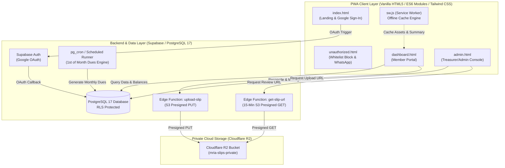
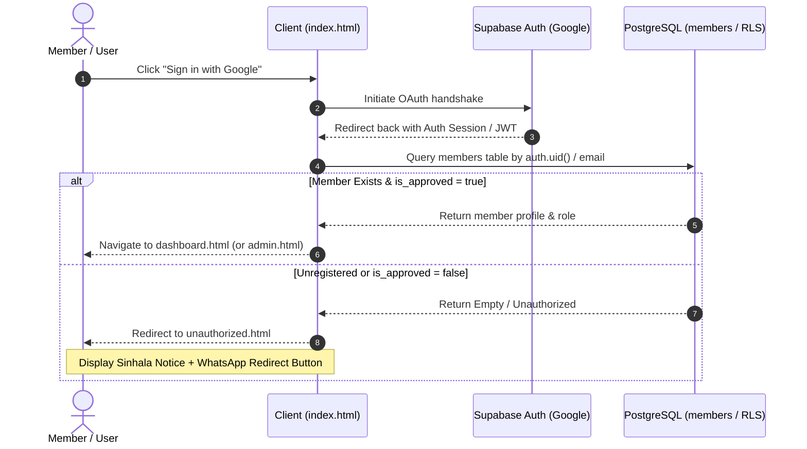
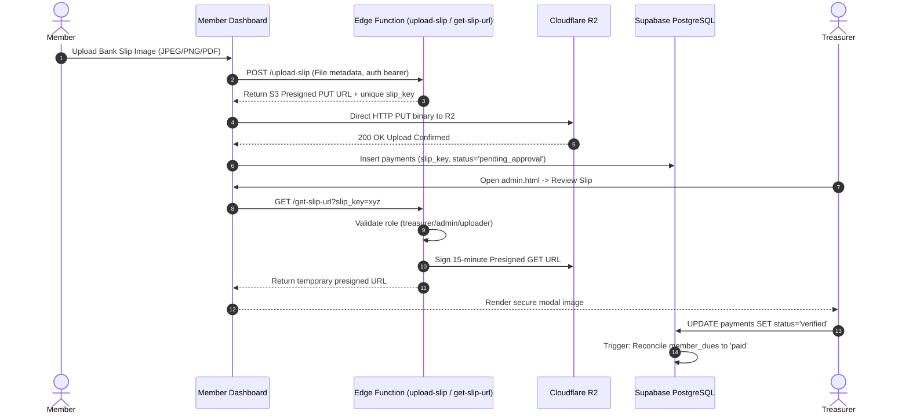

# MRIA Management Welfare Association PWA

* **Author:** kiyamaninfo-alt
* **Status:** Draft
* **Date:** 2026-11-08

---

## Overview

The MRIA Management Welfare Association (MRIA සුබසාධක කළමනාකරණ සංගමය) Progressive Web Application provides a centralized, mobile-first platform to manage community membership, monthly dues collection, bank slip verification, direct cash transactions, and bereavement welfare aid disbursements. The application serves both general association members and administrative officials across Sri Lanka, operating with bilingual support (Sinhala and English) and offline-tolerant dashboard caching.

## The Problem

Community welfare associations frequently struggle with manual record-keeping, delayed monthly contribution tracking, and chaotic verification of bank deposit slips sent over informal messaging channels. This causes several operational breakdowns:

1. **Untracked Defaulters & Revenue Leaks:** Without an automated ledger, tracking who has or has not paid monthly dues past the end of the month requires tedious manual reconciliation across paper logs or spreadsheets.
2. **Unverified & Scattered Payment Slips:** Members deposit funds via bank transfer or cash deposit machines (CDMs) and share screenshots over WhatsApp, leading to missed entries, lost receipts, and no verifiable audit trail.
3. **Discretion & Privacy in Debt Enforcement:** Exposing debt lists publicly causes friction among members, yet treasurers need an authoritative, private roster of overdue accounts to maintain the welfare fund.
4. **Welfare Benefit Distribution Integrity:** Processing urgent claims (such as bereavement aid) requires quick confirmation of a member's active standing, previous claims history, and eligibility.
5. **Accessibility & Connectivity Gaps:** Members require accessible mobile interfaces in their native language (Sinhala) that load reliably even under spotty mobile data connections.

## Goals

* **Automate Membership Ledger & Cutoff Rules:** Automatically generate monthly dues for active members and classify unpaid accounts as defaulters starting at 00:00:00 on the 1st of each month.
* **Streamline Slip Verification with Strict Privacy:** Allow members to upload bank slips into a private Cloudflare R2 bucket with 15-minute time-boxed presigned URLs for treasurer verification, preventing unauthorized access to financial documents.
* **Provide Immediate Cash Receipts:** Enable the treasurer to log physical cash payments in real time and generate verifiable digital receipts for members on the spot.
* **Enforce Strict Access Whitelisting:** Authenticate members via Google OAuth and block unregistered accounts with an immediate, polite Sinhala prompt directing them to the administrative WhatsApp line (`0759555924`).
* **Guarantee Confidential Defaulter Tracking:** Restrict visibility of unpaid member balances and defaulter lists exclusively to `admin`, `manager`, and `official` roles.
* **Deliver an Offline-Tolerant, Localized PWA:** Provide an installable Progressive Web App with instant language toggling (Sinhala / English) and offline read-only access to cached balances, announcements, and the official Bank QR code.

## Non-Goals

* **Automated Card Payment Gateways:** Direct integration with credit card processors (e.g., Stripe, PayHere) is out of scope; all payments occur via bank transfer slips or physical cash.
* **Offline Financial Write Queueing:** Members and treasurers cannot submit payment slips or record cash receipts while offline; financial mutations require verified server connectivity to prevent race conditions.
* **External SMS/Automated Calling Gateways:** Outbound telephony or automated SMS notifications are excluded; all member contact and fallback registration requests route directly to WhatsApp deep links.
* **Multi-Organization Multi-Tenancy:** The system is single-tenant and built exclusively for the MRIA Management Welfare Association.

## Open Questions

* **Question 1:** Should admission fees be split into installment options for new members, or must they be settled as a single lump-sum debit before membership activation?
* **Question 2:** Will benefit claim payouts be handled through direct bank transfers recorded manually by the treasurer, or does the system need a formal two-party approval (e.g., Manager reviews, Treasurer disburses)?

## Critical User Journeys (CUJs)

### CUJ 1: New Member Google Sign-In & Whitelist Rejection
* **Given**: A user has a Google account but has not yet been registered or approved in the `members` database table.
* **When**: The user clicks "Sign in with Google" on `index.html`.
* **Then**: The system detects the unregistered email, suppresses dashboard access, redirects to `unauthorized.html`, displays the localized notice ("ඔබ තවමත් MRIA සුබසාධක සංගමයේ ලියාපදිංචි වී නොමැත..."), and presents a one-click WhatsApp contact button pointing to `https://wa.me/94759555924`.

### CUJ 2: Member Monthly Due Settlement via Bank QR & Slip Upload
* **Given**: An approved member logs into `dashboard.html` and sees an outstanding monthly due for the current billing cycle.
* **When**: The member scans the displayed Bank QR code, transfers funds via their mobile banking app, uploads a screenshot of the transfer slip, and clicks "Submit for Verification".
* **Then**: The slip is uploaded to Cloudflare R2 under an obfuscated object key (`slip_key`), a `pending_approval` payment record is inserted into Supabase, and the member's dashboard reflects the pending status with offline-cached visibility.

### CUJ 3: Treasurer Slip Review & Verification
* **Given**: A treasurer accesses `admin.html` and views the "Pending Slips" queue.
* **When**: The treasurer clicks "Review Slip" on an entry.
* **Then**: The frontend requests a temporary 15-minute presigned URL from the `get-slip-url` Edge Function, displays the slip in a secure modal, and upon clicking "Approve", marks the payment as `verified`, reconciles the associated `member_dues` row to `paid`, and updates the member's balance.

### CUJ 4: Treasurer Direct Cash Collection
* **Given**: A member physically hands cash to the treasurer for monthly dues or an admission fee.
* **When**: The treasurer selects the member in `admin.html`, enters the amount, selects "Direct Cash", and submits the form.
* **Then**: The system immediately creates a `verified` payment record, marks the corresponding due as `paid`, and renders a downloadable/shareable digital receipt.

### CUJ 5: End-of-Month Defaulter Transition & Restricted Viewing
* **Given**: A member has an unpaid due on the final calendar day of the month at 23:59:59.
* **When**: The clock advances to 00:00:00 on the 1st of the subsequent month.
* **Then**: The system flags the account as a defaulter. General members cannot see the defaulter status of any peer, while administrators, managers, and officials viewing `admin.html` see the overdue member in the restricted Defaulters Roster.


## Technical Plan (Architecture)

### 1. High-Level System Architecture

The application is structured as a decoupled, serverless Progressive Web Application comprising a static client layer, a relational backend with automated scheduling, and private cloud object storage.



### 2. End-to-End Sequence Workflows

#### A. Google OAuth Sign-In & Whitelist Verification Flow


#### B. Bank Slip Upload & Private Presigned Verification Flow


### 3. Database Schema Specification (PostgreSQL 17)

All relational models reside within the public schema, protected by Row Level Security (RLS) policies.

```sql
-- 1. ROLES ENUM
CREATE TYPE app_role AS ENUM ('admin', 'manager', 'official', 'treasurer', 'member');
CREATE TYPE payment_status AS ENUM ('pending_approval', 'verified', 'rejected');
CREATE TYPE payment_method_type AS ENUM ('bank_transfer', 'cash');
CREATE TYPE payment_category AS ENUM ('monthly_due', 'admission_fee', 'donation');
CREATE TYPE claim_status AS ENUM ('submitted', 'under_review', 'approved', 'rejected', 'disbursed');

-- 2. MEMBERS / PROFILES
CREATE TABLE public.members (
    id UUID PRIMARY KEY DEFAULT gen_random_uuid(),
    user_id UUID UNIQUE REFERENCES auth.users(id) ON DELETE SET NULL,
    email TEXT UNIQUE NOT NULL,
    full_name TEXT NOT NULL,
    phone TEXT NOT NULL,
    nic TEXT,
    address TEXT,
    is_legacy_member BOOLEAN NOT NULL DEFAULT false,
    is_approved BOOLEAN NOT NULL DEFAULT false,
    role app_role NOT NULL DEFAULT 'member',
    created_at TIMESTAMPTZ NOT NULL DEFAULT now(),
    updated_at TIMESTAMPTZ NOT NULL DEFAULT now()
);

-- 3. USER ROLES (RBAC mapping)
CREATE TABLE public.user_roles (
    id UUID PRIMARY KEY DEFAULT gen_random_uuid(),
    user_id UUID NOT NULL REFERENCES public.members(id) ON DELETE CASCADE,
    role app_role NOT NULL,
    assigned_by UUID REFERENCES public.members(id),
    created_at TIMESTAMPTZ NOT NULL DEFAULT now(),
    UNIQUE(user_id, role)
);

-- 4. MONTHLY DUES LEDGER
CREATE TABLE public.member_dues (
    id UUID PRIMARY KEY DEFAULT gen_random_uuid(),
    member_id UUID NOT NULL REFERENCES public.members(id) ON DELETE CASCADE,
    billing_month DATE NOT NULL, -- Stored as YYYY-MM-01
    amount NUMERIC(10, 2) NOT NULL,
    status TEXT NOT NULL CHECK (status IN ('pending', 'paid', 'waived')) DEFAULT 'pending',
    created_at TIMESTAMPTZ NOT NULL DEFAULT now(),
    updated_at TIMESTAMPTZ NOT NULL DEFAULT now(),
    UNIQUE(member_id, billing_month)
);

-- 5. PAYMENTS & TRANSACTIONS
CREATE TABLE public.payments (
    id UUID PRIMARY KEY DEFAULT gen_random_uuid(),
    member_id UUID NOT NULL REFERENCES public.members(id) ON DELETE RESTRICT,
    amount NUMERIC(10, 2) NOT NULL CHECK (amount > 0),
    payment_type payment_category NOT NULL,
    payment_method payment_method_type NOT NULL,
    slip_key TEXT, -- Cloudflare R2 object key (e.g., "slips/2026-11/uuid.jpg")
    status payment_status NOT NULL DEFAULT 'pending_approval',
    verified_by UUID REFERENCES public.members(id),
    verified_at TIMESTAMPTZ,
    notes TEXT,
    created_at TIMESTAMPTZ NOT NULL DEFAULT now()
);

-- 6. DUES RECONCILIATION MAPPING
CREATE TABLE public.payment_dues_reconciliation (
    id UUID PRIMARY KEY DEFAULT gen_random_uuid(),
    payment_id UUID NOT NULL REFERENCES public.payments(id) ON DELETE CASCADE,
    due_id UUID NOT NULL REFERENCES public.member_dues(id) ON DELETE RESTRICT,
    allocated_amount NUMERIC(10, 2) NOT NULL CHECK (allocated_amount > 0),
    created_at TIMESTAMPTZ NOT NULL DEFAULT now()
);

-- 7. WELFARE BENEFIT TYPES (Extensible Schema)
CREATE TABLE public.benefit_types (
    id UUID PRIMARY KEY DEFAULT gen_random_uuid(),
    code TEXT UNIQUE NOT NULL, -- e.g., 'DEATH_AID', 'MEDICAL_AID'
    title_en TEXT NOT NULL,
    title_si TEXT NOT NULL,
    description_en TEXT,
    description_si TEXT,
    max_amount NUMERIC(10, 2) NOT NULL,
    is_active BOOLEAN NOT NULL DEFAULT true,
    created_at TIMESTAMPTZ NOT NULL DEFAULT now()
);

-- 8. BENEFIT CLAIMS
CREATE TABLE public.benefit_claims (
    id UUID PRIMARY KEY DEFAULT gen_random_uuid(),
    member_id UUID NOT NULL REFERENCES public.members(id) ON DELETE RESTRICT,
    benefit_type_id UUID NOT NULL REFERENCES public.benefit_types(id) ON DELETE RESTRICT,
    claim_amount NUMERIC(10, 2) NOT NULL,
    disbursed_amount NUMERIC(10, 2) DEFAULT 0,
    status claim_status NOT NULL DEFAULT 'submitted',
    approved_by UUID REFERENCES public.members(id),
    disbursed_by UUID REFERENCES public.members(id),
    disbursed_at TIMESTAMPTZ,
    notes TEXT,
    created_at TIMESTAMPTZ NOT NULL DEFAULT now()
);

-- 9. ANNOUNCEMENTS / NOTICE BOARD
CREATE TABLE public.announcements (
    id UUID PRIMARY KEY DEFAULT gen_random_uuid(),
    title_en TEXT NOT NULL,
    title_si TEXT NOT NULL,
    content_en TEXT NOT NULL,
    content_si TEXT NOT NULL,
    priority TEXT NOT NULL CHECK (priority IN ('normal', 'urgent')) DEFAULT 'normal',
    is_pinned BOOLEAN NOT NULL DEFAULT false,
    created_by UUID REFERENCES public.members(id),
    created_at TIMESTAMPTZ NOT NULL DEFAULT now()
);

-- 10. SYSTEM CONFIGURATION & SETTINGS
CREATE TABLE public.system_settings (
    key TEXT PRIMARY KEY,
    value JSONB NOT NULL,
    description TEXT,
    updated_at TIMESTAMPTZ NOT NULL DEFAULT now(),
    updated_by UUID REFERENCES public.members(id)
);
```

### 4. Row Level Security (RLS) Policy Matrix

| Table | Policy Scope | Operations | Allowed Roles | Invariant Logic |
| :--- | :--- | :--- | :--- | :--- |
| `members` | Self Read | `SELECT` | `authenticated` | `auth.uid() = user_id` |
| `members` | Admin Full Access | `SELECT, INSERT, UPDATE, DELETE` | `admin, manager` | Role check via `members.role` |
| `member_dues` | Self Read | `SELECT` | `member` | `member_id = (SELECT id FROM members WHERE user_id = auth.uid())` |
| `member_dues` | Defaulter Roster Access | `SELECT, UPDATE` | `admin, manager, official, treasurer` | General members cannot view peers' dues |
| `payments` | Self View & Insert | `SELECT, INSERT` | `member` | Can view own payments, upload slips under own ID |
| `payments` | Treasurer Verification | `SELECT, UPDATE` | `admin, treasurer` | Can verify or reject slips, enter cash payments |
| `benefit_types` | Public Active Read | `SELECT` | `authenticated` | `is_active = true` visible to all |
| `benefit_claims` | Self View & Submit | `SELECT, INSERT` | `member` | Own claims visible |
| `benefit_claims` | Disburse & Review | `SELECT, UPDATE` | `admin, manager, treasurer` | Authorized review team |
| `announcements` | General Read | `SELECT` | `authenticated` | Visible to all approved members |
| `announcements` | Publishing | `INSERT, UPDATE, DELETE` | `admin, manager` | Restricted to governance roles |
| `system_settings` | Read Public Config | `SELECT` | `authenticated` | Public keys (QR image, fee values) |

### 5. Database Triggers & Stored Functions

#### A. Initial Administrator & Google Auth Linker Trigger
```sql
CREATE OR REPLACE FUNCTION public.handle_auth_user_created()
RETURNS TRIGGER AS $$
DECLARE
    matched_member_id UUID;
    is_root_admin BOOLEAN := false;
BEGIN
    -- Check if user matches the bootstrapped admin
    IF NEW.email = 'krishaja@gmail.com' THEN
        is_root_admin := true;
    END IF;

    -- Look for pre-registered member record
    SELECT id INTO matched_member_id FROM public.members WHERE email = NEW.email;

    IF matched_member_id IS NOT NULL THEN
        UPDATE public.members
        SET user_id = NEW.id,
            is_approved = CASE WHEN is_root_admin THEN true ELSE is_approved END,
            role = CASE WHEN is_root_admin THEN 'admin'::app_role ELSE role END,
            updated_at = now()
        WHERE id = matched_member_id;
    ELSIF is_root_admin THEN
        -- Seed root admin if missing
        INSERT INTO public.members (user_id, email, full_name, phone, is_approved, role)
        VALUES (NEW.id, NEW.email, 'Primary Administrator', '0759555924', true, 'admin');
    END IF;

    RETURN NEW;
END;
$$ LANGUAGE plpgsql SECURITY DEFINER;

CREATE TRIGGER on_auth_user_created
AFTER INSERT ON auth.users
FOR EACH ROW EXECUTE FUNCTION public.handle_auth_user_created();
```

#### B. Monthly Dues Generation Routine (1st of Each Month)
```sql
CREATE OR REPLACE FUNCTION public.generate_monthly_dues_for_period(target_date DATE)
RETURNS INTEGER AS $$
DECLARE
    due_amount NUMERIC(10, 2);
    first_of_month DATE := date_trunc('month', target_date)::DATE;
    inserted_count INTEGER := 0;
BEGIN
    -- Fetch active due amount from settings (default 500.00 LKR)
    SELECT COALESCE((value->>'amount')::NUMERIC, 500.00) INTO due_amount
    FROM public.system_settings WHERE key = 'monthly_due_amount';

    INSERT INTO public.member_dues (member_id, billing_month, amount, status)
    SELECT m.id, first_of_month, due_amount, 'pending'
    FROM public.members m
    WHERE m.is_approved = true
    ON CONFLICT (member_id, billing_month) DO NOTHING;

    GET DIAGNOSTICS inserted_count = ROW_COUNT;
    RETURN inserted_count;
END;
$$ LANGUAGE plpgsql SECURITY DEFINER;
```

### 6. Cloudflare R2 Integration & Edge Functions

Private S3 bucket: `mria-slips-private` (No public bucket exposure).

* **`upload-slip` Edge Function:**
  1. Validates caller JWT from Supabase Auth.
  2. Generates an object key: `slips/YYYY-MM/{member_id}_{nanoid()}.{ext}`.
  3. Uses AWS SDK v3 `@aws-sdk/s3-request-presigner` configured with Cloudflare R2 credentials (`R2_ACCOUNT_ID`, `R2_ACCESS_KEY_ID`, `R2_SECRET_ACCESS_KEY`).
  4. Returns `{ uploadUrl, slipKey }`. Presigned upload URL expires in 10 minutes.
* **`get-slip-url` Edge Function:**
  1. Validates caller JWT.
  2. Queries `payments` table by `slip_key`.
  3. Verifies authorization: caller must be the uploader member, or hold role `admin`, `manager`, or `treasurer`.
  4. Generates a presigned `GetObjectCommand` URL strictly expiring in 15 minutes (900 seconds).
  5. For root admin (`krishaja@gmail.com`), logs audit record and issues on-demand signed URL.

### 7. Design System Specifications (Golden Ratio 1.618 & Minimalist White)

* **Mathematical Typography Scale:**
  * Base Font: `16px` (1rem)
  * Micro (Badges, Timestamps, Captions): `10px` (~9.88px)
  * Body / Input / Action: `16px` (1.000)
  * Subheading / Card Title / Metric Label: `26px` (1.618)
  * Section Heading: `42px` (2.618)
  * Display / Hero Metric: `68px` (4.236)
* **Fibonacci Layout Spacing Scale:**
  * Margins, paddings, and component gaps map strictly to: `8px`, `13px`, `21px`, `34px`, `55px`, `89px`.
* **Color Palette Token Matrix:**
  * Primary Surface: `#FFFFFF` (Pure White)
  * Secondary Surface / Canvas: `#F8FAFC` (Slate 50)
  * Borders / Dividers: `#E2E8F0` (Slate 200) and `#F1F5F9` (Slate 100)
  * Primary Typography: `#0F172A` (Slate 900)
  * Secondary Typography: `#64748B` (Slate 500)
  * Interactive Accent: `#0284C7` (Sky 600)
  * Verified / Paid State: `#10B981` (Emerald 500)
  * Overdue / Defaulter State: `#EF4444` (Rose 500)


## Alternatives Considered

### Alternative 1: Dynamic Dues Calculation vs. Recurring Monthly Ledger Table

* **Approach Evaluated:** Compute member balances dynamically at query time using the formula: `Balance = (months_since_joined * monthly_fee) + (admission_fee IF !is_legacy) - sum(verified_payments)`.
* **Pros:** Eliminates the need for recurring cron jobs, scheduled Edge Functions, or periodic database writes.
* **Cons:** Calculating balances across multi-year histories incurs progressive query latency degradation; does not allow line-item tracking, selective dues forgiveness, monthly fee rate changes over time, or point-in-time financial auditing.
* **Reason for Rejection:** An explicit monthly ledger (`member_dues`) guarantees immutability, individual monthly status tracking (`pending`, `paid`, `waived`), and historical financial auditing.

### Alternative 2: Supabase Storage vs. Private Cloudflare R2 Bucket with Presigned URLs

* **Approach Evaluated:** Store payment slip image files in Supabase Storage buckets using native Supabase storage RLS.
* **Pros:** Leverages the existing Supabase infrastructure without requiring a secondary cloud provider or external S3 credentials.
* **Cons:** Incurs standard Supabase egress bandwidth costs as slip uploads accumulate; public bucket access risks exposing sensitive banking slips with personal identification; native storage signed URLs lack fine-grained, time-boxed cryptographic control without complex proxy layers.
* **Reason for Rejection:** Cloudflare R2 provides zero egress bandwidth fees and full S3 API compatibility. Managing private object keys (`slip_key`) coupled with 15-minute presigned URLs via Edge Functions guarantees zero public exposure and strict least-privilege access for treasurers and members.

### Alternative 3: Fixed 31st Calendar Day vs. Dynamic End-of-Month Invariant

* **Approach Evaluated:** Hardcode the monthly payment deadline strictly to day 31 of each month.
* **Pros:** Matches informal conversational phrasing used by association members.
* **Cons:** Fails across 5 out of 12 months (February 28/29, April 30, June 30, September 30, November 30). On shorter months, a fixed "31st" check causes runtime date parsing exceptions, misses defaulter classification, or delays enforcement until the following month.
* **Reason for Rejection:** Replaced by an automated end-of-month calendar boundary triggering at 23:59:59 on the final calendar day of each month, cleanly handling leap years and 30-day months.

### Alternative 4: Offline Financial Mutation Queue vs. Strict Online Financial Enforcement

* **Approach Evaluated:** Allow members to upload slips and treasurers to record cash receipts while offline using IndexedDB, syncing when connectivity resumes.
* **Pros:** Permits form submissions under intermittent connectivity.
* **Cons:** Offline financial queues introduce race conditions, stale balance calculations, out-of-order ledger reconciliation, and duplicate payment submissions when network handshakes flutter.
* **Reason for Rejection:** Financial mutations require authoritative, real-time server verification. Offline PWA capabilities are strictly confined to read-only views of cached balances, announcements, and the Bank QR code.

### Alternative 5: Commercial Payment Gateway vs. Bank QR & Slip Verification

* **Approach Evaluated:** Integrate a commercial online payment processor (e.g., PayHere, Stripe, WebXPay).
* **Pros:** Instant automated reconciliation without manual treasurer approval.
* **Cons:** Payment gateways deduct 2.5% to 3.5% in transaction fees, reducing community welfare funds; requires formalized corporate merchant banking registrations that voluntary community associations often cannot fulfill; excludes members depositing cash via CDMs.
* **Reason for Rejection:** The zero-fee Bank QR code and slip verification workflow preserves 100% of association capital and accommodates both online banking apps and physical cash deposit slips.

---

## Non-Functional Requirements

### 1. Security & Privacy
* **Financial Slip Confidentiality:** Bank slip files in Cloudflare R2 are strictly private. Direct public bucket URLs are prohibited. Presigned URLs expire after 15 minutes (900 seconds) and are issued only after validating the caller's JWT against the payment record or administrative roles.
* **Defaulter Privacy Protection:** Overdue member listings are protected by PostgreSQL RLS. General members can view only their own ledger records; only `admin`, `manager`, `official`, and `treasurer` roles can access the overdue roster.
* **Google OAuth Whitelist Isolation:** Unapproved authenticated sessions are gated at the database layer (RLS returns empty sets) and at the application routing layer (redirect to `unauthorized.html`).

### 2. Performance & Mobile Optimization
* **Lightweight PWA Footprint:** Total initial bundle (HTML, Vanilla JS modules, compiled Tailwind CSS) is constrained to under 150 KB gzip to guarantee sub-second load times on 3G/4G cellular connections across Sri Lanka.
* **Caching Strategy:** Service Worker employs Stale-While-Revalidate for static assets, Bank QR images, and announcements, while balance queries and payment submissions use Network-Only with an offline fallback indicator.

### 3. Maintainability & Internationalization
* **Zero Heavy Framework Dependencies:** Pure Vanilla HTML5 and ES6 modules eliminate bundler churn and dependency deprecation cycles.
* **Modular i18n Dictionary:** Translation strings for English and Sinhala are decoupled in `js/i18n.js` with declarative `data-i18n` attributes in HTML templates.


## Detailed Implementation Plan

### Target Files to Create/Modify

#### 1. Database Migrations & Seed Scripts

* **`./supabase/migrations/20261108000001_initial_schema.sql`** (`Create`)
  * **Scope:** PostgreSQL 17 Relational Schema.
  * **Rationale:** Establishes core data models: custom ENUM types (`app_role`, `payment_status`, `payment_method_type`, `payment_category`, `claim_status`), `members`, `user_roles`, `member_dues`, `payments`, `payment_dues_reconciliation`, `benefit_types`, `benefit_claims`, `announcements`, and `system_settings` with foreign key cascades and integrity constraints.
* **`./supabase/migrations/20261108000002_rls_policies.sql`** (`Create`)
  * **Scope:** Security & Row Level Security Policies.
  * **Rationale:** Enforces table-level RLS to guarantee data isolation. Restricts peer dues and the defaulter roster to `admin`, `manager`, `official`, and `treasurer`; restricts payment slip access to uploader and financial officials.
* **`./supabase/migrations/20261108000003_triggers_and_functions.sql`** (`Create`)
  * **Scope:** Database Triggers & Stored Procedures.
  * **Rationale:** Implements `handle_auth_user_created` trigger for dynamic Google OAuth account linking and root admin bootstrap (`krishaja@gmail.com`); provides `generate_monthly_dues_for_period` stored procedure for automated 1st-of-month dues generation.
* **`./supabase/seed.sql`** (`Create`)
  * **Scope:** Initial Seed Data.
  * **Rationale:** Seeds root administrator record (`krishaja@gmail.com`), initial system settings (`monthly_due_amount = 500`, `admission_fee_amount = 1000`, `contact_phone = '0759555924'`), and default welfare benefit type (`DEATH_AID` / `මරණාධාර`).

#### 2. Supabase Edge Functions (Deno / TypeScript)

* **`./supabase/functions/upload-slip/index.ts`** (`Create`)
  * **Scope:** Serverless Cloudflare R2 Presigned Uploader.
  * **Rationale:** Validates caller JWT, verifies file MIME type (JPEG/PNG/PDF), initializes AWS S3 SDK v3 client pointed at Cloudflare R2 endpoint, and generates a 10-minute presigned PUT URL and randomized object key (`slip_key`).
* **`./supabase/functions/get-slip-url/index.ts`** (`Create`)
  * **Scope:** Secure 15-Minute Presigned Retrieval Endpoint.
  * **Rationale:** Validates caller JWT and checks authorization against the `payments` table. Issues a 15-minute presigned `GetObjectCommand` URL for authorized members, managers, and treasurers. Permits on-demand signed URL generation for the root administrator (`krishaja@gmail.com`).
* **`./supabase/functions/monthly-dues-cron/index.ts`** (`Create`)
  * **Scope:** Scheduled Cron Runner.
  * **Rationale:** Triggered at 00:00:00 UTC on the 1st of each month via Supabase scheduled cron to invoke `generate_monthly_dues_for_period()`.

#### 3. Progressive Web Application (PWA) Views

* **`./index.html`** (`Create`)
  * **Scope:** Landing & Authentication Portal (Stitch MCP Scaffolded).
  * **Rationale:** Public entry point featuring association branding, bilingual toggle (EN/SI), value proposition, and the primary "Sign in with Google" OAuth button styled with Golden Ratio typography and Fibonacci spacing.
* **`./unauthorized.html`** (`Create`)
  * **Scope:** Whitelist Blocked Screen (Stitch MCP Scaffolded).
  * **Rationale:** Gated landing displayed when an unregistered email signs in. Renders the polite Sinhala advisory ("ඔබ තවමත් MRIA සුබසාධක සංගමයේ ලියාපදිංචි වී නොමැත...") and the direct WhatsApp redirection button pointing to `https://wa.me/94759555924`.
* **`./dashboard.html`** (`Create`)
  * **Scope:** Authenticated Member Portal (Stitch MCP Scaffolded).
  * **Rationale:** Displays member standing, total balance, pending monthly dues, official Bank QR code display, slip upload modal, benefit claims tracker (bereavement aid), pinned announcements, and historical payment receipts.
* **`./admin.html`** (`Create`)
  * **Scope:** Governance & Financial Management Console (Stitch MCP Scaffolded).
  * **Rationale:** Restricted to administrative roles (`admin`, `manager`, `official`, `treasurer`). Houses the pending slip verification queue with image review modal, direct cash receipt logger, restricted post-cutoff defaulters roster, role allocator, and Bank QR image manager.
* **`./manifest.json`** (`Create`)
  * **Scope:** PWA Application Manifest.
  * **Rationale:** Declares app metadata, icon references (`icon-192.png`, `icon-512.png`), theme color (`#0284C7`), background color (`#FFFFFF`), and display mode (`standalone`) for mobile installation.
* **`./sw.js`** (`Create`)
  * **Scope:** Service Worker Offline Cache Engine.
  * **Rationale:** Pre-caches static shell assets, Bank QR image, and announcements using Stale-While-Revalidate caching. Intercepts fetch requests and renders an offline fallback indicator when financial mutation endpoints are invoked without network access.

#### 4. Modular Client-Side JavaScript Modules (ES6)

* **`./js/config.js`** (`Create`)
  * **Scope:** Environment Configuration & Constants.
  * **Rationale:** Centralizes Supabase project URL, publishable anonymous key, Cloudflare R2 bucket identifier, and app-wide configuration constants.
* **`./js/auth.js`** (`Create`)
  * **Scope:** Authentication & Session Management.
  * **Rationale:** Wraps `@supabase/supabase-js` authentication methods, initiates Google OAuth redirects, listens to `onAuthStateChange`, verifies user email against `members`, and enforces whitelist redirection to `unauthorized.html`.
* **`./js/api.js`** (`Create`)
  * **Scope:** Relational Data Access Layer.
  * **Rationale:** Executes database queries against Supabase: fetching member dues, balance calculation, submitting payment records, retrieving announcements, querying benefit claims, and executing treasurer approvals.
* **`./js/storage.js`** (`Create`)
  * **Scope:** Cloudflare R2 Client Bridge.
  * **Rationale:** Coordinates with the `upload-slip` and `get-slip-url` Edge Functions to perform direct binary uploads to Cloudflare R2 and retrieve temporary 15-minute viewing URLs.
* **`./js/i18n.js`** (`Create`)
  * **Scope:** Bilingual Localization Engine.
  * **Rationale:** Houses the complete English and Sinhala translation dictionary. Parses all DOM elements marked with `data-i18n` attributes, toggles languages on button click, and persists language preference in `localStorage`.
* **`./js/receipt.js`** (`Create`)
  * **Scope:** Digital Receipt Formatter & Printer.
  * **Rationale:** Generates clean, printable/downloadable digital receipts for verified cash and bank transfer payments, displaying association name, member details, transaction timestamp, payment method, and verification official.
* **`./js/ui.js`** (`Create`)
  * **Scope:** Common UI Interactions & Alerts.
  * **Rationale:** Manages modal state transitions, toast alerts, offline detection banners (`navigator.onLine`), and Golden Ratio layout adjustments.

#### 5. Configuration & Project Documentation

* **`./.env.example`** (`Modify`)
  * **Scope:** Environment Credentials Template.
  * **Rationale:** Adds documentation for Cloudflare R2 variables (`R2_ACCOUNT_ID`, `R2_ACCESS_KEY_ID`, `R2_SECRET_ACCESS_KEY`, `R2_BUCKET_NAME`) alongside Supabase keys.
* **`./README.md`** (`Modify`)
  * **Scope:** Project Documentation.
  * **Rationale:** Documents installation steps, Supabase migration deployment, Edge Function deployment commands, Cloudflare R2 setup, and PWA testing instructions.

---

## Verification Plan

### 1. Database Migrations & RLS Validation
* **Schema Application:** Apply migrations sequentially using Supabase CLI:
  ```bash
  supabase db reset
  ```
* **Trigger Verification:** Execute test query confirming root admin `krishaja@gmail.com` is seeded with `is_approved = true` and `role = 'admin'`.
* **RLS Isolation Test:** 
  * Query `member_dues` as an unprivileged member session; assert that only records where `member_id = auth.uid()` are returned.
  * Query `member_dues` as an admin session; assert that all member dues are visible.

### 2. Dues Ledger & Defaulter Automation Test
* **Scheduled Function Execution:** Trigger `generate_monthly_dues_for_period('2026-11-01')`.
* **Assertion:** Confirm a pending due record is generated for every active approved member.
* **Defaulter Cutoff Logic:** Query overdue accounts with `status = 'pending'` where current date > end-of-month calendar boundary; verify the list matches the restricted Defaulters Roster in `admin.html`.

### 3. Cloudflare R2 Presigned Access Test
* **Presigned PUT:** Invoke `upload-slip` with valid JWT; upload test JPEG binary using `curl -X PUT --upload-file`; assert `200 OK` from Cloudflare R2.
* **Presigned GET:** Invoke `get-slip-url?slip_key=...` as treasurer; verify returned URL is accessible and expires after 15 minutes.
* **Unauthorized Access Test:** Attempt to access `get-slip-url` with an unauthenticated session; assert `401 Unauthorized`. Attempt to access another member's slip as a regular member; assert `403 Forbidden`.

### 4. Client-Side & PWA Offline Verification
* **Whitelist Gate Test:** Sign in with an un-whitelisted Google account; assert immediate redirection to `unauthorized.html` displaying the Sinhala message and WhatsApp button.
* **Offline Caching:** Disconnect network in browser DevTools; assert `dashboard.html` loads cached balances, announcements, and the Bank QR image.
* **Offline Mutation Blocking:** Attempt to upload a slip while offline; assert that submission is prevented and the offline alert banner is displayed.
* **Bilingual Toggle Test:** Click language toggle button; assert all text with `data-i18n` instantly switches between English and Sinhala without full page reload.
