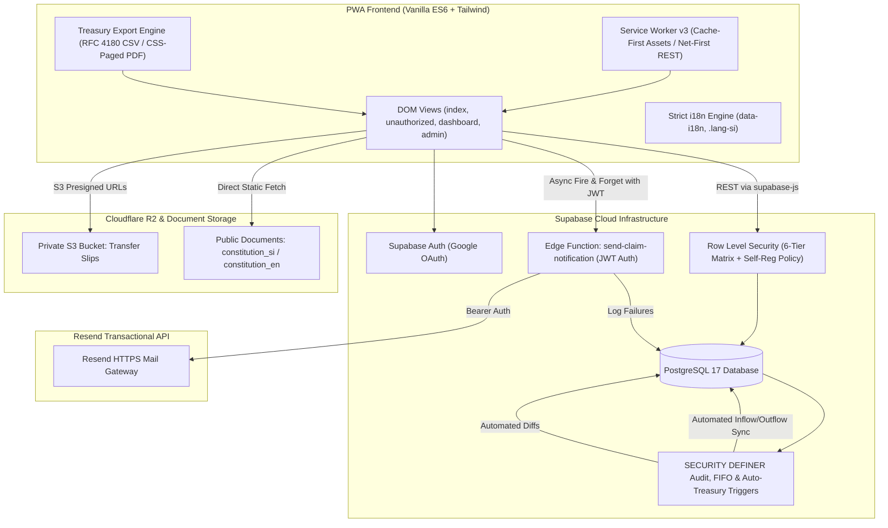
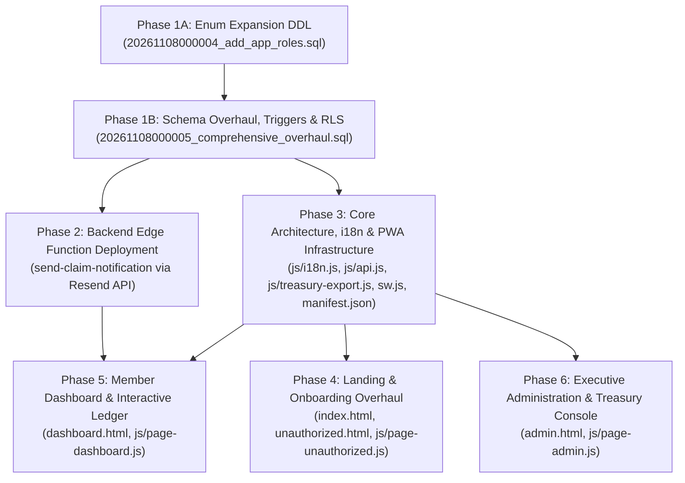

# MRIA Management Welfare Association PWA: Comprehensive Redesign & Architectural Overhaul

* **Author:** kiyamaninfo-alt
* **Status:** Approved (Post-Review Remediated)
* **Date:** 2026-11-08

--------------------------------------------------------------------------------

## Overview

The Mattala Rajapaksa International Airport (MRIA) Management Welfare Association ("MRIA කළමනාකාර සුබසාධක සංගමය") operates an internal statutory welfare society for airport management staff. This design document establishes the comprehensive architectural overhaul of the association's Progressive Web Application (PWA).

The upgraded platform is built with Vanilla HTML5, Vanilla ES6 JavaScript modules, Tailwind CSS, Supabase (PostgreSQL 17), and Cloudflare R2 object storage. It replaces legacy manual coordination with an automated, auditable, offline-capable member self-service and treasury management system. The overhaul encompasses six foundational pillars: statutory identity & contact CMS, strict single-language localization, multi-platform PWA installation, a 6-tier granular Role-Based Access Control (RBAC) matrix, an interactive member ledger with asynchronous welfare claim dispatch, and an immutable audit trail with an automated, asset-segregated treasury ledger and reporting engine.

## The Problem

The existing digital prototype and operational workflow suffer from critical functional, statutory, and ergonomic limitations:

1. **Brand Inconsistency & Public Exposure of Private Contacts:** 
   The application displays conflicting nomenclature ("MRIA සුබසාධක සංගමය" vs. "MRIA සුබසාධක කළමනාකරණ සංගමය"), references outdated build tags and restrictive airport domain disclaimers, and publicly exposes private executive telephone numbers instead of institutional routing channels. The official administrative liaison email `krishaja@gmail.com` must serve as the primary institutional routing channel. Digital vouchers also contain legacy references to SMS delivery, which is unsupported.
2. **Mixed-Language User Interface:** 
   The interface currently displays English and Sinhala text simultaneously within identical containers, violating clean localization principles and cluttering mobile viewports.
3. **Rigid Role-Based Access Control & Incomplete Identity Models:** 
   The database role matrix lacks dedicated tiers for the Secretary (`secretary` / ලේකම්) and Committee Members (`committee_member`). Member identity records lack statutory airport attributes—specifically the EPF Number (Employees' Provident Fund - සේවක අර්ථසාධක අරමුදල) and Airport Designation—as well as NIC (National Identity Card - ජාතික හැඳුනුම්පත), preventing formal administrative roster synchronization.
4. **Synchronous Notification Bottlenecks:** 
   Welfare claim lodgments lack automated committee alerting. Introducing third-party notification gateways synchronously risks aborting critical bereavement claims if the external mail service suffers latency or rate-limiting.
5. **Absence of Forensic Audit Trails:** 
   Administrative actions (such as role modifications, slip verifications, and dues waivers) lack an immutable, append-only database audit log, creating governance and accountability risks.
6. **Unsegregated Treasury Operations & Lack of Reporting:** 
   The treasury lacks transactional asset segregation between Bank of Ceylon operating savings, cash held by the Treasurer awaiting deposit, and long-term Fixed Deposits. Furthermore, the Treasurer cannot generate filtered statements (monthly, yearly, or custom date range) in CSV or printable PDF formats for formal executive audit meetings.

## Goals

* **Strict Single-Language i18n:** Enforce 100% linguistic isolation so that selecting Sinhala renders zero English (except standardized technical loanwords), and selecting English renders zero Sinhala, with instant reactive DOM swapping and script-aware line-height adjustments (`.lang-si`).
* **Granular 6-Tier RBAC:** Implement formal permissions for `admin`, `manager`, `secretary`, `treasurer`, `committee_member`, and `member` via Supabase Row Level Security (RLS) policies and dynamic UI route guards. Regular members have self-service read access with column-level update protection mediated by database triggers.
* **Statutory Airport Identity & Hybrid Onboarding:** Capture and display Full Name, EPF Number (Employees' Provident Fund), and Airport Designation across all profile headers, receipts, and admin rosters. Retain surrogate primary key integrity (`members.id UUID PRIMARY KEY DEFAULT gen_random_uuid()`) with a nullable `user_id UUID UNIQUE REFERENCES auth.users(id)` to support Secretary pre-seeding and automatic OAuth binding upon first login, backed by an in-app registration request modal on `unauthorized.html`.
* **Asynchronous Resend Email Notification:** Dispatch automated claim lodgment notices to all committee officials via an asynchronous Edge Function (`send-claim-notification`), ensuring claims commit to PostgreSQL unconditionally while logging delivery failures to the audit trail.
* **Immutable Database Audit Trail:** Establish an append-only `audit_logs` table protected by PostgreSQL row-level `BEFORE UPDATE OR DELETE` triggers and a statement-level `BEFORE TRUNCATE` trigger, capturing automated diffs with safe system fallback (`COALESCE(auth.jwt() ->> 'email', 'SYSTEM')`) for automated cron tasks.
* **Automated Asset-Segregated Treasury Ledger:** Track every inflow, outflow, and internal transfer across three distinct accounts (BOC Savings, Cash in Hand, Fixed Deposits) with automated trigger synchronization on verified payments and disbursed claims to eliminate dual-bookkeeping drift.
* **Treasury Statement Export Engine:** Enable the Treasurer to export date-filtered ledger statements (monthly, yearly, custom range) into RFC 4180 CSV and official printable PDF documents, complete with opening balance computation for prior periods.
* **Dual-Slot Statutory Constitution Documents:** Provide instant, language-aware Constitution access by serving paired documents (`constitution_si.pdf` / `constitution_en.pdf`) from `/assets/docs/` or a public storage bucket, eliminating unnecessary CMS complexity.
* **True Multi-Platform PWA:** Upgrade `manifest.json` and `sw.js` (v3) to deliver installation shortcuts for Windows, Linux, Android, and iOS, with cache-first delivery for official Bank QR codes, static scripts (including `treasury-export.js`), and web fonts.

## Non-Goals

* **Merchant Payment Gateways:** Automated integration with commercial credit/debit card merchant processors (e.g., Stripe, PayHere) is out of scope; payments remain processed via bank transfer slips and verified cash intake.
* **Outbound SMS Gateway:** Automated SMS messaging is excluded in favor of transactional email notifications and downloadable digital PDF receipts.
* **Direct Banking API Integrations:** Automated screen scraping or open-banking API integration with Bank of Ceylon is excluded; bank account balances are updated via slip approvals, cash receipts, and explicit transfer transactions.
* **Petty Cash Bookkeeping:** Tracking minor daily stationery or refreshment expenses is excluded from the system ledger; petty cash is accounted for at bulk replenishment/withdrawal intervals.

## Open Questions

*All core architectural questions raised during the brainstorming and review phases have been resolved:*
* *Q1 (Email Dispatch):* Resolved. Operates via Resend API gateway through Edge Function `send-claim-notification` asynchronously without blocking database transactions. Function validates caller JWT Bearer tokens and handles CORS preflight.
* *Q2 (EPF Onboarding):* Resolved. Implemented as a hybrid model: Secretary pre-seeding support via decoupled `user_id` + self-service registration modal on `unauthorized.html` backed by a scoped RLS INSERT policy.
* *Q3 (Treasury Accounting):* Resolved. Implemented as a transaction ledger (`treasury_transactions`) across 3 asset accounts automatically driven by triggers on verified payments and disbursed claims, with CSV and CSS-paged PDF exports supported by an opening-balance RPC.
* *Q4 (Constitution CMS):* Resolved. Simplified to lean static document hosting for `constitution_si.pdf` and `constitution_en.pdf` in `/assets/docs/` (or public Supabase Storage bucket `mria-documents`), eliminating unnecessary database tables and presigned URL pipelines.

## Critical User Journeys (CUJs)

### CUJ 1: Unregistered Airport Staff Member Onboarding & Secretary Verification
* **Given**: A newly hired Mattala Airport staff member signs in using their personal Google account for the first time.
* **When**: The user authenticates via Supabase OAuth and is redirected to `unauthorized.html` because their email is not yet approved.
* **Then**: 
  1. The user sees a clear status notice in their preferred language (Sinhala or English) and clicks "Register My Details".
  2. A modal opens with their name and email pre-filled; the user inputs their EPF Number, Airport Designation, and Phone Number, then submits.
  3. The record is inserted into `public.members` with `is_approved = false` and `role = 'member'` via the scoped `members_self_registration_insert` RLS policy (`auth.uid() = user_id`).
  4. The Secretary navigates to the Member Administration tab on `admin.html`, reviews the pending registration, verifies the EPF Number against the official airport roster, and clicks "Approve Member".
  5. The member record is updated to `is_approved = true`, logged to `audit_logs`, and the user is granted access to `dashboard.html` upon their next visit.

### CUJ 2: Member Welfare Aid Claim Submission & Asynchronous Committee Alerting
* **Given**: An active, approved member needs to request emergency bereavement aid for an immediate family member.
* **When**: The member navigates to `dashboard.html`, clicks "Request Welfare Aid", selects the benefit type, enters the requested amount, attaches supporting documentation via Cloudflare R2 upload, and submits the form.
* **Then**:
  1. The claim record commits immediately to `public.benefit_claims` with status `submitted`.
  2. The frontend triggers an asynchronous background request to Edge Function `${CONFIG.FUNCTIONS_URL}/send-claim-notification` passing the caller's JWT Bearer token.
  3. The Edge Function dispatches an HTML notification email via the Resend API to all users with roles `admin`, `manager`, `secretary`, `treasurer`, and `committee_member`.
  4. If the Resend API fails or is rate-limited, the claim remains safely committed in the database, and the error is appended to `public.audit_logs`.
  5. Committee members see the new claim on their administrative console for collective review and disbursement authorization.

### CUJ 3: Direct Cash Intake & Real-Time Treasury Ledger Rebalancing
* **Given**: A member pays their monthly membership dues in physical cash to the Treasurer at the airport administrative office.
* **When**: The Treasurer logs in, opens the Cash Collection Desk on `admin.html`, selects the member, verifies the transaction date and amount, and clicks "Issue Instant Cash Receipt".
* **Then**:
  1. A verified payment record is created in `public.payments` (`payment_method = 'cash'`, `status = 'verified'`).
  2. The database trigger `on_payment_verified_reconcile` (firing on `AFTER INSERT OR UPDATE`) immediately reconciles the payment against the member's oldest pending monthly due in `member_dues` using FIFO logic.
  3. The database trigger `trg_payments_sync_to_treasury` automatically records a corresponding inflow in `treasury_transactions` (`transaction_type = 'inflow'`, `destination_account_id = 'cash_in_hand'`, `payment_id = payments.id`), eliminating manual duplicate entries.
  4. An instant digital cash receipt opens in a printable modal with verified security stamps.
  5. The Treasurer's running "Cash in Hand" balance increments immediately. When the Treasurer subsequently deposits accumulated cash into the Bank of Ceylon account, they record a `transfer` transaction (`source_account_id = 'cash_in_hand'`, `destination_account_id = 'boc_savings'`), keeping the ledger balanced.

### CUJ 4: Periodic Treasury Audit & Custom Date-Filtered Export
* **Given**: The Treasurer needs to present a quarterly financial statement to the Executive Committee.
* **When**: The Treasurer navigates to the Society Treasury module on `admin.html`, selects the "Custom Date Range" filter, enters the start and end dates, and clicks "Export Statement".
* **Then**:
  1. The reporting engine invokes `public.get_treasury_statement(start_date, end_date)`, calculating the accurate opening balance of prior periods and querying line-item movements within the date boundaries.
  2. The Treasurer can click "Download CSV" to receive a standardized RFC 4180 file with ISO dates, decimal figures, and account identifiers for spreadsheet analysis.
  3. The Treasurer can click "Print Official PDF" to open a styled print window formatted with the association crest, date boundaries, categorized inflows/outflows, opening/closing balances across Savings, Cash in Hand, and Fixed Deposits, and a formal Treasurer certification signature box.

### CUJ 5: Language Toggle & Dual-Slot Constitution Access
* **Given**: A member prefers reading documents in Sinhala.
* **When**: The member clicks the language toggle button in the navigation bar.
* **Then**:
  1. All DOM elements with `data-i18n` update immediately to Sinhala without a page reload, and all lingering dual-language text nodes are systematically purged.
  2. The `.lang-si` class is applied to the document body, adjusting line heights and text scaling.
  3. When the member clicks "Download Association Constitution", the client immediately opens or downloads `/assets/docs/constitution_si.pdf`.
* **When**: The member clicks the language toggle button in the navigation bar.
* **Then**:
  1. All DOM elements with `data-i18n` update immediately to Sinhala without a page reload.
  2. The `.lang-si` class is applied to the document body, adjusting line heights and text scaling.
  3. When the member clicks "Download Association Constitution", the system detects the active language and downloads `constitution_si.pdf` sourced from Cloudflare R2.


--------------------------------------------------------------------------------

## Technical Plan (Architecture)

### 1. High-Level System Architecture

The application implements a decoupled, offline-resilient Progressive Web App architecture backed by Supabase Managed PostgreSQL 17, Cloudflare R2 object storage, and the Resend transactional email API.



---

### 2. Database Schema & Data Models

The relational schema is implemented across PostgreSQL migrations enforcing strict foreign key constraints, check invariants, and automated triggers.

#### A. Role Enumeration Migration (`app_role`)
PostgreSQL enforces that `ALTER TYPE ... ADD VALUE` cannot be used in subsequent DML statements within the same transaction block. To ensure zero breaking changes and reliable transactional execution, the role changes are partitioned across two discrete sequential migration files:

1. **`supabase/migrations/20261108000004_add_app_roles.sql` (Enum DDL):**
```sql
-- Committed DDL to expand enum types without transactional conflict
ALTER TYPE public.app_role ADD VALUE IF NOT EXISTS 'secretary';
ALTER TYPE public.app_role ADD VALUE IF NOT EXISTS 'committee_member';
```

2. **`supabase/migrations/20261108000005_comprehensive_overhaul.sql` (Data Migration & Schema Overhaul):**
```sql
-- Safe DML referencing newly committed enum values
UPDATE public.members 
SET role = 'committee_member' 
WHERE role = 'official';
```

#### B. Member Profiles Schema (`public.members`)
Augments the existing profile table with official statutory airport attributes while preserving pre-seeding primary key integrity:
* `id` UUID PRIMARY KEY DEFAULT gen_random_uuid()
* `user_id` UUID UNIQUE REFERENCES auth.users(id) ON DELETE SET NULL
* `email` VARCHAR(255) UNIQUE NOT NULL
* `full_name` VARCHAR(255) NOT NULL
* `epf_number` VARCHAR(50) UNIQUE NOT NULL -- Employees' Provident Fund (සේවක අර්ථසාධක අරමුදල)
* `designation` VARCHAR(150) NOT NULL
* `phone` VARCHAR(30) NOT NULL
* `nic` VARCHAR(20) -- National Identity Card (ජාතික හැඳුනුම්පත)
* `role` public.app_role NOT NULL DEFAULT 'member'
* `is_legacy_member` BOOLEAN NOT NULL DEFAULT FALSE
* `is_approved` BOOLEAN NOT NULL DEFAULT FALSE
* `created_at` TIMESTAMPTZ NOT NULL DEFAULT timezone('utc', now())
* `updated_at` TIMESTAMPTZ NOT NULL DEFAULT timezone('utc', now())

##### Zero-Downtime Phased Column Migration
To prevent migration crashes caused by `NOT NULL` constraints on pre-existing member rows, migration `20261108000005_comprehensive_overhaul.sql` executes in three phased steps:
```sql
-- Step 1: Add columns as nullable
ALTER TABLE public.members 
ADD COLUMN IF NOT EXISTS epf_number VARCHAR(50),
ADD COLUMN IF NOT EXISTS designation VARCHAR(150),
ADD COLUMN IF NOT EXISTS nic VARCHAR(20);

-- Step 2: Backfill existing administrative and legacy records
UPDATE public.members 
SET epf_number = 'EPF-0001', designation = 'System Administrator'
WHERE email = 'krishaja@gmail.com' AND (epf_number IS NULL OR designation IS NULL);

UPDATE public.members
SET epf_number = COALESCE(epf_number, 'EPF-' || substring(id::text, 1, 6)),
    designation = COALESCE(designation, 'Airport Staff Member')
WHERE epf_number IS NULL OR designation IS NULL;

-- Step 3: Apply constraints
ALTER TABLE public.members ALTER COLUMN epf_number SET NOT NULL;
ALTER TABLE public.members ADD CONSTRAINT members_epf_number_unique UNIQUE (epf_number);
ALTER TABLE public.members ALTER COLUMN designation SET NOT NULL;
```

##### Privilege Escalation & Sensitive Column Protection Trigger
Regular members are permitted to update their own contact details (e.g. phone number) via client REST updates. To strictly prevent unauthorized privilege escalation (such as modifying `role`, `is_approved`, `is_legacy_member`, or `epf_number`), a `BEFORE UPDATE` trigger function enforces role boundaries:
```sql
CREATE OR REPLACE FUNCTION public.fn_protect_member_sensitive_columns()
RETURNS TRIGGER AS $$
BEGIN
    IF (public.get_current_user_role() NOT IN ('admin', 'manager', 'secretary')) THEN
        IF (NEW.role IS DISTINCT FROM OLD.role) OR
           (NEW.is_approved IS DISTINCT FROM OLD.is_approved) OR
           (NEW.is_legacy_member IS DISTINCT FROM OLD.is_legacy_member) OR
           (NEW.epf_number IS DISTINCT FROM OLD.epf_number) THEN
            RAISE EXCEPTION 'Security Violation: Modifying role, approval status, legacy flag, or EPF number is strictly restricted to Administrators and the Secretary.';
        END IF;
    END IF;
    NEW.updated_at = timezone('utc', now());
    RETURN NEW;
END;
$$ LANGUAGE plpgsql SECURITY DEFINER;

CREATE TRIGGER trg_members_protect_sensitive_columns
BEFORE UPDATE ON public.members
FOR EACH ROW EXECUTE FUNCTION public.fn_protect_member_sensitive_columns();
```

#### C. Immutable Audit Trail Schema (`public.audit_logs`)
Stores an append-only forensic history. Direct client inserts are blocked by RLS; updates, deletions, and truncations are blocked by database triggers:
```sql
CREATE TABLE public.audit_logs (
    id UUID PRIMARY KEY DEFAULT gen_random_uuid(),
    timestamp TIMESTAMPTZ NOT NULL DEFAULT timezone('utc', now()),
    user_email VARCHAR(255) NOT NULL DEFAULT 'SYSTEM',
    full_name VARCHAR(255),
    epf_number VARCHAR(50),
    action VARCHAR(100) NOT NULL,
    entity_type VARCHAR(100) NOT NULL,
    entity_id VARCHAR(100) NOT NULL,
    diff_json JSONB NOT NULL DEFAULT '{}'::jsonb
);

-- Database-Level Invariant: Strictly prevent modification or truncation
CREATE OR REPLACE FUNCTION public.fn_prevent_audit_tampering()
RETURNS TRIGGER AS $$
BEGIN
    RAISE EXCEPTION 'Security Violation: audit_logs records are strictly immutable and cannot be updated, deleted, or truncated.';
END;
$$ LANGUAGE plpgsql SECURITY DEFINER;

-- Row-level trigger for UPDATE or DELETE
CREATE TRIGGER trg_audit_logs_immutable
BEFORE UPDATE OR DELETE ON public.audit_logs
FOR EACH ROW EXECUTE FUNCTION public.fn_prevent_audit_tampering();

-- Statement-level trigger for TRUNCATE
CREATE TRIGGER trg_audit_logs_prevent_truncate
BEFORE TRUNCATE ON public.audit_logs
FOR EACH STATEMENT EXECUTE FUNCTION public.fn_prevent_audit_tampering();

-- Audit recording function with safe system actor fallback for automated cron jobs
CREATE OR REPLACE FUNCTION public.fn_record_audit_log(
    p_action VARCHAR,
    p_entity_type VARCHAR,
    p_entity_id VARCHAR,
    p_diff_json JSONB DEFAULT '{}'::jsonb
) RETURNS VOID AS $$
DECLARE
    v_user_email VARCHAR;
    v_full_name VARCHAR;
    v_epf_number VARCHAR;
BEGIN
    -- Fallback to 'SYSTEM' when executed by pg_cron or system triggers without an active JWT
    v_user_email := COALESCE(auth.jwt() ->> 'email', 'SYSTEM');
    
    IF v_user_email <> 'SYSTEM' THEN
        SELECT full_name, epf_number INTO v_full_name, v_epf_number
        FROM public.members WHERE email = v_user_email LIMIT 1;
    ELSE
        v_full_name := 'Automated System Service';
        v_epf_number := 'SYSTEM';
    END IF;

    INSERT INTO public.audit_logs (
        user_email, full_name, epf_number, action, entity_type, entity_id, diff_json
    ) VALUES (
        v_user_email, v_full_name, v_epf_number, p_action, p_entity_type, p_entity_id, p_diff_json
    );
END;
$$ LANGUAGE plpgsql SECURITY DEFINER;
```

#### D. Treasury Asset Segregation Schema (`public.treasury_accounts` & `public.treasury_transactions`)
Maintains a full transaction ledger across segregated asset accounts, eliminating dual-bookkeeping through automated PostgreSQL triggers:
```sql
CREATE TYPE public.treasury_tx_type AS ENUM ('inflow', 'outflow', 'transfer');

CREATE TABLE public.treasury_accounts (
    id VARCHAR(50) PRIMARY KEY, -- 'boc_savings', 'cash_in_hand', 'fixed_deposits'
    account_name VARCHAR(100) NOT NULL,
    account_number VARCHAR(100),
    description TEXT,
    is_active BOOLEAN NOT NULL DEFAULT TRUE,
    created_at TIMESTAMPTZ NOT NULL DEFAULT timezone('utc', now())
);

-- Initial Accounts Seeding
INSERT INTO public.treasury_accounts (id, account_name, account_number, description) VALUES
('boc_savings', 'Bank of Ceylon Operating Savings', 'BOC-HAM-8839201', 'Primary association operational bank account'),
('cash_in_hand', 'Treasurer Physical Cash Float', NULL, 'Physical cash collected at airport desk awaiting bank deposit'),
('fixed_deposits', 'BOC Fixed Deposit Capital Reserve', 'BOC-FD-0029104', 'Long-term interest-bearing emergency welfare reserve')
ON CONFLICT (id) DO NOTHING;

CREATE TABLE public.treasury_transactions (
    id UUID PRIMARY KEY DEFAULT gen_random_uuid(),
    transaction_date DATE NOT NULL DEFAULT CURRENT_DATE,
    transaction_type public.treasury_tx_type NOT NULL,
    source_account_id VARCHAR(50) REFERENCES public.treasury_accounts(id),
    destination_account_id VARCHAR(50) REFERENCES public.treasury_accounts(id),
    amount NUMERIC(12, 2) NOT NULL CHECK (amount > 0),
    reference_no VARCHAR(100) NOT NULL,
    description TEXT NOT NULL,
    payment_id UUID REFERENCES public.payments(id) ON DELETE SET NULL,
    claim_id UUID REFERENCES public.benefit_claims(id) ON DELETE SET NULL,
    recorded_by UUID NOT NULL REFERENCES public.members(id),
    created_at TIMESTAMPTZ NOT NULL DEFAULT timezone('utc', now()),
    CONSTRAINT chk_treasury_accounts_validity CHECK (
        (transaction_type = 'inflow' AND destination_account_id IS NOT NULL AND source_account_id IS NULL) OR
        (transaction_type = 'outflow' AND source_account_id IS NOT NULL AND destination_account_id IS NULL) OR
        (transaction_type = 'transfer' AND source_account_id IS NOT NULL AND destination_account_id IS NOT NULL AND source_account_id <> destination_account_id)
    )
);

-- Real-Time Balance Summary View
CREATE OR REPLACE VIEW public.treasury_account_balances AS
SELECT 
    acc.id AS account_id,
    acc.account_name,
    COALESCE(SUM(
        CASE 
            WHEN tx.destination_account_id = acc.id THEN tx.amount 
            WHEN tx.source_account_id = acc.id THEN -tx.amount 
            ELSE 0 
        END
    ), 0.00) AS current_balance
FROM public.treasury_accounts acc
LEFT JOIN public.treasury_transactions tx 
    ON acc.id = tx.source_account_id OR acc.id = tx.destination_account_id
GROUP BY acc.id, acc.account_name;

-- Automated Inflow Synchronization Trigger (Bank Slip & Cash Intake)
CREATE OR REPLACE FUNCTION public.fn_sync_payment_to_treasury()
RETURNS TRIGGER AS $$
DECLARE
    v_target_account VARCHAR(50);
BEGIN
    IF (NEW.status = 'verified' AND (OLD.status IS NULL OR OLD.status <> 'verified')) THEN
        -- Route cash to 'cash_in_hand', bank slip transfers to 'boc_savings'
        v_target_account := CASE WHEN NEW.payment_method = 'cash' THEN 'cash_in_hand' ELSE 'boc_savings' END;
        
        -- Insert automated inflow if not already recorded
        IF NOT EXISTS (SELECT 1 FROM public.treasury_transactions WHERE payment_id = NEW.id) THEN
            INSERT INTO public.treasury_transactions (
                transaction_date, transaction_type, destination_account_id, amount,
                reference_no, description, payment_id, recorded_by
            ) VALUES (
                COALESCE(NEW.verified_at::date, CURRENT_DATE),
                'inflow',
                v_target_account,
                NEW.amount,
                'PAY-' || substring(NEW.id::text, 1, 8),
                'Automated Dues Inflow (' || NEW.payment_method || ') - Ref ' || COALESCE(NEW.receipt_number, 'N/A'),
                NEW.id,
                COALESCE(NEW.verified_by, NEW.member_id)
            );
        END IF;
    END IF;
    RETURN NEW;
END;
$$ LANGUAGE plpgsql SECURITY DEFINER;

CREATE TRIGGER trg_payments_sync_to_treasury
AFTER INSERT OR UPDATE ON public.payments
FOR EACH ROW EXECUTE FUNCTION public.fn_sync_payment_to_treasury();

-- Automated Outflow Synchronization Trigger (Disbursed Welfare Aid Claims)
CREATE OR REPLACE FUNCTION public.fn_sync_claim_disbursement_to_treasury()
RETURNS TRIGGER AS $$
BEGIN
    IF (NEW.status = 'disbursed' AND (OLD.status IS NULL OR OLD.status <> 'disbursed')) THEN
        IF NOT EXISTS (SELECT 1 FROM public.treasury_transactions WHERE claim_id = NEW.id) THEN
            INSERT INTO public.treasury_transactions (
                transaction_date, transaction_type, source_account_id, amount,
                reference_no, description, claim_id, recorded_by
            ) VALUES (
                COALESCE(NEW.disbursed_at::date, CURRENT_DATE),
                'outflow',
                'boc_savings',
                NEW.approved_amount,
                'CLM-' || substring(NEW.id::text, 1, 8),
                'Disbursed Welfare Aid Grant - Benefit: ' || NEW.benefit_type,
                NEW.id,
                COALESCE(NEW.approved_by, NEW.member_id)
            );
        END IF;
    END IF;
    RETURN NEW;
END;
$$ LANGUAGE plpgsql SECURITY DEFINER;

CREATE TRIGGER trg_claims_sync_to_treasury
AFTER UPDATE ON public.benefit_claims
FOR EACH ROW EXECUTE FUNCTION public.fn_sync_claim_disbursement_to_treasury();

-- Stored Function for Date-Filtered Statement Export with Accurate Opening Balance
CREATE OR REPLACE FUNCTION public.get_treasury_statement(
    p_start_date DATE,
    p_end_date DATE
)
RETURNS JSONB AS $$
DECLARE
    v_opening_balances JSONB;
    v_transactions JSONB;
    v_closing_balances JSONB;
BEGIN
    -- 1. Calculate opening balance before start_date for each account
    SELECT jsonb_object_agg(acc.id, COALESCE(SUM(
        CASE 
            WHEN tx.destination_account_id = acc.id THEN tx.amount 
            WHEN tx.source_account_id = acc.id THEN -tx.amount 
            ELSE 0 
        END
    ), 0.00))
    INTO v_opening_balances
    FROM public.treasury_accounts acc
    LEFT JOIN public.treasury_transactions tx 
        ON (acc.id = tx.source_account_id OR acc.id = tx.destination_account_id)
        AND tx.transaction_date < p_start_date
    GROUP BY TRUE;

    -- 2. Fetch line items within [p_start_date, p_end_date]
    SELECT COALESCE(jsonb_agg(jsonb_build_object(
        'id', tx.id,
        'transaction_date', tx.transaction_date,
        'transaction_type', tx.transaction_type,
        'source_account_id', tx.source_account_id,
        'destination_account_id', tx.destination_account_id,
        'amount', tx.amount,
        'reference_no', tx.reference_no,
        'description', tx.description,
        'recorded_by', tx.recorded_by,
        'created_at', tx.created_at
    ) ORDER BY tx.transaction_date ASC, tx.created_at ASC), '[]'::jsonb)
    INTO v_transactions
    FROM public.treasury_transactions tx
    WHERE tx.transaction_date BETWEEN p_start_date AND p_end_date;

    -- 3. Calculate closing balance up to and including end_date
    SELECT jsonb_object_agg(acc.id, COALESCE(SUM(
        CASE 
            WHEN tx.destination_account_id = acc.id THEN tx.amount 
            WHEN tx.source_account_id = acc.id THEN -tx.amount 
            ELSE 0 
        END
    ), 0.00))
    INTO v_closing_balances
    FROM public.treasury_accounts acc
    LEFT JOIN public.treasury_transactions tx 
        ON (acc.id = tx.source_account_id OR acc.id = tx.destination_account_id)
        AND tx.transaction_date <= p_end_date
    GROUP BY TRUE;

    RETURN jsonb_build_object(
        'start_date', p_start_date,
        'end_date', p_end_date,
        'opening_balances', COALESCE(v_opening_balances, '{}'::jsonb),
        'transactions', v_transactions,
        'closing_balances', COALESCE(v_closing_balances, '{}'::jsonb)
    );
END;
$$ LANGUAGE plpgsql SECURITY DEFINER;
```

#### E. Simplified Constitution & Statutory Document Management (YAGNI)
In place of a complex custom database CMS table and private R2 presigned URL pipeline, the statutory Constitution is hosted as static, public-readable paired assets:
* **Static Assets:** `/assets/docs/constitution_si.pdf` (Sinhala) and `/assets/docs/constitution_en.pdf` (English) delivered directly via static hosting or a public Supabase Storage bucket (`mria-documents`).
* **Language Detection:** The client detects the active language session and downloads the appropriate document directly without intermediate API hops or Edge Function authorization delays.
* **Statutory Governance Texts:** Privacy Policy and Security Terms are rendered cleanly as client-side accessible modals localized via `js/i18n.js`, drastically reducing codebase surface area and maintenance overhead.

---

### 3. Granular Row Level Security (RLS) Policy Matrix

Security is enforced at the PostgreSQL layer based on `public.get_current_user_role()`:

| Table | `member` | `committee_member` | `treasurer` | `secretary` | `manager` | `admin` |
| :--- | :--- | :--- | :--- | :--- | :--- | :--- |
| `members` | Own Profile (Read / Phone Update via Trigger) + Self-Reg Insert | Read All Active | Read All Active | Full CRUD | Read All | Full CRUD |
| `member_dues` | Own Dues (Read) | Read All | Full CRUD | Read All | Read All | Full CRUD |
| `payments` | Own (Insert/Read) | Read All | Verify / Direct Cash | Read All | Read All | Full CRUD |
| `benefit_claims` | Own (Insert/Read) | Read / Vote | Read / Disburse | Read All | Review / Approve | Full CRUD |
| `treasury_transactions` | No Access | Read Summary | Full CRUD | Read Summary | Read All | Full CRUD |
| `audit_logs` | No Access | No Access | No Access | No Access | Read Only | Full Read (No Write) |

#### Scoped Self-Service Registration RLS Policy
To enable unrecognized Google OAuth users on `unauthorized.html` to register their details without administrative permissions, an explicit scoped `INSERT` policy is applied:
```sql
CREATE POLICY members_self_registration_insert ON public.members
FOR INSERT TO authenticated
WITH CHECK (
    auth.uid() = user_id AND 
    role = 'member'::public.app_role AND 
    is_approved = false AND 
    is_legacy_member = false
);
```

---

### 4. Asynchronous Claim Notification Edge Function (`send-claim-notification`)

* **Runtime:** Supabase Edge Function (Deno TypeScript runtime).
* **Endpoint & Trigger:** Frontend invokes `${CONFIG.FUNCTIONS_URL}/send-claim-notification` (or `supabase.functions.invoke('send-claim-notification', { body: { claim_id } })`) asynchronously upon claim creation, transmitting the caller's JWT Bearer token in the `Authorization` header.
* **Security & Authentication:** 
  - Validates caller's JWT Bearer token using `supabaseClient.auth.getUser()`, confirming the requester is an active authenticated member.
  - Handles HTTP `OPTIONS` preflight requests with CORS headers (`Access-Control-Allow-Origin: *`, `Access-Control-Allow-Headers: authorization, x-client-info, apikey, content-type`).
* **Environment Secrets:** Configured with `RESEND_API_KEY` (Resend email gateway) and `SUPABASE_SERVICE_ROLE_KEY` (to query committee member emails across administrative roles).
* **Recipient Resolution:** Service Role client queries all approved members where `role IN ('admin', 'manager', 'secretary', 'treasurer', 'committee_member')` and extracts their verified emails.
* **Email Template:** Formal institutional HTML notification displaying Claim ID, Member Name, EPF Number, Airport Designation, Benefit Category, Amount Claimed, and a direct link to the Executive Review Portal.
* **Resilience Invariant:** Wrapped in `try...catch`. Any Resend HTTP error, rate-limit, or timeout logs an entry into `public.audit_logs` (`action = 'claim_notification_failed'`) with error details, returning HTTP 200 with `{ dispatched: false, error: ... }` to guarantee client-side welfare claim submission remains uninterrupted.

---

### 5. Frontend Client-Side Architecture

#### A. Strict Single-Language i18n Engine & Template Purge (`js/i18n.js`)
* Complete dictionary mapping for 100% of UI keys in `en` and `si`.
* Eliminates all container-level bilingual duplication. Elements specify `<span data-i18n="nav_dashboard">Dashboard</span>`.
* **Systematic Dual-Language Purge:** All views (`index.html`, `unauthorized.html`, `dashboard.html`, `admin.html`) undergo a complete sweep to replace hardcoded bilingual strings (e.g., `Monthly Dues / මාසික දායක මුදල්`) with single semantic tags governed by `data-i18n`.
* When Sinhala is active, `document.documentElement.lang = 'si'` and `document.body.classList.add('lang-si')`.
* CSS Invariant: `.lang-si` enforces `line-height: 1.6` on card headers and buttons to prevent vertical descender clipping in Sinhala glyphs.

#### B. Multi-Platform PWA Installation Lifecycle
* `manifest.json`: Defines `id`, `start_url`, `display: "standalone"`, `background_color: "#FFFFFF"`, `theme_color: "#0F172A"`, and multi-density icon masks (`192x192`, `512x512`, `512x512-maskable`).
* Windows/Linux/Android Shortcuts: Direct shortcuts for "My Dues Ledger", "Cash Collection Desk", and "Submit Slip".
* `sw.js` (v3):
  * Cache-First for web fonts (`Plus Jakarta Sans`), Google Material Symbols, official Bank QR SVGs, and static script modules (including `/js/treasury-export.js`).
  * Network-First for API requests (`/rest/v1/*`) backed by the Cache Storage API (`v3-runtime-cache`).
  * Client-side fallback to `mria_cached_member` is handled explicitly in `js/auth.js` (`window.localStorage.getItem('mria_cached_member')`) when offline, strictly preserving the ServiceWorkerGlobalScope isolation boundary.

#### C. Treasury Statement Export Engine (`js/treasury-export.js`)
1. **Accurate Period Accounting via RPC:**
   - Statements query `public.get_treasury_statement(start_date, end_date)`, receiving accurate opening balances prior to `start_date`, all period movements, and closing balances across BOC Savings, Cash in Hand, and Fixed Deposits.
2. **RFC 4180 CSV Generator:**
   - Escapes quotes and commas, standardizes headers: `Transaction Date, Reference No, Type, Source Account, Destination Account, Amount (LKR), Description, Recorded By`.
   - Formats dates as ISO `YYYY-MM-DD` and amounts with two decimal places.
3. **CSS-Paged PDF Generator:**
   - Opens an isolated print preview window populated with official MRIA Welfare letterhead, executive metadata, date boundary summary, opening balance, detailed ledger rows, closing balances for all 3 asset accounts, and the official Treasurer verification seal block.
   - Invokes `window.print()` with `@media print` rules setting A4 page margins, page-break preservation, and background color printing.


--------------------------------------------------------------------------------

## Alternatives Considered

### Alternative 1: Synchronous Email Dispatch via Client-Side Webhook

* **Mechanism**: The browser client or a synchronous database trigger halts the claim lodgment transaction until the Resend API confirms delivery of the notification email to all executive committee members.
* **Pros**: 
  * The member receives immediate visual confirmation on the dashboard that all committee members have received an email.
  * Simpler execution topology without requiring background fire-and-forget handling.
* **Cons**:
  * External HTTP latency to the mail provider (typically 800ms–2500ms) is injected directly into the critical transaction path.
  * Any third-party outage, DNS resolution failure, expired API secret, or rate-limiting error causes the member's welfare aid claim to abort and roll back.
  * Catastrophic for airport staff submitting emergency bereavement or urgent medical aid requests during off-peak hours.
* **Reason for Rejection**: Member welfare submissions must possess 100% database write availability. Asynchronous Edge Function execution decouples database persistence from external network health, logging any delivery exceptions directly to `audit_logs` without impacting the member.

---

### Alternative 2: Manual Balance Snapshot Overrides for Treasury Management

* **Mechanism**: The Treasurer inputs balance figures manually for Savings, Fixed Deposits, and Cash in Hand whenever a physical count or bank reconciliation occurs, saving a point-in-time snapshot with textual notes.
* **Pros**:
  * Eliminates the need to log discrete internal transfers when cash collected from dues is deposited at a Bank of Ceylon branch.
  * Faster to implement with fewer relational tables.
* **Cons**:
  * Destroys line-item mathematical auditability. There is no historical ledger tracing when specific cash batches were deposited, making forensic auditing impossible.
  * Inadvertent arithmetic errors or deliberate balance manipulations cannot be detected without cross-referencing physical paper deposit slips.
  * Fails to support automated date-filtered statement exports (monthly or custom range) because historical daily balances cannot be mathematically reconstructed.
* **Reason for Rejection**: The association manages statutory employee welfare funds requiring forensic audit compliance. The double-entry `treasury_transactions` ledger enforces explicit source and destination account validation on every movement, ensuring continuous reconciliation against physical Bank of Ceylon passbooks and cash float drawers.

---

### Alternative 3: Over-Engineered CMS Database Tables for Constitution PDFs

* **Mechanism**: Creating a custom database table (`cms_documents`), private Cloudflare R2 bucket, and dedicated presigned URL Edge Function for two static Constitution PDFs that change once every few years.
* **Pros**:
  * Allows managing Constitution metadata through arbitrary database records.
* **Cons**:
  * Excessive accidental complexity, introducing multiple failure modes (database migrations, Edge Function token expirations, presigned URL latency) for static reference documents.
  * Increases operational burden with zero tangible user benefit.
* **Reason for Rejection**: YAGNI simplification mandates hosting `constitution_si.pdf` and `constitution_en.pdf` as static assets in `/assets/docs/` or a public Supabase Storage bucket (`mria-documents`). The client directly initiates the download based on the active language session, delivering instant response times.

---

### Alternative 4: Rigid Pre-Seeding Only Member Onboarding

* **Mechanism**: Only airport staff members whose email addresses were manually pre-entered by the Secretary into `public.members` can sign in. Unrecognized users receive a static rejection screen with no submission capabilities.
* **Pros**:
  * Zero unverified registration records ever touch the database.
  * Simplest possible authorization code paths.
* **Cons**:
  * Airport employees whose personal Google OAuth addresses differ from official personnel records are permanently locked out without recourse.
  * Creates significant administrative bottlenecks and endless offline WhatsApp messaging back-and-forth with the Secretary to get emails added.
* **Reason for Rejection**: The hybrid onboarding model balances security with usability. Pre-seeding handles the bulk roster, while the self-service modal on `unauthorized.html` captures unlisted staff EPF numbers and designations, presenting a structured verification queue to the Secretary.

---

### Alternative 5: Client-Side Audit Event Generation

* **Mechanism**: Audit logs are generated by JavaScript frontend functions sending `INSERT` requests to the `audit_logs` table upon button clicks or form submissions.
* **Pros**:
  * Trivial to implement without writing PL/pgSQL database trigger functions.
* **Cons**:
  * Trivially bypassed or forged by anyone with an active Supabase JWT token using standard REST tools.
  * Fails completely if an ad-blocker or network drop interrupts the secondary audit HTTP call.
  * Misses all direct SQL operations or administrative dashboard queries.
* **Reason for Rejection**: An audit log that can be forged or omitted is legally and forensically worthless. PostgreSQL `SECURITY DEFINER` table triggers guarantee that every mutation across `members`, `payments`, `member_dues`, and `treasury_transactions` is recorded unconditionally at the database engine level.


--------------------------------------------------------------------------------

## Detailed Implementation Plan

The implementation is executed as a unified, phased rollout across database migrations, backend Edge Functions, client-side core modules, and HTML/JavaScript user views.

### 1. Phased Execution Sequence



---

### 2. Comprehensive File Manifest & Impact Rationale

| File Path | Status | Impact Rationale |
| :--- | :--- | :--- |
| `supabase/migrations/20261108000004_add_app_roles.sql` | **New** | DDL migration expanding `app_role` enum with `'secretary'` and `'committee_member'`. Executed and committed outside transaction blocks to satisfy PostgreSQL transactional isolation. |
| `supabase/migrations/20261108000005_comprehensive_overhaul.sql` | **New** | Upgrades legacy `'official'` rows; phased `epf_number` (UNIQUE) and `designation` additions on `members` with safe backfills; creates immutable `audit_logs` table with row and statement truncate triggers; establishes `treasury_accounts`, `treasury_transactions`, automated triggers on payments/claims, and `get_treasury_statement` RPC; defines sensitive column guard trigger; and updates RLS policies for all 6 roles including `members_self_registration_insert`. |
| `supabase/functions/send-claim-notification/index.ts` | **New** | Deno TypeScript Edge Function orchestrating asynchronous committee email notifications on welfare claim creation via the Resend API gateway. Validates caller JWT, handles CORS `OPTIONS`, and logs failures to `audit_logs` with zero disruption to the member. |
| `/assets/docs/constitution_si.pdf` & `constitution_en.pdf` | **New / Static** | Paired bilingual Constitution documents hosted as static/public assets, served instantly based on active language session without complex database CMS overhead. |
| `js/config.js` | **Modified** | Standardizes official titles strictly to "MRIA කළමනාකාර සුබසාධක සංගමය", binds institutional contact email `krishaja@gmail.com`, and establishes Edge Function URLs. |
| `js/i18n.js` | **Modified** | Complete dictionary overhaul delivering 100% strict single-language isolation (zero dual-language text in Sinhala mode). Implements `.lang-si` body class switching for line-height and typography normalization. |
| `js/api.js` | **Modified** | Adds Secretary member profile CRUD (including EPF and Designation), in-app registration submission, treasury transaction recording, real-time account balances retrieval, and date-filtered statement queries via `get_treasury_statement`. |
| `js/treasury-export.js` | **New** | Implements RFC 4180 compliant CSV export engine with ISO dates and decimal formatting, alongside a dedicated CSS-paged print window generator formatted with official welfare crest headers and opening/closing balances for formal audit PDF printing. |
| `js/ui.js` | **Modified** | Implements interactive Contact Administration modal (`openContactModal`), notification center dismiss persistence (`mria_dismissed_announcements`), and enhanced modal controllers. |
| `sw.js` | **Modified** | Upgrades to `mria-welfare-v3`, pre-caching `/js/treasury-export.js`, Google Fonts, Material Symbols, and official Bank QR SVGs via Cache-First, alongside Network-First caching for Supabase REST endpoints using Cache Storage API (`v3-runtime-cache`). |
| `manifest.json` | **Modified** | Updates official application name, defines desktop and mobile shortcuts ("My Dues Ledger", "Cash Collection Desk", "Submit Slip"), and configures standalone PWA display parameters across Windows, Linux, Android, and iOS. |
| `index.html` | **Modified** | Updates hero branding ("Digital Platform - MRIA Management Welfare Association", "100% DEDICATED STAFF WELFARE"), removes domain restrictions and raw phone numbers, wires the interactive contact modal, updates voucher copy (removes SMS), and purges all bilingual dual-language text nodes. |
| `js/page-index.js` | **Modified** | Connects contact form submission logic routing to `krishaja@gmail.com` and synchronizes single-language DOM transitions. |
| `unauthorized.html` | **Modified** | Replaces static raw contact numbers with the interactive Self-Service Registration Modal, allowing unrecognized airport staff to submit their EPF Number, Airport Designation, and Phone Number for administrative approval, and purges dual-language text nodes. |
| `js/page-unauthorized.js` | **Modified** | Manages registration modal submission, validating required fields, creating an unapproved record in `public.members`, and rendering a verified submission confirmation state. |
| `dashboard.html` | **Modified** | Implements statutory member header (`Full Name (EPF: [epf]) • [designation]`), top-3 dismissible Notification Center, interactive Outstanding Dues popup trigger, dynamic Current Month Due card, language-aware Constitution download button, and purges bilingual dual-language text nodes. |
| `js/page-dashboard.js` | **Modified** | Connects interactive dues breakdown popup (paid vs. unpaid months), handles notification dismissal persistence, fires asynchronous Edge Function call upon claim submission, and opens `constitution_si.pdf` or `constitution_en.pdf` based on the active language. |
| `admin.html` | **Modified** | Restructures administrative console into role-filtered workspaces: Secretary Member Administration tab (profile CRUD, EPF approval queue), Treasurer Cash Collection & Slip Verification queues, Society Treasury Module (3-account balances, transaction logger, CSV/PDF export controls), and purges all bilingual dual-language text nodes. |
| `js/page-admin.js` | **Modified** | Updates `allowedRoles` to `['admin', 'manager', 'secretary', 'treasurer', 'committee_member']`, implements Secretary member CRUD and verification actions, wires Treasury transaction recording, connects date-filtered CSV and PDF statement exports, and filters tab visibility per role. |

---

### 3. Step-by-Step Implementation Specifications

#### Step 1: Database Migration & Security Hardening
1. Execute `supabase/migrations/20261108000004_add_app_roles.sql` to add enum values `secretary` and `committee_member`.
2. Execute `supabase/migrations/20261108000005_comprehensive_overhaul.sql` to perform data upgrades and phased schema additions:
   - Add `epf_number` and `designation` as nullable; backfill `krishaja@gmail.com` with `EPF-0001` and other existing members with provisional tags; apply `NOT NULL` and `UNIQUE` constraints.
   - Attach `fn_protect_member_sensitive_columns()` `BEFORE UPDATE` trigger on `public.members`.
   - Create table `audit_logs` with row-level `trg_audit_logs_immutable` and statement-level `trg_audit_logs_prevent_truncate` triggers. Implement `fn_record_audit_log()` with `COALESCE(auth.jwt() ->> 'email', 'SYSTEM')` actor fallback.
   - Create tables `treasury_accounts`, `treasury_transactions`, and the `treasury_account_balances` view. Include foreign keys `payment_id` and `claim_id` on `treasury_transactions`.
   - Attach automated synchronization triggers: `trg_payments_sync_to_treasury` on `payments` (syncing verified payments) and `trg_claims_sync_to_treasury` on `benefit_claims` (syncing disbursed claims).
   - Update trigger `on_payment_verified_reconcile` on `public.payments` to fire on `AFTER INSERT OR UPDATE` so direct cash payments immediately trigger FIFO dues reconciliation.
   - Deploy `public.get_treasury_statement(start_date, end_date)` function for date-filtered accounting exports with opening balance computation.
   - Apply updated RLS policies including `members_self_registration_insert`.

#### Step 2: Supabase Edge Function Deployment
1. Scaffold `supabase/functions/send-claim-notification/index.ts`.
2. Configure `RESEND_API_KEY` and `SUPABASE_SERVICE_ROLE_KEY` in Supabase Secrets.
3. Validate caller JWT Bearer token using `supabaseClient.auth.getUser()`.
4. Implement CORS preflight handling for HTTP `OPTIONS`.
5. Test function execution by passing mock claim payloads, verifying committee email extraction and audit log fallback on invalid keys.

#### Step 3: Core Client Libraries & PWA Infrastructure
1. Update `js/config.js` with standardized titles strictly as "MRIA කළමනාකාර සුබසාධක සංගමය", institutional contact `krishaja@gmail.com`, and Edge Function URL.
2. Expand `js/i18n.js` with comprehensive bilingual dictionaries, ensuring zero mixed-language leakage and binding `.lang-si` typographic rules.
3. Update `js/api.js` to include Secretary CRUD, registration requests, treasury logging, and balance queries.
4. Create `js/treasury-export.js` implementing RFC 4180 CSV export and CSS-paged print PDF generation connected to `get_treasury_statement`.
5. Update `sw.js` to v3 with Cache-First handling for fonts, bank QR media, and `/js/treasury-export.js`, alongside Cache Storage API Network-First handling for Supabase REST endpoints.
6. Enhance `manifest.json` with multi-platform shortcuts and standalone configurations.

#### Step 4: Public Landing & Onboarding Workflows
1. Overhaul `index.html` typography, copywriting, contact modal, and unified footer. Conduct a systematic purge of all dual-language strings, replacing them with single `data-i18n` elements.
2. Wire `js/page-index.js` to handle interactive contact modal submissions routing to `krishaja@gmail.com`.
3. Update `unauthorized.html` and `js/page-unauthorized.js` to replace raw phone numbers with the Self-Service Registration Modal capturing EPF and Designation, purging dual-language text nodes.

#### Step 5: Member Self-Service Dashboard
1. Update `dashboard.html` with the statutory identity header (`Full Name`, `EPF`, `Designation`) and purge all lingering dual-language text nodes.
2. Add the dismissible top-3 Notification Center and wire dismiss state persistence in `js/page-dashboard.js`.
3. Implement the interactive Outstanding Dues popup detailing settled vs. pending monthly breakdown.
4. Wire asynchronous Edge Function notification dispatch on claim submission via `${CONFIG.FUNCTIONS_URL}/send-claim-notification`.
5. Connect language-aware Constitution download directly serving `/assets/docs/constitution_si.pdf` or `constitution_en.pdf`.

#### Step 6: Executive Administration & Treasury Console
1. Re-architect `admin.html` into tabbed, role-gated modules (Secretary Console, Treasurer Console, Committee Console). Purge all dual-language text nodes.
2. In `js/page-admin.js`, update route guard `allowedRoles` to `['admin', 'manager', 'secretary', 'treasurer', 'committee_member']`.
3. Wire Secretary member CRUD and one-click verification queue in `js/page-admin.js`.
4. Connect Treasury transaction logging (Inflows, Outflows, Internal Transfers) and real-time 3-account balance rendering.
5. Hook date-filtered monthly, yearly, and custom range statement downloads to `js/treasury-export.js`.
