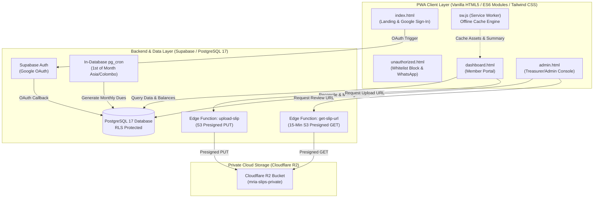
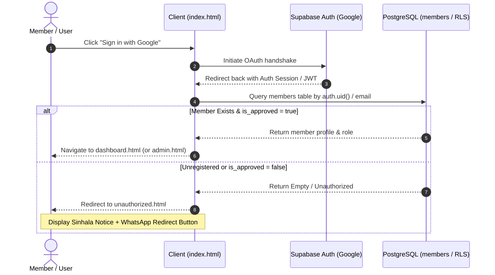
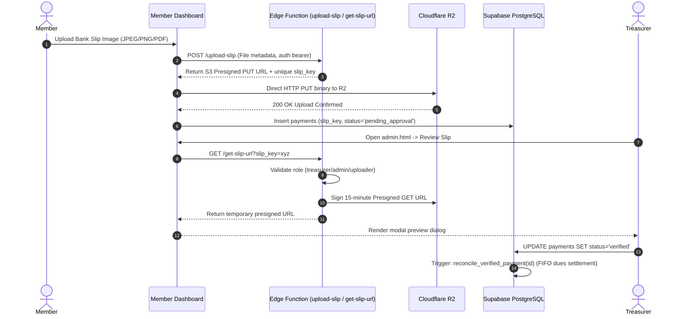

# MRIA Management Welfare Association PWA

* **Author:** kiyamaninfo-alt
* **Status:** Approved
* **Date:** 2026-11-08

---

## Overview

The MRIA Management Welfare Association (MRIA සුබසාධක කළමනාකරණ සංගමය) Progressive Web Application is a mobile-first platform that manages community membership, recurring dues collection, bank slip verification, direct cash transactions, and bereavement welfare aid disbursements. The application serves both general association members and administrative officials across Sri Lanka, operating with client-side bilingual support (Sinhala and English) and offline-tolerant dashboard caching.

Members registered prior to the deployment of this platform are classified as "legacy members" (`is_legacy_member = true`) and are exempted from the initial one-time admission fee. All new registrants must settle the admission fee alongside their initial dues to activate approved membership.

## The Problem

Community welfare associations frequently struggle with manual record-keeping, delayed monthly contribution tracking, and uncentralized verification of bank deposit slips sent over informal messaging channels. This causes several operational breakdowns:

1. **Untracked Defaulters and Uncollected Dues:** Without an automated ledger, identifying unpaid monthly dues requires manual reconciliation across paper logs or spreadsheets.
2. **Uncentralized and Unverified Payment Slips:** Members deposit funds via bank transfer or Cash Deposit Machines (CDMs) and share screenshots over messaging apps, leading to missed entries, lost receipts, and no verifiable audit trail.
3. **Discretion and Privacy in Debt Enforcement:** Exposing debt lists publicly causes friction among members, yet treasurers need an authoritative, private roster of overdue accounts to maintain the welfare fund.
4. **Welfare Benefit Distribution Integrity:** Processing urgent claims (such as bereavement aid) requires quick confirmation of a member's active standing, previous claims history, and eligibility.
5. **Accessibility Under Low-Bandwidth Connectivity:** Members require accessible mobile interfaces in their native language (Sinhala) that load reliably even under intermittent, low-bandwidth mobile connections.

## Goals

* **Automate Membership Ledger & Cutoff Invariants:** Automatically generate monthly dues for active members and classify unpaid accounts past the end of the month as defaulters via dynamic database views.
* **Private Slip Verification via Presigned URLs:** Allow members to upload bank slips into a private Cloudflare R2 bucket with 15-minute time-boxed presigned URLs for treasurer verification, enforcing private access controls.
* **Immediate Cash Receipts:** Enable the treasurer to log physical cash payments in real time and generate verifiable digital receipts for members upon payment logging.
* **Access Whitelisting:** Authenticate members via Google OAuth and redirect unregistered accounts to a Sinhala instructional prompt containing the administrative WhatsApp contact link (`0759555924`).
* **Confidential Defaulter Tracking:** Restrict visibility of unpaid member balances and defaulter rosters to `admin`, `manager`, `official`, and `treasurer` roles.
* **Offline-Tolerant, Localized PWA:** Provide an installable Progressive Web App with client-side language switching (Sinhala / English) and offline read-only access to cached balances, announcements, and the official Bank QR code.

## Non-Goals

* **Automated Card Payment Gateways:** Direct integration with commercial card processors (e.g., Stripe, PayHere) is out of scope; all payments occur via bank transfer slips or physical cash.
* **Offline Financial Write Queueing:** Members and treasurers cannot submit payment slips or record cash receipts while offline; financial mutations require verified server connectivity to prevent race conditions.
* **External SMS/Automated Calling Gateways:** Outbound telephony or automated SMS notifications are excluded; all member contact and fallback registration requests route directly to WhatsApp deep links.
* **Multi-Organization Multi-Tenancy:** The system is single-tenant and built exclusively for the MRIA Management Welfare Association.

## Open Questions

* **Question 1 (Admission Fee Installments):** Should admission fees be split into installment options for new members, or must they be settled as a single lump-sum debit before membership activation?  
  *Decision:* Settled as a single lump-sum debit (1,000 LKR) recorded in `payments` under category `admission_fee`.
* **Question 2 (Bereavement Benefit Approval Lifecycle):** Will benefit claim payouts be handled through direct bank transfers recorded manually by the treasurer, or does the system need a formal two-party approval?  
  *Decision:* Formal two-party workflow: an administrative official (`admin` or `manager`) reviews and marks the claim `approved`, after which the `treasurer` executes the financial disbursement and marks it `disbursed`.

## Critical User Journeys (CUJs)

### CUJ 1: New Member Google Sign-In & Whitelist Rejection
* **Given:** A user has a Google account but has not yet been registered or approved in the `members` database table.
* **When:** The user clicks "Sign in with Google" on `index.html`.
* **Then:** The system detects the unregistered email, suppresses dashboard access, redirects to `unauthorized.html`, displays the localized notice ("ඔබ තවමත් MRIA සුබසාධක සංගමයේ ලියාපදිංචි වී නොමැත..."), and presents a WhatsApp contact link pointing to [https://wa.me/94759555924](https://wa.me/94759555924).

### CUJ 2: Member Monthly Due Settlement via Bank QR & Slip Upload
* **Given:** An approved member logs into `dashboard.html` and sees an outstanding monthly due for the current billing cycle.
* **When:** The member scans the displayed Bank QR code, transfers funds via their mobile banking app, uploads a screenshot of the transfer slip, and clicks "Submit for Verification".
* **Then:** The slip is uploaded to Cloudflare R2 under a unique random object key (`slip_key`), a `pending_approval` payment record is inserted into Supabase, and the member's dashboard reflects the pending status with offline-cached visibility.

### CUJ 3: Treasurer Slip Review & Verification
* **Given:** A treasurer accesses `admin.html` and views the "Pending Slips" queue.
* **When:** The treasurer clicks "Review Slip" on an entry.
* **Then:** The frontend requests a temporary 15-minute presigned URL from the `get-slip-url` Edge Function, displays the slip in a modal preview dialog, and upon clicking "Approve", marks the payment as `verified`, which triggers the database reconciliation function to reconcile the oldest unpaid `member_dues` rows to `paid` and updates the member's balance.

### CUJ 4: Treasurer Direct Cash Collection
* **Given:** A member physically hands cash to the treasurer for monthly dues or an admission fee.
* **When:** The treasurer selects the member in `admin.html`, enters the amount, selects "Direct Cash", and submits the form.
* **Then:** The system creates a `verified` payment record, runs the reconciliation function to mark corresponding dues as `paid`, and generates a downloadable digital receipt.

### CUJ 5: End-of-Month Defaulter Transition & Restricted Viewing
* **Given:** A member has an unpaid due on the final calendar day of the month at 23:59:59 Sri Lanka time (UTC+05:30).
* **When:** The clock advances to 00:00:00 on the 1st of the subsequent month.
* **Then:** The member's unpaid due is dynamically classified as overdue by the `defaulters_roster` database view. General members cannot see the defaulter status of any peer, while administrators, managers, officials, and treasurers viewing `admin.html` see the overdue member in the restricted Defaulters Roster.

---

## Technical Plan (Architecture)

### 1. High-Level System Architecture

The application is structured as a decoupled Progressive Web Application comprising a static client layer, a relational backend with automated in-database scheduling, and private cloud object storage.



### 2. End-to-End Sequence Workflows

#### A. Google OAuth Sign-In & Whitelist Verification Flow



#### B. Bank Slip Upload & Private Presigned Verification Flow



### 3. Database Schema Specification (PostgreSQL 17)

All relational models reside within the public schema, protected by Row Level Security (RLS) policies. Single-role assignment is authoritative via `members.role`.

```sql
-- 1. ENUMS
CREATE TYPE app_role AS ENUM ('admin', 'manager', 'official', 'treasurer', 'member');
CREATE TYPE payment_status AS ENUM ('pending_approval', 'verified', 'rejected');
CREATE TYPE payment_method_type AS ENUM ('bank_transfer', 'cash');
CREATE TYPE payment_category AS ENUM ('monthly_due', 'admission_fee', 'donation');
CREATE TYPE due_status AS ENUM ('pending', 'paid', 'waived');
CREATE TYPE claim_status AS ENUM ('submitted', 'under_review', 'approved', 'rejected', 'disbursed');

-- 2. MEMBERS / PROFILES
CREATE TABLE public.members (
    id UUID PRIMARY KEY DEFAULT gen_random_uuid(),
    user_id UUID UNIQUE REFERENCES auth.users(id) ON DELETE SET NULL,
    email TEXT UNIQUE NOT NULL,
    full_name TEXT NOT NULL,
    phone TEXT NOT NULL,
    nic TEXT,
    address TEXT,
    is_legacy_member BOOLEAN NOT NULL DEFAULT false,
    is_approved BOOLEAN NOT NULL DEFAULT false,
    role app_role NOT NULL DEFAULT 'member',
    created_at TIMESTAMPTZ NOT NULL DEFAULT now(),
    updated_at TIMESTAMPTZ NOT NULL DEFAULT now()
);

-- 3. MONTHLY DUES LEDGER
CREATE TABLE public.member_dues (
    id UUID PRIMARY KEY DEFAULT gen_random_uuid(),
    member_id UUID NOT NULL REFERENCES public.members(id) ON DELETE CASCADE,
    billing_month DATE NOT NULL, -- Stored as YYYY-MM-01
    amount NUMERIC(10, 2) NOT NULL CHECK (amount > 0),
    status due_status NOT NULL DEFAULT 'pending',
    created_at TIMESTAMPTZ NOT NULL DEFAULT now(),
    updated_at TIMESTAMPTZ NOT NULL DEFAULT now(),
    UNIQUE(member_id, billing_month)
);

-- 4. PAYMENTS & TRANSACTIONS
CREATE TABLE public.payments (
    id UUID PRIMARY KEY DEFAULT gen_random_uuid(),
    member_id UUID NOT NULL REFERENCES public.members(id) ON DELETE RESTRICT,
    amount NUMERIC(10, 2) NOT NULL CHECK (amount > 0),
    payment_type payment_category NOT NULL,
    payment_method payment_method_type NOT NULL,
    slip_key TEXT, -- Cloudflare R2 object key
    status payment_status NOT NULL DEFAULT 'pending_approval',
    verified_by UUID REFERENCES public.members(id),
    verified_at TIMESTAMPTZ,
    rejection_reason TEXT,
    notes TEXT,
    created_at TIMESTAMPTZ NOT NULL DEFAULT now()
);

-- 5. DUES RECONCILIATION MAPPING
CREATE TABLE public.payment_dues_reconciliation (
    id UUID PRIMARY KEY DEFAULT gen_random_uuid(),
    payment_id UUID NOT NULL REFERENCES public.payments(id) ON DELETE CASCADE,
    due_id UUID NOT NULL REFERENCES public.member_dues(id) ON DELETE RESTRICT,
    allocated_amount NUMERIC(10, 2) NOT NULL CHECK (allocated_amount > 0),
    created_at TIMESTAMPTZ NOT NULL DEFAULT now()
);

-- 6. WELFARE BENEFIT TYPES
CREATE TABLE public.benefit_types (
    id UUID PRIMARY KEY DEFAULT gen_random_uuid(),
    code TEXT UNIQUE NOT NULL, -- 'DEATH_AID', 'MEDICAL_AID'
    title_en TEXT NOT NULL,
    title_si TEXT NOT NULL,
    description_en TEXT,
    description_si TEXT,
    max_amount NUMERIC(10, 2) NOT NULL,
    is_active BOOLEAN NOT NULL DEFAULT true,
    created_at TIMESTAMPTZ NOT NULL DEFAULT now()
);

-- 7. BENEFIT CLAIMS
CREATE TABLE public.benefit_claims (
    id UUID PRIMARY KEY DEFAULT gen_random_uuid(),
    member_id UUID NOT NULL REFERENCES public.members(id) ON DELETE RESTRICT,
    benefit_type_id UUID NOT NULL REFERENCES public.benefit_types(id) ON DELETE RESTRICT,
    claim_amount NUMERIC(10, 2) NOT NULL CHECK (claim_amount > 0),
    disbursed_amount NUMERIC(10, 2) DEFAULT 0,
    status claim_status NOT NULL DEFAULT 'submitted',
    approved_by UUID REFERENCES public.members(id),
    disbursed_by UUID REFERENCES public.members(id),
    disbursed_at TIMESTAMPTZ,
    notes TEXT,
    created_at TIMESTAMPTZ NOT NULL DEFAULT now()
);

-- 8. ANNOUNCEMENTS / NOTICE BOARD
CREATE TABLE public.announcements (
    id UUID PRIMARY KEY DEFAULT gen_random_uuid(),
    title_en TEXT NOT NULL,
    title_si TEXT NOT NULL,
    content_en TEXT NOT NULL,
    content_si TEXT NOT NULL,
    priority TEXT NOT NULL CHECK (priority IN ('normal', 'urgent')) DEFAULT 'normal',
    is_pinned BOOLEAN NOT NULL DEFAULT false,
    created_by UUID REFERENCES public.members(id),
    created_at TIMESTAMPTZ NOT NULL DEFAULT now()
);

-- 9. SYSTEM CONFIGURATION & SETTINGS
CREATE TABLE public.system_settings (
    key TEXT PRIMARY KEY,
    value JSONB NOT NULL,
    description TEXT,
    updated_at TIMESTAMPTZ NOT NULL DEFAULT now(),
    updated_by UUID REFERENCES public.members(id)
);

-- 10. DEFAULTERS COMPUTED VIEW
CREATE OR REPLACE VIEW public.defaulters_roster AS
SELECT 
    m.id AS member_id,
    m.full_name,
    m.phone,
    m.email,
    d.id AS due_id,
    d.billing_month,
    d.amount,
    d.status
FROM public.members m
JOIN public.member_dues d ON d.member_id = m.id
WHERE d.status = 'pending'
  AND d.billing_month < date_trunc('month', TIMEZONE('Asia/Colombo', now()))::DATE;
```

### 4. Row Level Security (RLS) Policy Matrix

To prevent PostgreSQL recursive RLS execution (`54001: stack depth limit exceeded`), all administrative role evaluations utilize a `SECURITY DEFINER` function.

```sql
-- Helper function to avoid RLS recursion
CREATE OR REPLACE FUNCTION public.get_current_user_role()
RETURNS app_role AS $$
    SELECT role FROM public.members WHERE user_id = auth.uid() LIMIT 1;
$$ LANGUAGE sql STABLE SECURITY DEFINER SET search_path = public;

CREATE OR REPLACE FUNCTION public.is_approved_member()
RETURNS BOOLEAN AS $$
    SELECT COALESCE((SELECT is_approved FROM public.members WHERE user_id = auth.uid() LIMIT 1), false);
$$ LANGUAGE sql STABLE SECURITY DEFINER SET search_path = public;
```

| Table | Policy Scope | Operations | Allowed Roles | Invariant Logic |
| :--- | :--- | :--- | :--- | :--- |
| `members` | Self Read | `SELECT` | `authenticated` | `auth.uid() = user_id` |
| `members` | Admin Full Access | `ALL` | `admin, manager` | `public.get_current_user_role() IN ('admin', 'manager')` |
| `member_dues` | Self Read | `SELECT` | `member` | `member_id = (SELECT id FROM members WHERE user_id = auth.uid())` |
| `member_dues` | Defaulter Roster Access | `SELECT, UPDATE` | `admin, manager, official, treasurer` | `public.get_current_user_role() IN ('admin', 'manager', 'official', 'treasurer')` |
| `payments` | Self View & Insert | `SELECT, INSERT` | `member` | `member_id = (SELECT id FROM members WHERE user_id = auth.uid())` |
| `payments` | Treasurer Verification | `SELECT, UPDATE` | `admin, treasurer` | `public.get_current_user_role() IN ('admin', 'treasurer')` |
| `payment_dues_reconciliation` | Self View | `SELECT` | `member` | `payment_id IN (SELECT id FROM payments WHERE member_id = (SELECT id FROM members WHERE user_id = auth.uid()))` |
| `payment_dues_reconciliation` | Admin View | `SELECT` | `admin, manager, official, treasurer` | `public.get_current_user_role() IN ('admin', 'manager', 'official', 'treasurer')` |
| `benefit_types` | Approved Member Read | `SELECT` | `authenticated` | `is_active = true AND public.is_approved_member() = true` |
| `benefit_claims` | Self View & Submit | `SELECT, INSERT` | `member` | `member_id = (SELECT id FROM members WHERE user_id = auth.uid())` |
| `benefit_claims` | Review & Disburse | `SELECT, UPDATE` | `admin, manager, treasurer` | `public.get_current_user_role() IN ('admin', 'manager', 'treasurer')` |
| `announcements` | Approved Member Read | `SELECT` | `authenticated` | `public.is_approved_member() = true` |
| `announcements` | Publishing | `INSERT, UPDATE, DELETE` | `admin, manager` | `public.get_current_user_role() IN ('admin', 'manager')` |
| `system_settings` | Approved Member Read | `SELECT` | `authenticated` | `public.is_approved_member() = true` |
| `system_settings` | Admin Manage | `UPDATE` | `admin` | `public.get_current_user_role() = 'admin'` |

### 5. Database Triggers & Stored Functions

#### A. Initial Administrator & Google Auth Linker Trigger

The root administrator is seeded via database migration/seed script rather than hardcoding personal email strings inside DDL.

```sql
CREATE OR REPLACE FUNCTION public.handle_auth_user_created()
RETURNS TRIGGER AS $$
DECLARE
    matched_member_id UUID;
BEGIN
    -- Look for pre-registered member record by email
    SELECT id INTO matched_member_id FROM public.members WHERE email = NEW.email;

    IF matched_member_id IS NOT NULL THEN
        UPDATE public.members
        SET user_id = NEW.id,
            updated_at = now()
        WHERE id = matched_member_id;
    END IF;

    RETURN NEW;
END;
$$ LANGUAGE plpgsql SECURITY DEFINER SET search_path = public;

CREATE TRIGGER on_auth_user_created
AFTER INSERT ON auth.users
FOR EACH ROW EXECUTE FUNCTION public.handle_auth_user_created();
```

#### B. FIFO Payment Dues Reconciliation Procedure

```sql
CREATE OR REPLACE FUNCTION public.reconcile_verified_payment()
RETURNS TRIGGER AS $$
DECLARE
    remaining_funds NUMERIC(10, 2) := NEW.amount;
    due_record RECORD;
    alloc_amount NUMERIC(10, 2);
BEGIN
    -- Only execute when status transitions to 'verified' for monthly_due payments
    IF NEW.status = 'verified' AND (OLD.status IS DISTINCT FROM 'verified') AND NEW.payment_type = 'monthly_due' THEN
        -- Loop through unpaid dues chronologically (FIFO)
        FOR due_record IN 
            SELECT id, amount 
            FROM public.member_dues 
            WHERE member_id = NEW.member_id AND status = 'pending'
            ORDER BY billing_month ASC
        LOOP
            EXIT WHEN remaining_funds <= 0;

            IF remaining_funds >= due_record.amount THEN
                alloc_amount := due_record.amount;
                UPDATE public.member_dues SET status = 'paid', updated_at = now() WHERE id = due_record.id;
            ELSE
                alloc_amount := remaining_funds;
            END IF;

            INSERT INTO public.payment_dues_reconciliation (payment_id, due_id, allocated_amount)
            VALUES (NEW.id, due_record.id, alloc_amount);

            remaining_funds := remaining_funds - alloc_amount;
        END LOOP;
    END IF;

    RETURN NEW;
END;
$$ LANGUAGE plpgsql SECURITY DEFINER SET search_path = public;

CREATE TRIGGER on_payment_verified_reconcile
AFTER UPDATE ON public.payments
FOR EACH ROW EXECUTE FUNCTION public.reconcile_verified_payment();
```

#### C. Monthly Dues Generation Routine (In-Database pg_cron)

```sql
CREATE OR REPLACE FUNCTION public.generate_monthly_dues_for_period(target_date DATE)
RETURNS INTEGER AS $$
DECLARE
    due_amount NUMERIC(10, 2);
    first_of_month DATE := date_trunc('month', target_date)::DATE;
    inserted_count INTEGER := 0;
BEGIN
    -- Fetch active due amount from settings (default 500.00 LKR)
    SELECT COALESCE((value->>'amount')::NUMERIC, 500.00) INTO due_amount
    FROM public.system_settings WHERE key = 'monthly_due_amount';

    INSERT INTO public.member_dues (member_id, billing_month, amount, status)
    SELECT m.id, first_of_month, due_amount, 'pending'
    FROM public.members m
    WHERE m.is_approved = true
    ON CONFLICT (member_id, billing_month) DO NOTHING;

    GET DIAGNOSTICS inserted_count = ROW_COUNT;
    RETURN inserted_count;
END;
$$ LANGUAGE plpgsql SECURITY DEFINER SET search_path = public;

-- Schedule in-database pg_cron: Run at 00:00:00 Asia/Colombo (18:30:00 UTC) on the 1st of each month
SELECT cron.schedule(
    'generate-monthly-dues-cron',
    '30 18 1 * *',
    'SELECT public.generate_monthly_dues_for_period(TIMEZONE(''Asia/Colombo'', now())::DATE);'
);
```

### 6. Cloudflare R2 Integration & Edge Functions

Private S3 bucket: `mria-slips-private` (No public bucket exposure).

* **`upload-slip` Edge Function:**
  1. Validates caller JWT from Supabase Auth and checks that `is_approved_member()` is true.
  2. Validates request JSON: `{ fileName: string, fileType: string, fileSize: number }`.
  3. Enforces constraints: `fileType` must be `image/jpeg`, `image/png`, or `application/pdf`; `fileSize <= 5242880` (5 MB).
  4. Generates an object key: `slips/YYYY-MM/{member_id}_{nanoid()}.{ext}`.
  5. Uses AWS SDK v3 `@aws-sdk/s3-request-presigner` configured with Cloudflare R2 credentials to generate a 10-minute presigned PUT URL with signed `ContentType`.
  6. Returns `{ uploadUrl, slipKey }`. Handles CORS via `_shared/cors.ts`.
* **`get-slip-url` Edge Function:**
  1. Validates caller JWT.
  2. Queries `payments` table by `slip_key`.
  3. Verifies authorization: caller must be the uploader member, or hold role `admin`, `manager`, `official`, or `treasurer`.
  4. Generates a presigned `GetObjectCommand` URL expiring in 15 minutes (900 seconds). Handles CORS via `_shared/cors.ts`.

### 7. Design Tokens (Typography, Spacing, and Colors)

* **Typography Scale:**
  * Micro (Badges, Timestamps, Captions): `10px`
  * Body / Input / Action: `16px`
  * Subheading / Card Title / Metric Label: `26px`
  * Section Heading: `42px`
  * Display / Hero Metric: `68px`
* **Layout Spacing Scale:**
  * Increments: `8px`, `13px`, `21px`, `34px`, `55px`, `89px`.
* **Color Palette Tokens:**
  * Primary Surface: `#FFFFFF` (Pure White)
  * Secondary Surface / Canvas: `#F8FAFC` (Slate 50)
  * Borders / Dividers: `#E2E8F0` (Slate 200) and `#F1F5F9` (Slate 100)
  * Primary Typography: `#0F172A` (Slate 900)
  * Secondary Typography: `#64748B` (Slate 500)
  * Interactive Accent: `#0284C7` (Sky 600)
  * Verified / Paid State: `#10B981` (Emerald 500)
  * Overdue / Defaulter State: `#EF4444` (Rose 500)

---

## Alternatives Considered

### Alternative A: Dynamic Dues Calculation vs. Recurring Monthly Ledger Table

* **Approach Evaluated:** Compute member balances dynamically at query time using: `Balance = (months_since_joined * monthly_fee) + (admission_fee IF !is_legacy) - sum(verified_payments)`.
* **Pros:** Eliminates the need for recurring cron jobs or periodic database writes.
* **Cons:** Calculating balances dynamically increases query execution time as transaction history grows; prevents line-item tracking, selective dues forgiveness, monthly fee adjustments over time, or point-in-time financial auditing.
* **Reason for Rejection:** An explicit monthly ledger (`member_dues`) guarantees immutability, individual monthly status tracking (`pending`, `paid`, `waived`), and historical financial auditing.

### Alternative B: Supabase Storage vs. Private Cloudflare R2 Bucket with Presigned URLs

* **Approach Evaluated:** Store payment slip image files in Supabase Storage buckets using native Supabase storage RLS.
* **Pros:** Leverages the existing Supabase infrastructure without requiring a secondary cloud provider or external S3 credentials.
* **Cons:** Incurs standard Supabase egress bandwidth costs as slip uploads accumulate; public bucket access risks exposing sensitive banking slips with personal identification; native storage signed URLs lack fine-grained, time-boxed cryptographic control without complex proxy layers.
* **Reason for Rejection:** Cloudflare R2 provides zero egress bandwidth fees and full S3 API compatibility. Managing private object keys (`slip_key`) coupled with 15-minute presigned URLs via Edge Functions enforces private access controls and least-privilege access for treasurers and members.

### Alternative C: Fixed 31st Calendar Day vs. Dynamic End-of-Month Invariant

* **Approach Evaluated:** Hardcode the monthly payment deadline strictly to day 31 of each month.
* **Pros:** Matches informal conversational phrasing used by association members.
* **Cons:** Fails across 5 out of 12 months (February 28/29, April 30, June 30, September 30, November 30). On shorter months, a fixed "31st" check causes runtime date parsing exceptions, misses defaulter classification, or delays enforcement until the following month.
* **Reason for Rejection:** Replaced by an automated end-of-month calendar boundary triggering at 23:59:59 Sri Lanka time on the final calendar day of each month, which accounts for leap years and months with fewer than 31 days.

### Alternative D: Offline Financial Mutation Queue vs. Strict Online Financial Enforcement

* **Approach Evaluated:** Allow members to upload slips and treasurers to record cash receipts while offline using IndexedDB, syncing when connectivity resumes.
* **Pros:** Permits form submissions under intermittent connectivity.
* **Cons:** Offline financial queues introduce race conditions, stale balance calculations, out-of-order ledger reconciliation, and duplicate payment submissions during intermittent or dropping network connections.
* **Reason for Rejection:** Financial mutations require authoritative, real-time server verification. Offline PWA capabilities are strictly confined to read-only views of cached balances, announcements, and the Bank QR code.

### Alternative E: Commercial Payment Gateway vs. Bank QR & Slip Verification

* **Approach Evaluated:** Integrate a commercial online payment processor (e.g., PayHere, Stripe, WebXPay).
* **Pros:** Instant automated reconciliation without manual treasurer approval.
* **Cons:** Payment gateways deduct 2.5% to 3.5% in transaction fees, reducing community welfare funds; requires formalized corporate merchant banking registrations that voluntary community associations often cannot fulfill; excludes members depositing cash via CDMs.
* **Reason for Rejection:** The zero-fee Bank QR code and slip verification workflow preserves 100% of association capital and accommodates both online banking apps and physical cash deposit slips.

---

## Non-Functional Requirements

### 1. Security & Privacy
* **Financial Slip Confidentiality:** Bank slip files in Cloudflare R2 are private. Direct public bucket URLs are prohibited. Presigned URLs expire after 15 minutes (900 seconds) and are issued only after validating the caller's JWT against the payment record or administrative roles.
* **Defaulter Privacy Protection:** Overdue member listings are protected by PostgreSQL RLS. General members can view only their own ledger records; only `admin`, `manager`, `official`, and `treasurer` roles can access the overdue roster.
* **Google OAuth Whitelist Isolation:** Unapproved authenticated sessions are gated at the database layer (RLS returns empty sets) and at the application routing layer (redirect to `unauthorized.html`).

### 2. Performance & Mobile Optimization
* **Lightweight PWA Footprint:** Total initial bundle (HTML, Vanilla JS modules, compiled Tailwind CSS) is constrained to under 150 KB gzip to target sub-second initial render times under typical 3G/4G network conditions across Sri Lanka.
* **Caching Strategy:** Service Worker employs Stale-While-Revalidate for static assets, Bank QR images, and announcements. Dues balances and claim submissions utilize Network-First with fallback to cached balances accompanied by an "Offline Data as of [Date]" indicator.

### 3. Maintainability & Internationalization
* **Native Web Platform Architecture:** Standard HTML5 and ES6 modules are used without SPA frameworks to eliminate compilation dependencies and build pipeline overhead.
* **Modular i18n Dictionary:** Translation strings for English and Sinhala are decoupled in `js/i18n.js` with declarative `data-i18n` attributes in HTML templates.

### 4. Rollout & Rollback

* **Migration Sequencing:**
  1. `20261108000001_initial_schema.sql` (Types, tables, foreign keys, indexes).
  2. `20261108000002_rls_policies.sql` (Security helper functions, table RLS policies).
  3. `20261108000003_triggers_and_functions.sql` (Auth triggers, FIFO reconciliation, `pg_cron` schedule).
  4. `seed.sql` (Initial settings, benefit types, initial admin).
* **Rollback Procedure:** Each migration includes an idempotent down-migration script (e.g., `DROP VIEW IF EXISTS defaulters_roster`, `DROP TRIGGER IF EXISTS on_payment_verified_reconcile ON payments`, `DROP TABLE IF EXISTS ... CASCADE`).
* **Cloudflare R2 Bucket Rollback:** The R2 bucket is provisioned with versioning enabled. Deleting an erroneous object can be rolled back via S3 object version recovery.

---

## Risks & Mitigations

| Failure Mode / Risk | Impact | Defensive Mitigation |
| :--- | :--- | :--- |
| **Edge Function Timeout / S3 Network Drop** | Member slip upload fails mid-flight. | Client implements 3 exponential backoff retries. If the upload fails, the payment record is not inserted, preventing phantom pending entries. |
| **Ghost Uploads in Cloudflare R2** | Unreferenced image blobs accumulate in R2. | Configure an R2 lifecycle bucket rule to automatically purge objects under `slips/tmp/` older than 24 hours if no database record is created. |
| **Intermittent Mobile Connectivity (Drop mid-action)** | Member receives no feedback after clicking submit. | UI disables action buttons upon click, displays a spinner, and catches offline network drops with a non-blocking toast alert: "Connection lost. Please retry when online." |
| **Service Worker Cache Staleness** | Member sees an old balance after payment verification. | Balance queries apply Network-First. When network is available, the client updates IndexedDB cache. When offline, an "Offline as of [Timestamp]" banner is rendered. |
| **Timezone Skew on Month-End Dues Cutoff** | Dues generated 5.5 hours late for Sri Lankan users. | All SQL functions explicitly execute against `TIMEZONE('Asia/Colombo', now())`, and `pg_cron` is configured to trigger at `30 18 * * *` UTC. |

---

## Detailed Implementation Plan

### Target Files to Create/Modify

#### 1. Database Migrations, Config & Seed Scripts

* **`./supabase/config.toml`** (`Create`)
  * **Scope:** Supabase Local CLI Configuration.
  * **Rationale:** Declares project ID, database port, API port, and cron configuration required for `supabase db reset` and local development.
* **`./supabase/migrations/20261108000001_initial_schema.sql`** (`Create`)
  * **Scope:** PostgreSQL 17 Relational Schema.
  * **Rationale:** Establishes custom ENUMs (`app_role`, `payment_status`, `payment_method_type`, `payment_category`, `due_status`, `claim_status`), `members`, `member_dues`, `payments`, `payment_dues_reconciliation`, `benefit_types`, `benefit_claims`, `announcements`, `system_settings`, and view `defaulters_roster`.
* **`./supabase/migrations/20261108000002_rls_policies.sql`** (`Create`)
  * **Scope:** Security & Row Level Security Policies.
  * **Rationale:** Implements `public.get_current_user_role()` and `public.is_approved_member()` `SECURITY DEFINER` helpers to eliminate RLS recursion. Enforces strict row-level read/write permissions across all tables.
* **`./supabase/migrations/20261108000003_triggers_and_functions.sql`** (`Create`)
  * **Scope:** Database Triggers & Stored Procedures.
  * **Rationale:** Implements `handle_auth_user_created` trigger for dynamic Google OAuth account linking; implements `reconcile_verified_payment` trigger for FIFO dues settlement; implements `generate_monthly_dues_for_period` with `pg_cron` schedule.
* **`./supabase/seed.sql`** (`Create`)
  * **Scope:** Initial Seed Data.
  * **Rationale:** Seeds root administrator record (`krishaja@gmail.com`), initial system settings (`monthly_due_amount = 500`, `admission_fee_amount = 1000`, `contact_phone = '0759555924'`), and default welfare benefit type (`DEATH_AID` / `මරණාධාර`).
* **`./supabase/tests/database.test.sql`** (`Create`)
  * **Scope:** Automated pgTAP SQL Test Suite.
  * **Rationale:** Verifies RLS isolation, FIFO dues reconciliation, defaulter view filtering, and trigger execution.

#### 2. Supabase Edge Functions (Deno / TypeScript)

* **`./supabase/functions/deno.json`** (`Create`)
  * **Scope:** Deno Dependency Map.
  * **Rationale:** Defines npm package specifiers for `@aws-sdk/client-s3` and `@aws-sdk/s3-request-presigner`.
* **`./supabase/functions/_shared/cors.ts`** (`Create`)
  * **Scope:** Shared CORS Handler.
  * **Rationale:** Handles cross-origin preflight `OPTIONS` requests and returns standard CORS headers (`Access-Control-Allow-Origin`, `Access-Control-Allow-Headers`).
* **`./supabase/functions/upload-slip/index.ts`** (`Create`)
  * **Scope:** Serverless Cloudflare R2 Presigned Uploader.
  * **Rationale:** Validates caller JWT, verifies MIME types and 5 MB size limit, initializes S3 client for Cloudflare R2, and returns `{ uploadUrl, slipKey }`.
* **`./supabase/functions/get-slip-url/index.ts`** (`Create`)
  * **Scope:** Secure 15-Minute Presigned Retrieval Endpoint.
  * **Rationale:** Validates caller JWT, verifies authorization against `payments`, and returns a temporary 15-minute presigned `GetObjectCommand` URL.

#### 3. Progressive Web Application (PWA) Views & Static Assets

* **`./index.html`** (`Create`)
  * **Scope:** Landing & Authentication Portal (Stitch MCP Scaffolded).
  * **Rationale:** Public entry point featuring association branding, bilingual toggle (EN/SI), `<script type="importmap">`, and Google OAuth sign-in button.
* **`./unauthorized.html`** (`Create`)
  * **Scope:** Whitelist Blocked Screen (Stitch MCP Scaffolded).
  * **Rationale:** Renders the polite Sinhala advisory ("ඔබ තවමත් MRIA සුබසාධක සංගමයේ ලියාපදිංචි වී නොමැත...") and WhatsApp link to `0759555924`.
* **`./dashboard.html`** (`Create`)
  * **Scope:** Authenticated Member Portal (Stitch MCP Scaffolded).
  * **Rationale:** Displays member standing, total balance, pending dues list, Bank QR display, slip upload modal (`#slip-upload-modal`), benefit claims tracker (`#claim-benefit-modal`), announcements, and receipt history.
* **`./admin.html`** (`Create`)
  * **Scope:** Governance & Financial Management Console (Stitch MCP Scaffolded).
  * **Rationale:** Restricted to administrative roles. Features pending slip verification queue with image review modal, direct cash receipt logger (`#cash-collection-form`), restricted defaulters roster (`#defaulters-table`), member onboarding table (`#member-onboarding-table`), and Bank QR manager.
* **`./manifest.json`** (`Create`)
  * **Scope:** PWA Application Manifest.
  * **Rationale:** Declares app metadata, icon references (`assets/icon-192.png`, `assets/icon-512.png`), theme color (`#0284C7`), and `standalone` display mode.
* **`./sw.js`** (`Create`)
  * **Scope:** Service Worker Offline Cache Engine.
  * **Rationale:** Pre-caches static shell assets, Bank QR image, and announcements using Stale-While-Revalidate caching. Intercepts fetch requests and provides offline balance fallbacks.
* **`./assets/icon-192.png`** (`Create`)
  * **Scope:** PWA Icon 192x192.
  * **Rationale:** Required for mobile home screen installation.
* **`./assets/icon-512.png`** (`Create`)
  * **Scope:** PWA Icon 512x512.
  * **Rationale:** Required for PWA splash screen and high-DPI displays.
* **`./assets/default-bank-qr.png`** (`Create`)
  * **Scope:** Default Bank QR Image.
  * **Rationale:** Pre-cached placeholder for bank transfer instructions.
* **`./css/style.css`** (`Create`)
  * **Scope:** Standalone Compiled Tailwind Stylesheet.
  * **Rationale:** Pre-compiled Tailwind CSS containing Golden Ratio scale and spacing utilities for offline PWA operation.

#### 4. Modular Client-Side JavaScript Modules (ES6)

* **`./js/config.js`** (`Create`)
  * **Scope:** Client Public Configuration.
  * **Rationale:** Centralizes public constants (`SUPABASE_URL`, `SUPABASE_ANON_KEY`, Cloudflare R2 bucket name).
* **`./js/auth.js`** (`Create`)
  * **Scope:** Authentication & Session Management.
  * **Rationale:** Manages Supabase Auth, Google OAuth login/logout, session tracking, and whitelist redirection.
* **`./js/api.js`** (`Create`)
  * **Scope:** Relational Data Access Layer.
  * **Rationale:** Executes database queries: fetching member dues, balance computation (`SUM(pending dues) + (unpaid admission fee if !is_legacy)`), submitting payments, and executing treasurer approvals.
* **`./js/storage.js`** (`Create`)
  * **Scope:** Cloudflare R2 Client Bridge.
  * **Rationale:** Coordinates with `upload-slip` and `get-slip-url` Edge Functions for binary uploads and signed URL retrieval.
* **`./js/i18n.js`** (`Create`)
  * **Scope:** Bilingual Localization Engine.
  * **Rationale:** Decoupled translation dictionary (EN/SI), parses `data-i18n` attributes, and persists language preference in `localStorage`.
* **`./js/receipt.js`** (`Create`)
  * **Scope:** Digital Receipt Formatter & Printer.
  * **Rationale:** Generates printable/downloadable digital receipts for verified cash and bank transfer payments.
* **`./js/ui.js`** (`Create`)
  * **Scope:** Common UI Interactions & Alerts.
  * **Rationale:** Manages modal state transitions, toast alerts, and offline detection banners (`navigator.onLine`).

#### 5. Configuration & Project Documentation

* **`./.env.example`** (`Modify`)
  * **Scope:** Environment Credentials Template.
  * **Rationale:** Documents Cloudflare R2 credentials (`R2_ACCOUNT_ID`, `R2_ACCESS_KEY_ID`, `R2_SECRET_ACCESS_KEY`, `R2_BUCKET_NAME`) alongside Supabase keys.
* **`./README.md`** (`Modify`)
  * **Scope:** Project Documentation.
  * **Rationale:** Documents setup instructions, local development server (`python3 -m http.server 8080`), database migration commands, and Edge Function deployment.

---

## Verification Plan

### 1. Database Migrations & RLS Validation
* **Schema Application:** Apply migrations sequentially using Supabase CLI:
  ```bash
  supabase db reset
  ```
* **Trigger Verification:** Execute test query confirming root admin `krishaja@gmail.com` is seeded with `is_approved = true` and `role = 'admin'`.
* **RLS Isolation Test:** 
  * Query `member_dues` as an unprivileged member session; assert that only records where `member_id = (SELECT id FROM public.members WHERE user_id = auth.uid())` are returned.
  * Query `member_dues` as an admin session; assert that all member dues are visible.
  * Verify that `public.get_current_user_role()` executes without triggering recursion error `54001`.

### 2. Dues Ledger & Defaulter Automation Test
* **Scheduled Function Execution:** Trigger `generate_monthly_dues_for_period(TIMEZONE('Asia/Colombo', now())::DATE)`.
* **Assertion:** Confirm a pending due record is generated for every active approved member.
* **FIFO Reconciliation Test:** Insert verified payment of 1,500 LKR for member with three 500 LKR pending dues; assert all three dues transition to `paid` and three records appear in `payment_dues_reconciliation`.
* **Defaulter View Logic:** Query `defaulters_roster`; verify that only members with pending dues from prior calendar months appear.

### 3. Cloudflare R2 Presigned Access Test
* **Presigned PUT:** Invoke `upload-slip` with valid JWT; upload test JPEG binary using `curl -X PUT --upload-file`; assert `200 OK` from Cloudflare R2.
* **Presigned GET:** Invoke `get-slip-url?slip_key=...` as treasurer; verify returned URL is accessible and expires after 15 minutes.
* **Unauthorized Access Test:** Attempt to access `get-slip-url` with an unauthenticated session; assert `401 Unauthorized`. Attempt to access another member's slip as a regular member; assert `403 Forbidden`.

### 4. Client-Side & PWA Offline Verification
* **Local HTTP Server:** Start local server via `python3 -m http.server 8080` (verifying Service Worker registers over HTTP `localhost`).
* **Whitelist Gate Test:** Sign in with an un-whitelisted Google account; assert immediate redirection to `unauthorized.html` displaying the Sinhala message and WhatsApp button.
* **Offline Caching:** Disconnect network in browser DevTools; assert `dashboard.html` loads cached balances, announcements, and the Bank QR image.
* **Offline Mutation Blocking:** Attempt to upload a slip while offline; assert that submission is prevented and the offline alert banner is displayed.
* **Bilingual Toggle Test:** Click language toggle button; assert all text with `data-i18n` instantly switches between English and Sinhala without full page reload.

---

*Drafted with EGM*
